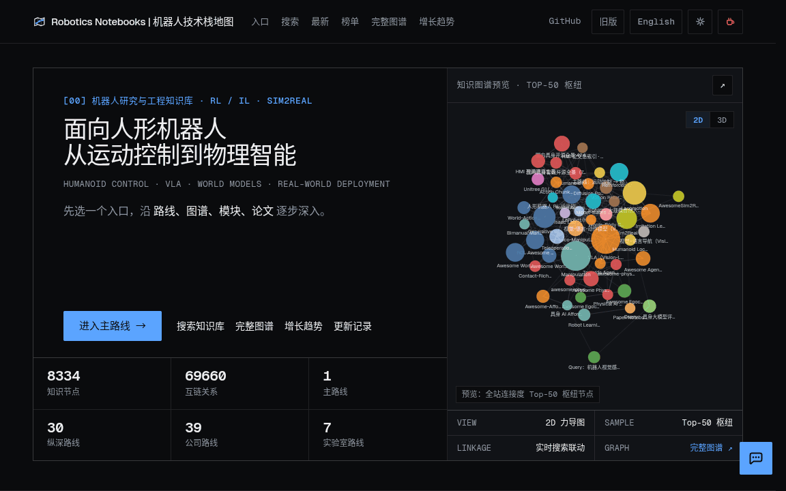

# Robotics_Notebooks

A robotics technology-stack knowledge base / robotics research and engineering wiki.

**Language:** [简体中文](README.md) | [English](README.en.md)

---

## Live Demo

- The **home page** provides entry points for learning paths, search, and the graph. **Find a project** and **Knowledge graph** scroll to and highlight their sections. Enter keywords to find knowledge pages instantly. [Open the live site](https://imchong.github.io/Robotics_Notebooks/)
- Open **AI Knowledge Q&A** with the chat button in the bottom-right corner. Enter a question or choose a starter prompt, then expand the cited excerpts or open the source pages. The GIF shows excerpts returned by the built-in wiki search mode.
- In the **knowledge graph**, nodes represent pages, colors identify technical communities, and edges link related pages. Hover over a node for a summary, or click it to open a details sidebar with a link to its page. Use **Parameters (参数)** to switch between **2D**, **3D Terrain**, and **3D Spatial**. Scroll to zoom, drag to pan in 2D or orbit in 3D Terrain, and adjust the peak height and viewing angle in 3D Terrain. [Open the knowledge graph](https://imchong.github.io/Robotics_Notebooks/graph.html)

---

## Who Is This For?

Readers who want to study humanoid robot motion control, reinforcement learning, and imitation learning systematically, then progress to Physical AI (VLA, world models, and real-robot deployment). Some programming experience (Python / C++) and undergraduate-level mathematics are recommended.

Not sure where to begin? Follow the [main learning path: Motion Control → Full-Stack Physical AI](roadmap/motion-control.md) (Physical AI & Robot Learning: control → learning → Sim2Real → Transformers / VLA / world models → deployment). If you already have a specific goal, choose a [specialized learning path](roadmap/README.md).

---

## What Is This Project?

`Robotics_Notebooks` is a **robotics engineering knowledge base**, not just a collection of resources. It organizes the robotics technology stack into interconnected knowledge pages. Each concept is explained in terms of what it is, why it matters, and how it relates to other concepts.

**It is not** a textbook (it does not teach every theory systematically), an unstructured pile of notes (pages have structure and dependencies), or a tool manual.

---

## Where to Start

| Your goal | Start here |
|-----------|------------|
| Explore the knowledge graph visually | [Knowledge Graph](https://imchong.github.io/Robotics_Notebooks/graph.html) |
| Follow a structured learning path | [Motion Control → Full-Stack Physical AI](roadmap/motion-control.md) |
| Browse all specialized paths before choosing one | [Learning Paths Overview](roadmap/README.md) |
| Learn PCB design from scratch and build robot driver, sensor, or controller boards | [PCB Design](roadmap/depth-pcb-design.md) |
| Collect data through teleoperation and control a humanoid in real time (whole body + fingers) | [Teleoperation](roadmap/depth-teleoperation.md) |
| Make a rocket return autonomously and perform a precise vertical landing | [Rocket Landing](roadmap/depth-rocket-landing.md) |
| Design torque-controlled joint motors | [Torque Motor Design](roadmap/depth-torque-motor-design.md) |
| Learn model-based classical control (MPC/WBC) | [Classical Control](roadmap/depth-classical-control.md) |
| Design complete humanoid hardware (mechanics + electronics + communication) | [Humanoid Hardware](roadmap/depth-humanoid-hardware-design.md) |
| Learn safety-critical control (CLF/CBF) | [Safe Control](roadmap/depth-safe-control.md) |
| Build R&D loops that improve themselves (recursive self-improvement) | [Recursive Self-Improvement (RSI)](roadmap/depth-rsi.md) |
| Build robots for contact-rich manipulation tasks | [Contact Manipulation](roadmap/depth-contact-manipulation.md) |
| Make a robot navigate autonomously from A to B | [Navigation](roadmap/depth-navigation.md) |
| Choose policy network architectures (backbones / action heads / multimodal foundations) | [Model Architecture](roadmap/depth-model-architecture.md) |
| Learn imitation learning and skill transfer | [Imitation Learning](roadmap/depth-imitation-learning.md) |
| Use reinforcement learning for motion control | [RL Locomotion](roadmap/depth-rl-locomotion.md) |
| Make a robot manipulate objects while walking | [Loco-Manipulation](roadmap/depth-loco-manipulation.md) |
| Make humanoids track a ball, shoot, and compete in matches | [Humanoid Soccer](roadmap/depth-humanoid-soccer.md) |
| Convert human or animal motion into humanoid or quadruped reference trajectories | [Motion Retargeting](roadmap/depth-motion-retargeting.md) |
| Coordinate humanoid groups for synchronized dances and formations | [Humanoid Swarm Performance](roadmap/depth-humanoid-swarm-performance.md) |
| Adapt one policy across embodiments (different grippers, robot models, or morphologies) | [Cross-Embodiment Transfer](roadmap/depth-cross-embodiment.md) |
| Deploy simulation-trained policies reliably on real robots | [Sim2Real](roadmap/depth-sim2real.md) |
| Make two humanoid robots spar in a ring | [Humanoid Boxing](roadmap/depth-humanoid-boxing.md) |
| Teach a robot a new task from a single demonstration | [Embodied In-Context Learning (ICL)](roadmap/depth-icl.md) |
| Build whole-body behavioral foundation models for humanoids | [Behavior Foundation Models (BFM)](roadmap/depth-bfm.md) |
| Test whether embodied models (including motion-control models) actually work | [Embodied Evaluation](roadmap/depth-embodied-eval.md) |
| Use terrain perception to cross obstacles | [Perceptive Locomotion](roadmap/depth-perceptive-locomotion.md) |
| Generate humanoid motion with generative models | [Motion Generation](roadmap/depth-motion-generation.md) |
| Understand robotic action policies from diffusion denoising to flow matching | [Diffusion & Flow-Matching Policies](roadmap/depth-robotics-diffusion-dit-flow.md) |
| Make robots follow natural-language instructions | [Vision-Language-Action Models (VLA)](roadmap/depth-vla.md) |
| Turn the real world into simulation assets for training and evaluation | [Real2Sim](roadmap/depth-real2sim.md) |
| Build a deliverable data pipeline for embodied models | [Embodied Data](roadmap/depth-embodied-data.md) |
| Let policies anticipate how actions will change the world | [World-Action Models (WAM)](roadmap/depth-wam.md) |
| Browse every knowledge page | [Site Topics and Full-Site Navigation](https://imchong.github.io/Robotics_Notebooks/hubs.html) (run `make catalog` locally to generate `catalog.md`) |
| Search for a specific concept | [Site Search](https://imchong.github.io/Robotics_Notebooks/) |

> The thirty specialized learning paths are ordered by the **historical date of each field's starting milestone** (matching the order of the home-page buttons): PCB Design (Eisler's printed-circuit patent, 1936) → Teleoperation (Goertz's master-slave manipulator, 1954) → Rocket Landing (Apollo Lunar Module powered-descent guidance, 1969) → Torque Motor Design (field-oriented control, FOC, 1971) → Classical Control (ZMP criterion, 1972) → Humanoid Hardware Design (WABOT-1 full-size humanoid, 1973) → Safe Control (CLF, 1983) → Recursive Self-Improvement (EURISKO self-modifying heuristics, 1983) → Contact Manipulation (impedance control, 1985) → Navigation (probabilistic SLAM, 1986) → Model Architecture (backpropagation, 1986) → Imitation Learning (behavioral cloning, 1988) → Reinforcement Learning (Q-learning, 1989) → Loco-Manipulation (coordinated mobile manipulation, 1994) → Humanoid Soccer (first RoboCup, 1997) → Motion Retargeting (Gleicher's motion retargeting, 1998) → Humanoid Swarm Performance (540 Alpha 1S robots dancing at the CCTV Spring Festival Gala, 2016) → Cross-Embodiment Transfer (Devin et al.'s modular multi-robot policy transfer, ICRA 2017) → Sim2Real (domain randomization, DR, 2017) → Humanoid Boxing (MuJoCo humanoid adversarial self-play, 2017) → In-Context Learning (One-Shot Imitation Learning, NeurIPS 2017) → Behavior Foundation Models (DeepMimic motion-tracking lineage, 2018) → Embodied Evaluation (RLBench standardized vision-based manipulation benchmark, 2019) → Perceptive Locomotion (the wave of perception-driven policies in the 2020s) → Motion Generation (MDM diffusion-based motion generation, 2022) → Diffusion & Flow-Matching Policies (Diffusion Policy, 2023) → Vision-Language-Action Models (RT-2 establishes the VLA paradigm, 2023) → Real2Sim (large-scale reconstruction using 3D Gaussian Splatting, 2023) → Embodied Data (Open X-Embodiment cross-embodiment data aggregation, 2023) → World-Action Models (formalization in World Action Models surveys, 2026). Earlier fields generally have deeper theoretical foundations, while later ones depend more heavily on learning methods and compute.

---

## License

This project is licensed under the [MIT License](LICENSE).

Want to help maintain the knowledge base or contribute new pages? See [CONTRIBUTING.md](CONTRIBUTING.md).

---

## ⭐ Star History

> Click the chart to open the [interactive Plotly version](https://imchong.github.io/Robotics_Notebooks/star-history.html), where you can zoom and hover for values, and switch between daily star counts, knowledge-node count trends, daily node counts, and specialized-path count trends. GitHub README files do not execute JavaScript, so a static preview is shown here.
