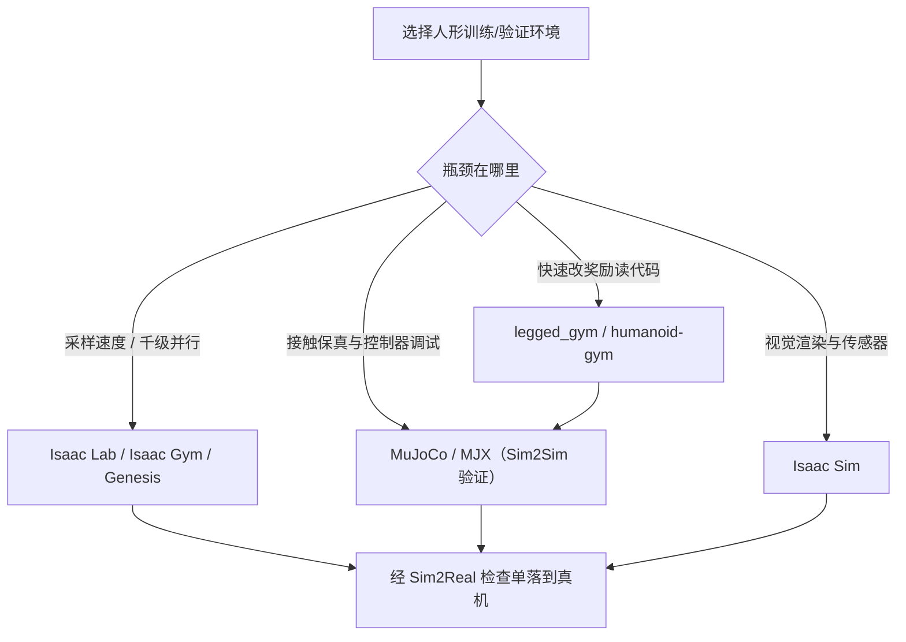

# 人形训练环境

**首屏导读**：人形策略训练几乎都跑在这几套环境之上。选型的分歧点不在「哪个更强」，而在 **你要并行多少环境、要不要接触精度、以及打算怎么迁到真机**。

## 按训练需求选环境

| 环境 | 适合什么 |
|------|----------|
| [Isaac Lab](../../wiki/entities/isaac-lab.md)（原 [Isaac Gym](../../wiki/entities/isaac-gym.md)） | GPU 大规模并行采样，腿足 / 人形 RL 训练的主流选择 |
| [legged_gym](../../wiki/entities/legged-gym.md) | 腿足 RL 的经典最小实现，读代码、改奖励最快 |
| [humanoid-gym](../../wiki/entities/humanoid-gym.md) | 面向人形的训练与 sim2sim 验证流程 |
| [MuJoCo](../../wiki/entities/mujoco.md) / [MJX](../../wiki/entities/mujoco-mjx.md) | 接触解算精细，常用于验证、控制器调试与 sim2sim |
| [Isaac Sim](../../wiki/entities/isaac-sim.md) | 高保真渲染与传感器仿真，偏感知与整机场景 |
| [Genesis](../../wiki/entities/genesis-sim.md) | 较新的高速仿真栈，生态仍在成长 |

## 选读路径 / Reading Path

## 分类与选型指南

### GPU 并行训练栈

- [Isaac Lab](../../wiki/entities/isaac-lab.md)（与 [Isaac Lab 默认环境清单](../../wiki/entities/isaac-lab-default-environments.md)）— 现阶段人形与腿足 GPU 并行 RL 的主力训练底座。
- [Isaac Gym](../../wiki/entities/isaac-gym.md) / [legged_gym](../../wiki/entities/legged-gym.md) / [humanoid-gym](../../wiki/entities/humanoid-gym.md) — 经典轻量教学与 Sim2Sim 起步范式。

### 高接触保真与 Sim2Sim 验证栈

- [MuJoCo](../../wiki/entities/mujoco.md) / [MJX](../../wiki/entities/mujoco-mjx.md) — 在迁移真机前先做一步 **Isaac → MuJoCo** 的 Sim2Sim 校验，暴露执行器与接触参数假设。
- [Genesis](../../wiki/entities/genesis-sim.md) — 面向高速物理仿真与多物理场的新兴栈。

### 怎么选

- 先看 [仿真器选型指南](../../wiki/queries/simulator-selection-guide.md)；
- 纠结 MuJoCo 还是 Isaac Sim，看 [MuJoCo vs Isaac Sim](../../wiki/comparisons/mujoco-vs-isaac-sim.md)；
- 训练跑通之后，迁真机的坑集中在 [Sim2Real](../../wiki/concepts/sim2real.md) 与 [Sim2Real 上机检查单](../../wiki/queries/sim2real-checklist.md)。

## 参考来源与收录边界

- [sources/papers/simulation_tools.md](../../sources/papers/simulation_tools.md) — 仿真引擎与物理接口归档。
- [sources/repos/isaac_lab.md](../../sources/repos/isaac_lab.md) · [sources/repos/isaac_lab_environments.md](../../sources/repos/isaac_lab_environments.md) — Isaac Lab 与环境清单归档。
- 实际采样吞吐与接触误差取决于 GPU 型号、子步数与机器人 URDF/MJCF 质量，选型前须对照实测基准。

## 关联页面

- [Locomotion 任务页](../../wiki/tasks/locomotion.md)
- [仿真评测基础设施](../../wiki/concepts/simulation-evaluation-infrastructure.md)
- [Isaac Lab 默认环境清单](../../wiki/entities/isaac-lab-default-environments.md)
- [Locomotion 评测](locomotion-benchmarks.md)
- [RL Frameworks](../repos/rl-frameworks.md)
