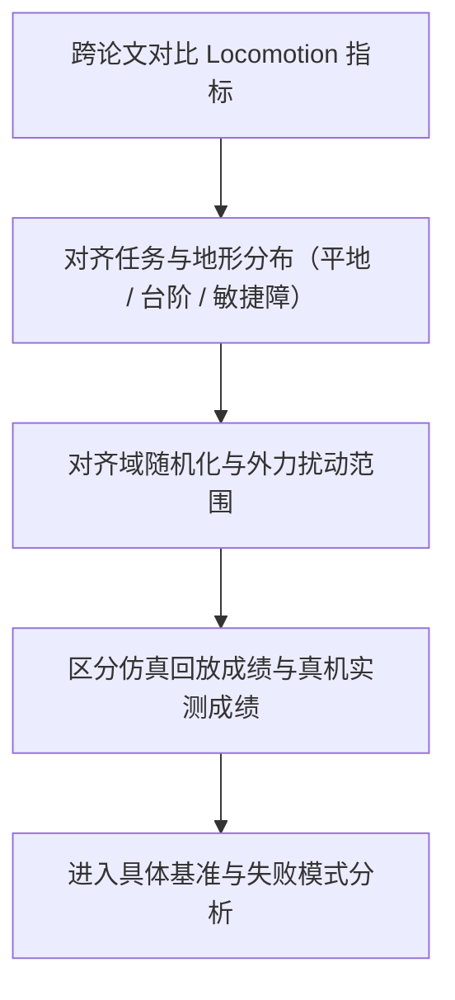

# Locomotion 评测

**首屏导读**：腿足 / 人形运动没有单一的「跑分榜」：不同论文的任务、地形、指标与随机化口径都不一样，跨论文比数字前先确认地形分布、域随机化范围与仿真/真机口径是否对齐。

## 选读路径 / Reading Path

## 常见的评测维度

| 维度 | 典型任务 | 常见指标 |
|------|----------|----------|
| 平地行走 | 速度跟踪、转向 | 跟踪误差、能耗（CoT）、存活时长 |
| 越障 / 复杂地形 | 台阶、碎石、斜坡 | 成功率、通过率、摔倒次数 |
| 高动态 | 跑、跳、跑酷 | 最高速度、腾空时间、落地稳定性 |
| 扰动恢复 | 推力 / 负载扰动 | 可承受冲量、恢复时间 |

## 看数字之前先对齐

### 地形课程与随机化边界

- **地形与课程是否同一套**——地形难度分布不同，成功率不可比；
- **随机化范围是否公开**——域随机化开得越大，仿真成绩通常越保守；

### 仿真 vs 真机评测口径

- **仿真还是真机**——仿真成绩与真机成绩不能混排；进一步差异见 [Sim vs Real 评测鸿沟](../../wiki/concepts/sim-vs-real-eval-gap.md)。
- 典型敏捷障碍课示例可对照 [Barkour 论文实体](../../wiki/entities/paper-barkour-quadruped-agility-benchmark.md)（[arXiv:2305.14654](https://arxiv.org/abs/2305.14654)）。

### 基准选型与失败模式排查

- 具体怎么挑评测，见 [具身评测基准选型闭环](../../wiki/queries/embodied-eval-benchmark-selection-loop.md)；
- 排查策略摔倒、步态漂移等现象，见 [常见失败模式](../../wiki/queries/locomotion-failure-modes.md)。

## 参考来源与收录边界

- [Barkour 四足敏捷基准（arXiv:2305.14654）](https://arxiv.org/abs/2305.14654) — 障碍课设计、敏捷分与零样本 Sim2Real 评测参考。
- [sources/papers/simulation_tools.md](../../sources/papers/simulation_tools.md) — 仿真测试平台差异归档。
- 本页整理评测对齐清单；具体任务指标以对应论文及 [具身评测基准选型闭环](../../wiki/queries/embodied-eval-benchmark-selection-loop.md) 为准。

## 关联页面

- [Locomotion 任务页](../../wiki/tasks/locomotion.md)
- [常见失败模式](../../wiki/queries/locomotion-failure-modes.md)
- [仿真评测基础设施](../../wiki/concepts/simulation-evaluation-infrastructure.md)
- [人形训练环境](humanoid-environments.md)
- [具身评测基准选型闭环](../../wiki/queries/embodied-eval-benchmark-selection-loop.md)
