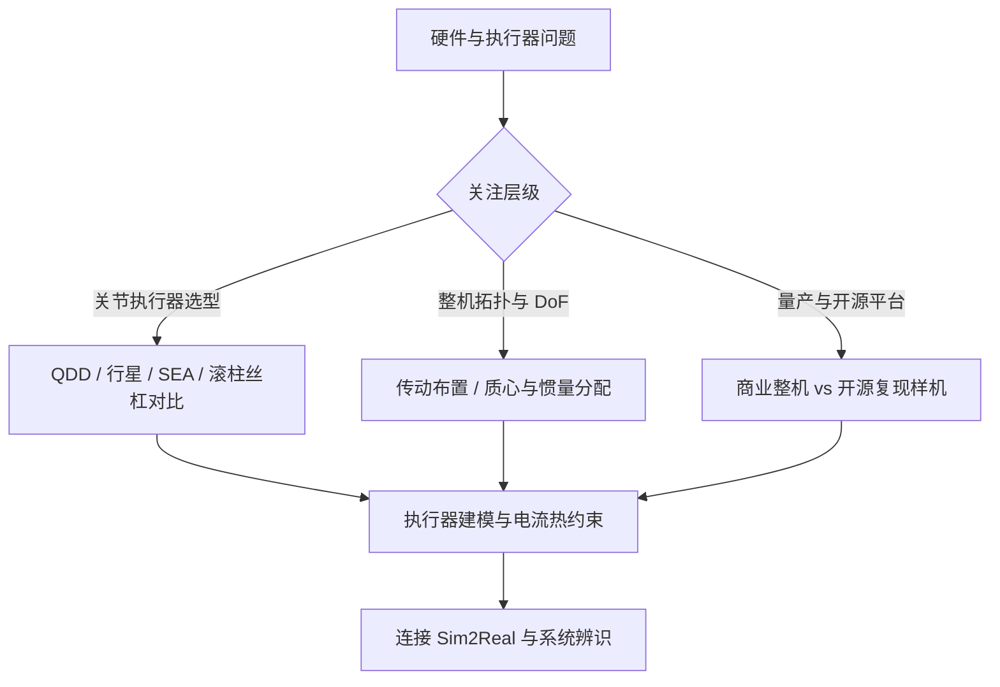

# Humanoid Hardware（人形硬件论文与平台导航）

**首屏导读**：本页索引人形机器人**硬件架构、执行器设计与整机工程**的参考入口，聚焦「执行器选型 → 关节传动与自由度配置 → 整机量产与硬件-控制协同」。具体开源硬件与论文的一手链接及全文核验以对应 `wiki/` 实体页为准。

## 按问题找入口

| 想回答的问题 | 优先入口 |
|---|---|
| 准直驱（QDD）、谐波与行星丝杠各自适用什么关节？ | [人形执行器 102 技术地图](../../wiki/overview/humanoid-actuator-102-technology-map.md) · [开源 QDD 执行器对比](../../wiki/comparisons/open-source-qdd-actuator-projects.md) |
| 人形整机的自由度、传动与结构边界怎么拆解？ | [人形硬件 101 技术地图](../../wiki/overview/humanoid-hardware-101-technology-map.md) · [人形机器人 (Entity)](../../wiki/entities/humanoid-robot.md) |
| 有哪些可直接对照复现的开源人形平台？ | [开源人形硬件对比 (Entity)](../../wiki/entities/open-source-humanoid-hardware.md) · [Berkeley Humanoid Lite](../../wiki/entities/berkeley-humanoid-lite.md) |
| 量产整机与商业平台的硬件方案怎么落地？ | [Unitree (Entity)](../../wiki/entities/unitree.md) · [Agility Robotics](../../wiki/entities/agility-robotics.md) |

## 选读路径 / Reading Path

## 关注问题

- 如何平衡高功率密度与结构紧凑性？
- 不同类型的执行器（如准直驱、行星减速器、SEA）的优缺点？
- 全身关节布置与自由度（DoF）优化如何影响运动能力？
- 硬件层面的鲁棒性如何提升（如散热、防震）？

## 代表性平台与论文

### 经典与先进执行器

- **Unitree G1/H1** — 展示了量产级人形机器人的硬件集成方案；见 [Unitree (Entity)](../../wiki/entities/unitree.md) 与 [Unitree G1](../../wiki/entities/unitree-g1.md)。
- **Digit (Agility Robotics)** — 腿部联动机构与执行器设计的代表作；见 [Agility Robotics](../../wiki/entities/agility-robotics.md)。
- **Berkeley Humanoid Lite** — 模块化低成本开源双足/人形平台（[arXiv:2407.21781](https://arxiv.org/abs/2407.21781)）；见 [Berkeley Humanoid Lite](../../wiki/entities/berkeley-humanoid-lite.md)。

### 硬件综述与系统

- **Open-source Humanoid Hardware** — 各类开源人形机器人项目（如 Reachy, IronBoy, Berkeley Humanoid Lite）的硬件对比；见 [开源人形硬件对比 (Entity)](../../wiki/entities/open-source-humanoid-hardware.md)。
- **人形硬件 101 / 102 技术地图** — 从传动机构、热极限到执行器驱动链的系统梳理；见 [人形硬件 101](../../wiki/overview/humanoid-hardware-101-technology-map.md) 与 [人形执行器 102](../../wiki/overview/humanoid-actuator-102-technology-map.md)。

### 硬件与控制协同

- **执行器动力学与仿真对齐** — 从电机电流过载、谐波/连杆运动学到策略训练中的 [执行器网络 (Method)](../../wiki/methods/actuator-network.md)。
- **纵深路线入口** — 若按工程设计主线推进，可转至 [人形硬件设计纵深路线](../../roadmap/depth-humanoid-hardware-design.md)。

## 参考来源与收录边界

- [sources/papers/humanoid_hardware.md](../../sources/papers/humanoid_hardware.md) — 人形硬件核心资料归档入口。
- [Berkeley Humanoid（arXiv:2407.21781）](https://arxiv.org/abs/2407.21781) — 开源模块化人形硬件与执行器论文原文入口。
- [Agility Robotics Research & Analysis](https://www.agilityrobotics.com/resources?tab=research-%2B-analysis#tab-group) — Digit 机械硬件与工程分析官方入口。
- 各平台的具体规格、BOM 与论文细节由上方对应 `wiki/` 实体页提供并核验。

## 关联页面

- [人形机器人 (Entity)](../../wiki/entities/humanoid-robot.md)
- [Unitree (Entity)](../../wiki/entities/unitree.md)
- [执行器网络 (Method)](../../wiki/methods/actuator-network.md)
- [开源人形硬件对比 (Entity)](../../wiki/entities/open-source-humanoid-hardware.md)
- [人形硬件设计纵深路线](../../roadmap/depth-humanoid-hardware-design.md)
