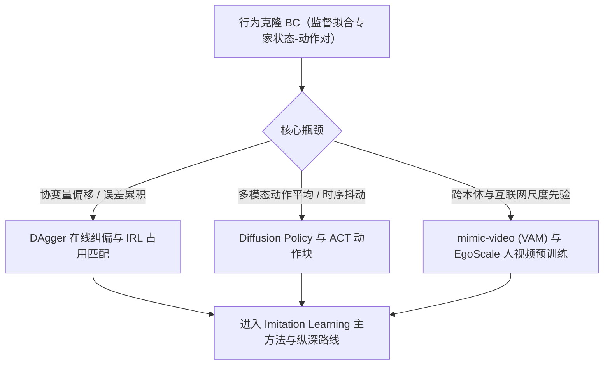

# Imitation Learning（模仿学习论文导航）

**首屏导读**：本页聚焦行为克隆、DAgger、Diffusion Policy、动作块输出、视频先验动作模型与技能嵌入的代表论文；按「解决什么瓶颈 → 对应论文与方法页」组织，单篇论文的全文核验见链接到的 `wiki/` 实体与方法页。

## 按问题找论文

| 想回答的问题 | 先读 |
|---|---|
| 为什么纯行为克隆会漂移，DAgger 怎么纠偏？ | [Behavior Cloning](../../wiki/methods/behavior-cloning.md) · Ross et al. 2011 |
| 如何建模多模态动作分布与长时序动作块？ | [Diffusion Policy](../../wiki/methods/diffusion-policy.md) · [Action Chunking](../../wiki/methods/action-chunking.md) |
| 如何不写手工奖励、从演示推断奖励或做占用匹配？ | [Inverse Reinforcement Learning](../../wiki/methods/inverse-reinforcement-learning.md) |
| 如何用互联网视频或 egocentric 人视频做预训练迁移？ | [mimic-video / VAM](../../wiki/methods/mimic-video.md) · [EgoScale](../../wiki/methods/egoscale.md) |
| 如何把演示压缩进可复用的隐空间技能先验？ | [隐空间技能先验论文导航](latent-skill-prior.md) |

## 选读路径 / Reading Path

## 关注问题

- 如何解决行为克隆（BC）中的协变量偏移（Covariate Shift）问题？
- 如何通过生成式模型（如 Diffusion）建模多模态专家数据？
- 如何有效压缩长时序动作序列以提升操作稳定性？
- 如何将动捕数据或专家演示转化为可重用的技能先验？

## 代表性论文

### 基础算法

- **DAgger** (Ross et al., 2011) — *A Reduction of Imitation Learning to No-Regret Online Learning*. 系统解决了 BC 的累计误差问题。
- **IRL 谱系** (Ng & Russell 2000 → MaxEnt 2008 → GAIL 2016 → AIRL 2018) — 从演示推断奖励或做占用匹配。归纳页见 [Inverse Reinforcement Learning](../../wiki/methods/inverse-reinforcement-learning.md)；一手索引见 [inverse_reinforcement_learning_primary_refs.md](../../sources/papers/inverse_reinforcement_learning_primary_refs.md)。
- **Diffusion Policy** (Chi et al., 2023) — *Visuomotor Policy Learning via Action Diffusion*. 将扩散模型引入策略建模，显著提升了复杂操作任务的成功率；论文实体见 [Diffusion Policy 论文实体](../../wiki/entities/paper-diffusion-policy.md)。

### 动作表达与架构

- **ACT** (Zhao et al., 2023) — *Learning Fine-Grained Bimanual Manipulation with Low-Cost Hardware*. 提出了 Action Chunking，改善了长时序稳定性；论文实体见 [ACT 论文实体](../../wiki/entities/paper-act.md)。

### 视频先验 + 逆动力学（VAM）

- **mimic-video** (Pai et al., 2025) — *Video-Action Models for Generalizable Robot Control Beyond VLAs*。用语义–动力学一体的 **互联网规模视频模型潜表示** 条件化 **流匹配动作解码器**，论文叙事强调相对 VLA 的 **样本效率** 与 oracle 缩放下的 **视频质量瓶颈**；归纳页见 [mimic-video](../../wiki/methods/mimic-video.md)。

### 人视频预训练 VLA（显式腕–手监督 + 对齐 mid-training）

- **EgoScale** (Zheng et al., 2026) — *EgoScale: Scaling Dexterous Manipulation with Diverse Egocentric Human Data*。在 **>20k h** egocentric 人视频上预训练 **流式 VLA**，给出 **数据规模–人轨验证损失（log-linear）–真机灵巧后训练** 的实证链条，并以 **小规模视点对齐的人–机 mid-training** 承接 embodiment gap；归纳页见 [EgoScale](../../wiki/methods/egoscale.md)。

### 技能嵌入

- **ASE** (Peng et al., 2022) — *Adversarial Skill Embeddings for Hierarchical RL*. 学习可组合的隐空间技能表征；更多技能先验工作见 [隐空间技能先验论文导航](latent-skill-prior.md)。

## 参考来源与收录边界

- [Diffusion Policy 原文通读归档（arXiv:2303.04137）](../../sources/papers/diffusion_policy_reading_arxiv_2303_04137.md)
- [IRL 一手文献索引](../../sources/papers/inverse_reinforcement_learning_primary_refs.md)
- [Learning Fine-Grained Bimanual Manipulation with Low-Cost Hardware（arXiv:2304.13705）](https://arxiv.org/abs/2304.13705)
- 本页为方向导航索引；各方法的超参细节、实验边界与原文核验状态请进入上方对应 `wiki/` 页面查看。

## 关联页面

- [Imitation Learning (Method)](../../wiki/methods/imitation-learning.md)
- [Inverse Reinforcement Learning (Method)](../../wiki/methods/inverse-reinforcement-learning.md)
- [Diffusion Policy (Method)](../../wiki/methods/diffusion-policy.md)
- [mimic-video / VAM (Method)](../../wiki/methods/mimic-video.md)
- [EgoScale (Method)](../../wiki/methods/egoscale.md)
- [Action Chunking (Method)](../../wiki/methods/action-chunking.md)
- [Behavior Cloning (Method)](../../wiki/methods/behavior-cloning.md)
- [模仿学习纵深路线](../../roadmap/depth-imitation-learning.md)
- [隐空间技能先验论文导航](latent-skill-prior.md)
- [操作 / 抓取感知工具索引](../repos/manipulation-perception.md)
