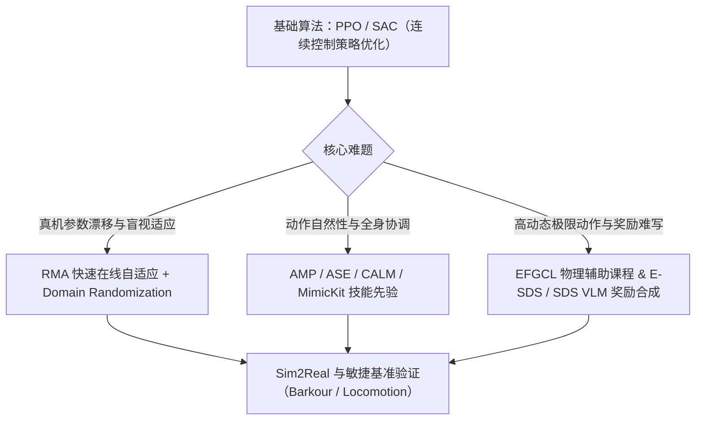

# Locomotion RL（腿足与人形强化学习论文导航）

**首屏导读**：本页索引人形与四足机器人 **Locomotion 强化学习**的代表论文与基准入口，按「基础策略优化 → 敏捷基准 → 技能先验与自适应 → 高动态课程与自动奖励合成」组织。各论文原文实验与复现细节见链接到的 `wiki/` 实体与方法页。

## 按问题找论文

| 想回答的问题 | 先读 |
|---|---|
| 腿足 RL 默认用什么 on-policy / off-policy 算法基线？ | [PPO (Method)](../../wiki/methods/ppo.md) · [PPO vs SAC](../../wiki/comparisons/ppo-vs-sac.md) |
| 如何把动捕风格或快速在线自适应引入腿足控制？ | AMP / ASE / RMA（见下）· [隐空间技能先验](latent-skill-prior.md) |
| 怎么公平评测四足/人形的敏捷越障与高速运动能力？ | [Barkour 论文实体](../../wiki/entities/paper-barkour-quadruped-agility-benchmark.md) · [Locomotion 评测](../../references/benchmarks/locomotion-benchmarks.md) |
| 高动态起跳/落地或复杂地形的奖励与课程怎么设计？ | [EFGCL (Method)](../../wiki/methods/efgcl.md) · [E-SDS (Entity)](../../wiki/entities/paper-e-sds-environment-aware-humanoid-locomotion-rl.md) |

## 选读路径 / Reading Path

## 关注问题

- 如何让机器人走得更稳？
- 如何提升速度与能效？
- 如何提高扰动恢复能力？
- 如何增强 sim2real 可迁移性？

## 代表性论文

### 基础算法

- **PPO** (Schulman et al., 2017) — Humanoid locomotion RL 最常用基线，[arXiv](https://arxiv.org/abs/1707.06347)；方法页见 [PPO](../../wiki/methods/ppo.md)。
- **SAC** (Haarnoja et al., 2018) — 连续控制常用 off-policy 算法，[arXiv](https://arxiv.org/abs/1801.01290)。

### 敏捷与四足障碍课基准

- **Barkour** — Benchmarking Animal-level Agility with Quadruped Robots（Caluwaerts et al., arXiv:2305.14654）：犬敏捷赛式障碍课 + 时间型敏捷分；专长 PPO + 导航 vs Locomotion-Transformer 蒸馏；零样本 sim2real 与开源 `barkour_robot` / MuJoCo Menagerie；[wiki 论文实体](../../wiki/entities/paper-barkour-quadruped-agility-benchmark.md) · [arXiv](https://arxiv.org/abs/2305.14654)

### 人形/足式 Locomotion

- **AMP** — Adversarial Motion Priors (Peng et al., 2021)，用对抗方式嵌入技能，[Code](https://github.com/google-deepmind/deepmind-research/tree/master/adversarial_motion_priors)
- **ASE** — Adversarial Skill Embeddings (Peng et al., 2022)，对抗训练 latent 技能先验，[Code](https://github.com/google-deepmind/ase)
- **RMA** — Rapid Motor Adaptation (Kumar et al., 2021)，四足快速自适应，[arXiv](https://arxiv.org/abs/2107.04034)

### 人形全身控制

- **CALM** — Conditioned Latent Action Models (Tessler et al., 2023)，latent 空间控制，[Code](https://github.com/irlet/calm)
- **MimicKit** — 模仿学习 + 技能迁移 framework，[Project Page](https://motion.stanford.edu/research/mimickit)

### 高动态与课程式物理引导

- **EFGCL** — External Force-Guided Curriculum Learning（Yoneda et al., RA-L 2026）：训练期辅助力 + 成功率衰减课程，四足高动态 sim2real；[wiki 方法页](../../wiki/methods/efgcl.md) · [Project Page](https://keitayoneda.github.io/kleiyn-efgcl/) · [DOI](https://doi.org/10.1109/LRA.2026.3675955)

### 奖励自动合成与地形感知（VLM 代码奖励）

- **E-SDS** — Environment-aware See it, Do it, Sorted（Yalcin et al., arXiv:2512.16446）：在 SDS 式视频分解上加入仿真采样的地形统计，生成调用高度图与 LiDAR 的 Python 奖励并闭环精炼 PPO；[wiki 论文实体](../../wiki/entities/paper-e-sds-environment-aware-humanoid-locomotion-rl.md) · [arXiv](https://arxiv.org/abs/2512.16446)
- **SDS** — See it, Do it, Sorted 四足单视频技能（Stamatopoulou et al., arXiv:2410.11571）：网格帧 + SUS 多智能体生成奖励，IsaacGym PPO 与 rollout 反馈进化；[arXiv](https://arxiv.org/abs/2410.11571) · [Project](https://rpl-cs-ucl.github.io/SDSweb/)

## 参考来源与收录边界

- [PPO 原文（arXiv:1707.06347）](https://arxiv.org/abs/1707.06347)
- [RMA 原文（arXiv:2107.04034）](https://arxiv.org/abs/2107.04034)
- [Barkour 原文（arXiv:2305.14654）](https://arxiv.org/abs/2305.14654)
- [EFGCL（DOI:10.1109/LRA.2026.3675955）](https://doi.org/10.1109/LRA.2026.3675955)
- 各工作的训练环境、超参和真机验证边界以对应 `wiki/` 实体与方法页为准。

## 关联页面

- [Barkour 论文实体](../../wiki/entities/paper-barkour-quadruped-agility-benchmark.md) — 敏捷障碍课基准 + 开源硬件与 Menagerie MJCF
- [sim2real](../../wiki/concepts/sim2real.md) — Sim2Real 是 locomotion RL 的核心挑战
- [domain-randomization](../../wiki/concepts/domain-randomization.md) — DR 是当前主流 sim2real 方法
- [locomotion](../../wiki/tasks/locomotion.md) — locomotion 任务层
- [强化学习 Locomotion 纵深路线](../../roadmap/depth-rl-locomotion.md)
- [隐空间技能先验](latent-skill-prior.md)
