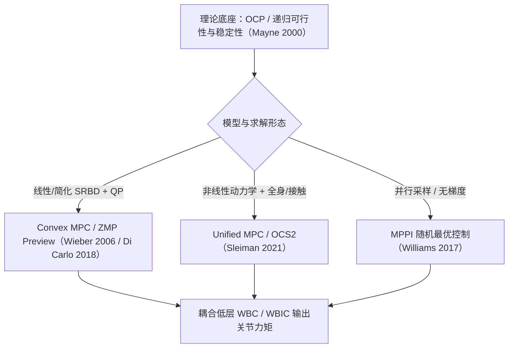

# MPC（模型预测控制论文导航）

**首屏导读**：本页整理机器人**模型预测控制（Model Predictive Control）**从稳定性理论到腿式/人形实时落地的代表论文；按「稳定性与采样理论 → 简化刚体 Convex MPC → 双足/全身统一框架」组织。

## 按问题找论文

| 想回答的问题 | 先读 |
|---|---|
| 为什么滚动时域优化能保证闭环稳定性与递归可行性？ | Mayne et al. (2000) · [MPC 方法页](../../wiki/methods/model-predictive-control.md) |
| 如何用单刚体（SRBD）凸化实现数百赫兹实时步态规划？ | Di Carlo et al. (2018) · [MIT Mini Cheetah WBIC+MPC](../../wiki/entities/paper-wbic-mpc-mini-cheetah.md) |
| 非凸动力学与接触切换下怎么用采样式 MPC？ | Williams et al. (2017) MPPI · [MPPI (Method)](../../wiki/methods/mppi.md) |
| 双足/全身操作中 MPC 如何与低层 WBC 耦合？ | Wieber (2006) · Sleiman et al. (2021) · [MPC 与 WBC 集成](../../wiki/concepts/mpc-wbc-integration.md) |

## 选读路径 / Reading Path

## 关注问题

- 如何在嵌入式硬件上实现数百赫兹的实时 OCP 求解？
- 如何通过简化模型（SRBD/LIP）降低计算开销？
- 如何保证带约束优化问题的递归可行性与稳定性？
- 如何将 MPC 与低层 WBC 或高层 RL 策略进行耦合？

## 代表性论文

### 理论与综述

- **Mayne et al. (2000)** — *Constrained Model Predictive Control: Stability and Optimality*. 奠定了 MPC 稳定性的理论框架。
- **Williams et al. (2017)** — *Model Predictive Path Integral Control (MPPI)*. 经典的基于采样的随机 MPC 方法；方法页见 [MPPI](../../wiki/methods/mppi.md)。

### 足式机器人应用 (MIT Cheetah 系列)

- **Di Carlo et al. (2018)** — *Dynamic and Robust Legged Locomotion Using a Simplified Model*. 提出了著名的 **Convex MPC**，用于 MIT Mini Cheetah / Cheetah 3；后续 WBIC 耦合见 [MIT Mini Cheetah WBIC+MPC 实体](../../wiki/entities/paper-wbic-mpc-mini-cheetah.md)。

### 人形与全身控制

- **Wieber (2006)** — *Trajectory Free Linear Model Predictive Control for Stable Walking*. 将预览控制与 ZMP 约束结合，用于双足行走；背景见 [LIP / ZMP](../../wiki/concepts/lip-zmp.md)。
- **Sleiman et al. (2021)** — *A Unified MPC Framework for Whole-Body Dynamic Locomotion and Manipulation*. ANYmal 全身控制与移动操作的统一 MPC 框架；参考实现见 [OCS2 Perceptive MPC](../../wiki/entities/ocs2-perceptive-mpc-go2.md)。

## 参考来源与收录边界

- [sources/papers/mpc.md](../../sources/papers/mpc.md) — MPC 核心论文集归档。
- [sources/papers/wbic_mpc_mini_cheetah_arxiv_1909_06586.md](../../sources/papers/wbic_mpc_mini_cheetah_arxiv_1909_06586.md)（[arXiv:1909.06586](https://arxiv.org/abs/1909.06586)）— MIT Cheetah MPC+WBIC 原文归档。
- [Force-and-moment-based MPC for Bipedal Robots（arXiv:2104.00065）](https://arxiv.org/abs/2104.00065) — 双足力矩 MPC 参考入口。
- 调参经验与求解器对比请转至 [MPC 方法页](../../wiki/methods/model-predictive-control.md) 与 [MPC 求解器选型](../../wiki/queries/mpc-solver-selection.md)。

## 关联页面

- [Model Predictive Control (Method)](../../wiki/methods/model-predictive-control.md)
- [MPC 技术栈模块](../../tech-map/modules/control/mpc.md)
- [MPC 与 WBC 集成 (Concept)](../../wiki/concepts/mpc-wbc-integration.md)
- [Centroidal Dynamics (Concept)](../../wiki/concepts/centroidal-dynamics.md)
- [LIP / ZMP (Concept)](../../wiki/concepts/lip-zmp.md)
- [Model Predictive Path Integral (Method)](../../wiki/methods/mppi.md)
- [Optimal Control 论文导航](optimal-control.md)
- [Whole-Body Control 论文导航](whole-body-control.md)
