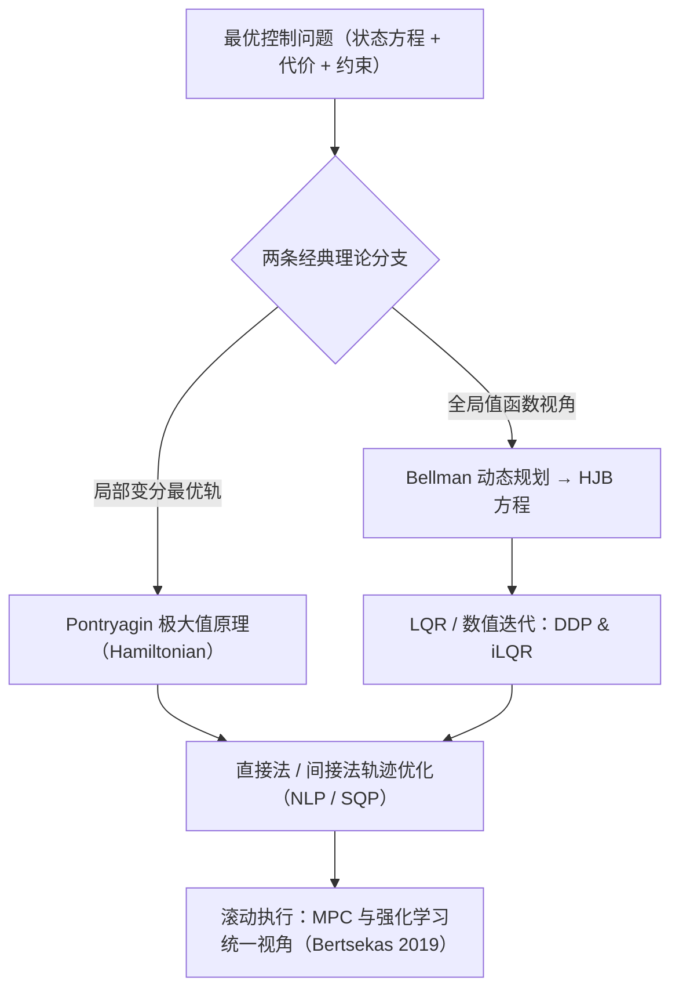

# Optimal Control（最优控制理论与轨迹优化导航）

**首屏导读**：本页整理机器人控制与强化学习共同的数学根基——**最优控制（Optimal Control）**从 Bellman 动态规划、Pontryagin 极大值原理到 DDP/iLQR 与现代轨迹优化的奠基文献，帮助控制与学习两条路线打通共同语言。

## 按问题找资料

| 想回答的问题 | 先读 |
|---|---|
| 离散状态空间的最优子结构与值函数迭代怎么推导？ | Bellman (1957) · [Bellman 方程 (Formalization)](../../wiki/formalizations/bellman-equation.md) |
| 连续时间控制如何用 Hamiltonian 与协态变量写必要条件？ | Pontryagin et al. (1962) · [HJB 方程 (Formalization)](../../wiki/formalizations/hjb.md) |
| 线性二次调节（LQR）与非线性迭代（iLQR/DDP）怎么求解？ | Mayne / Jacobson · [LQR / iLQR (Formalization)](../../wiki/formalizations/lqr.md) · [LQR/iLQR 方法页](../../wiki/methods/lqr-ilqr.md) |
| 最优控制如何落地成机器人多接触轨迹优化与在线 MPC？ | [Trajectory Optimization (Method)](../../wiki/methods/trajectory-optimization.md) · [MPC 论文导航](mpc.md) |

## 选读路径 / Reading Path

## 关注问题

- 如何求解具有动力学约束的最优控制序列？
- 离散时间与连续时间最优性的差异？
- 动态规划（DP）与极大值原理（PMP）的联系？
- 如何在非线性系统上高效迭代求解？

## 代表性著作与论文

### 理论奠基

- **Richard Bellman (1957)** — *Dynamic Programming*. 提出了最优子结构与 Bellman 方程。
- **Pontryagin et al. (1962)** — *A Pontryagin Minimum Principle*. 建立了基于 Hamiltonian 的连续时间最优控制必要条件。

### 工程方法

- **Bryson & Ho (1975)** — *Applied Optimal Control*. 将最优控制系统化为 LQR/LQG 等工程方法。
- **Mayne / Jacobson (1966/1970)** — *Differential Dynamic Programming*. 提出了 **DDP** 算法，是现代轨迹优化（如 [Crocoddyl](../../wiki/entities/crocoddyl.md)）的核心算法基础。

### 统一框架

- **Bertsekas (2019)** — *Reinforcement Learning and Optimal Control*. 建立了强化学习与最优控制的统一数学框架。

## 参考来源与收录边界

- [sources/papers/lqr_ilqr_primary_refs.md](../../sources/papers/lqr_ilqr_primary_refs.md) — LQR/iLQR/DDP 一手参考文献归档。
- [CMU 16-745 Optimal Control & RL 课程讲义归档](../../sources/courses/cmu_16_745_site_and_lecture_notes_reading_2025.md) — 直接配点、DDP/iLQR 与凸 MPC 课程对照。
- [MIT Underactuated Ch.8 LQR 讲义归档](../../sources/sites/mit_underactuated_ch8_lqr_reading.md) — LQR 与 Lyapunov 分析一手讲义。
- 本页定位为经典著作索引；公式推导与算法细节请转至下方形式化与方法页。

## 关联页面

- [Optimal Control (OCP) (Concept)](../../wiki/concepts/optimal-control.md)
- [Bellman 方程 (Formalization)](../../wiki/formalizations/bellman-equation.md)
- [HJB 方程 (Formalization)](../../wiki/formalizations/hjb.md)
- [LQR / iLQR (Formalization)](../../wiki/formalizations/lqr.md)
- [Trajectory Optimization (Method)](../../wiki/methods/trajectory-optimization.md)
- [MPC 论文导航](mpc.md)
- [Whole-Body Control 论文导航](whole-body-control.md)
