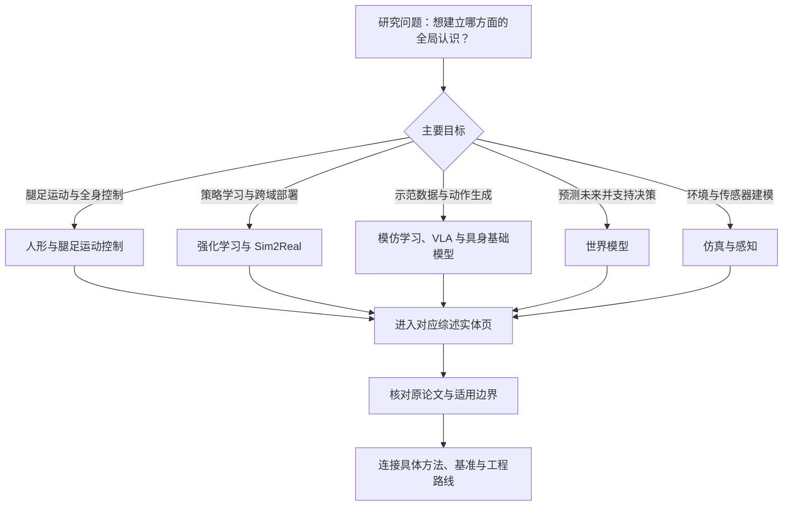

# 综述论文导航 / Survey Papers

**首屏导读**：本页是跨论文的**选读导航**，不是单篇论文，也不把所列综述一概声明为已通读。按「当前研究问题 → 综述类别 → 单篇实体与原文」阅读：先看分类框架，再沿实体页验证论文结论、版本与发布状态。

## 按问题找综述

| 想回答的问题 | 先读 |
|--------------|------|
| 人形 locomotion 控制从 ZMP 到 RL 再到生成式怎么演进？ | [Evolution of Humanoid Locomotion Control](../../wiki/entities/paper-evolution-humanoid-locomotion-control.md) |
| 机器人 RL 真机落地有哪些坑？ | Ibarz et al. 2021（见下） |
| Sim2Real 有哪些方法谱系？ | [Sim2Real RL 综述（2502.13187）](../../wiki/entities/paper-survey-sim2real-rl-foundation-models.md) |
| VLA / 基础模型在具身里怎么演进？ | [VLA Survey](../../wiki/entities/paper-vla-survey-embodied.md)、[统一机器人学习综述](../../wiki/entities/paper-unified-robot-learning-survey.md) |
| 世界模型怎么用于机器人决策？ | [World Models for Robotic Manipulation](../../wiki/entities/paper-sa-2606-00113-world-models-for-robotic-manipulation-a-survey.md) |
| 仿真平台怎么选？ | [Robotic Navigation & Manipulation with Physics Simulators](../../wiki/entities/paper-sa-2505-01458-a-survey-of-robotic-navigation-and-manipulation.md) |

## 选读路径 / Reading Path

下图按**研究目标**分流，而非按发表年份或论文优劣排名。每个终点对应下方的代表性综述分组；选择一组入门后，再按相邻方向补齐背景。

**使用顺序**：① 在「按问题找综述」定位入口；② 对照「代表性综述」阅读分类与差异；③ 打开独立实体页查看原文链接与进一步证据，最后回到任务 / 方法页面做工程落地判断。

| 对比维度 | 优先查看 | 阅读时需要核查 |
|---|---|---|
| 控制方式 | 人形与腿足运动控制 | 模型/优化与学习式控制如何组织；是否包含真机证据 |
| 迁移与安全 | 强化学习与 Sim2Real | 训练环境、域差异、安全约束与评测协议 |
| 数据与策略 | 模仿学习、VLA 与具身基础模型 | 示范数据形式、动作表示、泛化任务与部署延迟 |
| 预测与规划 | 世界模型 | 预测目标、行动条件、闭环使用方式及失败模式 |
| 复现基础设施 | 仿真与感知 | 物理假设、传感器配置、基准指标与可复现性 |

## 代表性综述

按方向分组，每组内先列最通用的一篇。

### 人形与腿足运动控制

- [Evolution of Humanoid Locomotion Control](../../wiki/entities/paper-evolution-humanoid-locomotion-control.md)（Science Robotics 2026）— 六十年人形 locomotion 三时代：经典模型/优化 → 大规模仿真 RL → 生成式智能。
- [腿式机器人进展、挑战与机遇](../../wiki/entities/paper-legged-robots-advances-challenges.md)（Science Robotics 2026）— 硬件 / 运动 / 自主 / 数据 / 应用五柱盘点。
- [Humanoid Loco-Manipulation Survey](../../wiki/entities/paper-humanoid-loco-manipulation-survey.md) — 按控制层与任务类型整理人形移动操作。
- [Teleoperation of Humanoid Robots](../../wiki/entities/paper-notebook-teleoperation-of-humanoid-robots-a-survey.md)（T-RO 2023）— 设备 → 重定向 → 稳定器 → WBC 主链。
- [A Survey of Behavior Foundation Model](../../wiki/entities/paper-bfm-survey-tpami-2025.md)（TPAMI 2025）— 人形 WBC 行为基础模型。
- [零空间投影综述](../../wiki/entities/paper-null-space-projections-survey.md)（IJRR 2015）— 力矩控制下的冗余任务分层。

### 强化学习与 Sim2Real

- **Ibarz et al. (2021)** — *How to Train Your Robot with Deep Reinforcement Learning: Lessons We Have Learned*（IJRR 2021）— 机器人 RL 实战经验总结；[arXiv](https://arxiv.org/abs/2102.02915)
- [Sim2Real RL 综述（2502.13187）](../../wiki/entities/paper-survey-sim2real-rl-foundation-models.md) — 按 MDP 四要素组织 Sim2Real，含基础模型增强迁移。
- [Safe Reinforcement Learning Survey](../../wiki/entities/paper-pai-2205-10330-safereinforcementlearningsurvey.md) — 安全 RL 方法与基准。
- [Progress Reward Modeling Survey](../../wiki/entities/paper-progress-reward-modeling-survey.md) — 过程 / 进度奖励建模。

### 模仿学习、VLA 与具身基础模型

- [DGM Robot Learning Survey](../../wiki/entities/paper-tro-manip-05-dgm-robot-learning-survey.md) — 扩散 / EBM / 流匹配等生成模型在 LfD 中的应用。
- [VLA Survey](../../wiki/entities/paper-vla-survey-embodied.md) — 具身 VLA 的数据、架构、训练与评测。
- [VLA 全生命周期综述（2611.18372）](../../wiki/entities/paper-vla-lifecycle-survey-2611-18372.md) — 模型四轴、训练两轴、部署一轴；88 项工作、22 个核心模型与公平评测。
- [基础模型时代具身操作综述](../../wiki/entities/paper-embodied-manipulation-foundation-models-survey.md) — 高层规划 × 低层动作建模双轴。
- [统一机器人学习综述](../../wiki/entities/paper-unified-robot-learning-survey.md)（TMLR 2026）— 表征 / VLA / 世界模型三轴耦合。
- [Data Pyramid for Embodied Manipulation](../../wiki/entities/paper-data-pyramid-embodied-manipulation.md) — 具身数据五层金字塔。
- [Robustness of Robotic Manipulation](../../wiki/entities/paper-robustness-robotic-manipulation-survey.md) — 操作鲁棒性的定义、形式化与失败管理。
- [TF-ART](../../wiki/entities/paper-tf-art-tactile-force-survey.md) — 触觉 / 力觉学习综述。

### 世界模型

- [Embodied World Model Survey](../../wiki/entities/paper-embodied-world-model-survey.md) — 具身世界模型的表示、训练目标与决策用法。
- [World Models for Robotic Manipulation](../../wiki/entities/paper-sa-2606-00113-world-models-for-robotic-manipulation-a-survey.md) — 预测什么 / 如何接动作 / 何时使用。
- [World Action Models: A Survey](../../wiki/entities/paper-sa-2606-20781-world-action-models-a-survey.md) — 厘清世界模型、视频生成、VLA 与 WAM 边界。

### 仿真与感知

- [Robotic Navigation & Manipulation with Physics Simulators](../../wiki/entities/paper-sa-2505-01458-a-survey-of-robotic-navigation-and-manipulation.md) — 从 sim2real 角度对比物理仿真器。
- [MSFP Survey](../../wiki/entities/paper-msfp-embodied-ai-survey.md) — 具身 AI 多传感器融合感知。

## 参考来源与收录边界

- [Ibarz et al., *How to Train Your Robot with Deep Reinforcement Learning* (2021)](https://arxiv.org/abs/2102.02915) — 真机深度强化学习经验的原始论文入口。
- [Sim2Real RL Survey (arXiv:2502.13187)](https://arxiv.org/abs/2502.13187) — 强化学习 Sim2Real 分类与基础模型衔接。
- [VLA 生命周期综述 (arXiv:2611.18372)](https://arxiv.org/abs/2611.18372) — VLA 全生命周期研究议题入口。
- 其他综述的原文、版本、DOI 与出处由上方的**独立 wiki 实体页**进一步提供；该目录只作索引，不视为已对每篇论文完成全文核验。

## 关联页面

- [Motion Control Roadmap](../../roadmap/motion-control.md) — 人形运控学习路线（非综述，但覆盖 ZMP 至今的主线）
- [Robot Learning Overview (Overview)](../../wiki/overview/robot-learning-overview.md)
- [Sim2Real (Concept)](../../wiki/concepts/sim2real.md)
- [VLA (Method)](../../wiki/methods/vla.md)
- [RL Algorithm Selection (Query)](../../wiki/queries/rl-algorithm-selection.md)
- [Sim2Real 综述合集（AwesomeSim2Real 技术地图）](../../wiki/overview/lc-awesome-sim2real-technology-map.md) — 更多 sim2real 综述条目
