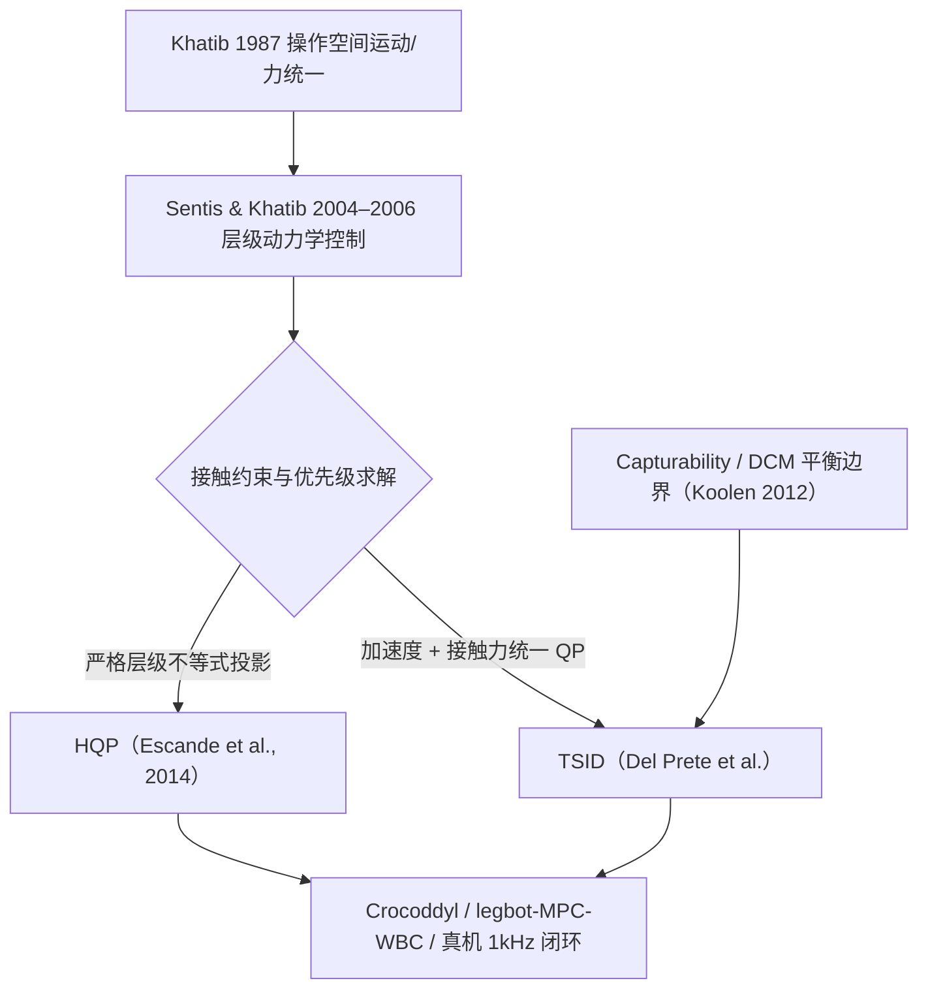

# Whole-Body Control（全身控制论文导航）

**首屏导读**：本页整理人形与腿足**全身控制（WBC）**的经典理论线、优先级约束求解（TSID / HQP）、平衡可捕获性（Capturability）与代表性开源实现；帮助读者从「操作空间动力学」一路打通到「MPC + WBC / RL 真机关节力矩输出」。

## 按问题找论文

| 想回答的问题 | 先读 |
|---|---|
| 操作空间运动/力统一与全身层级控制从何而来？ | [OSF 实体](../../wiki/entities/paper-operational-space-formulation.md) · [IJHR 2004 实体](../../wiki/entities/paper-khatib-sentis-ijhr-2004-whole-body-dynamic-behavior.md) |
| 如何把等式/不等式优先级、接触力与摩擦锥写进 QP？ | [TSID (Concept)](../../wiki/concepts/tsid.md) · [HQP (Concept)](../../wiki/concepts/hqp.md) |
| 多接触轨迹优化与求解器工程怎么做？ | [Crocoddyl (Entity)](../../wiki/entities/crocoddyl.md) · [Legbot MPC-WBC](../../wiki/entities/legbot-mpc-wbc.md) |
| 双足什么时候走得住、踩哪里才能稳住？ | Koolen et al. (2012) · [Capture Point / DCM](../../wiki/concepts/capture-point-dcm.md) |

## 选读路径 / Reading Path

## 关注问题

- 如何在多任务（平衡、跟踪、避障）之间设置优先级？
- 如何在保持动力学一致性的前提下实时求解关节力矩？
- 如何处理多接触状态下的约束（非穿地、摩擦锥）？
- 如何在高性能硬件上实现 kHz 级别的实时闭环？

## 代表性论文

### 经典理论线（Sentis–Khatib）

- **Khatib (1987)** — *Operational Space Formulation* — 操作空间运动/力统一；见 [OSF 实体](../../wiki/entities/paper-operational-space-formulation.md)。
- **Khatib et al. (2004)** — *Whole body dynamic behavior and control of human-like robots* (IJHR) — WBC 系统化起点；见 [IJHR 2004 实体](../../wiki/entities/paper-khatib-sentis-ijhr-2004-whole-body-dynamic-behavior.md)。
- **Sentis & Khatib (2006)** — *A Whole-Body Control Framework for Humanoids Operating in Human Environments* (ICRA) — 代表性人形环境框架；见 [ICRA 2006 实体](../../wiki/entities/paper-sentis-khatib-icra-2006-whole-body-control-framework.md)。
- **Fok et al. (2015)** — *ControlIt!* (arXiv:1506.01075) — WBOSC 开源软件；见 [ControlIt!](../../wiki/entities/controlit.md)。

### 核心方法论

- **Task Space Inverse Dynamics (TSID)** (Del Prete et al.) — 提出在接触约束下的 prioritized motion-force 控制框架，统一求解加速度与接触力。
- **Hierarchical Quadratic Programming (HQP)** (Escande et al., 2014) — 系统化了 HQP 的实时求解框架，奠定了人形机器人运动生成的工程基础。
- **Sentis & Khatib (2005)** — *Synthesis of Whole-Body Behaviors Through Hierarchical Control*. 奠定了全身行为层级控制范式。

### 工程框架与工具

- **Mastalli et al. (2020)** — *Crocoddyl: An Efficient and Versatile Framework for Multi-Contact Optimal Control*. 为 WBC 与轨迹优化提供高效求解器。
- **legbot-MPC-WBC** ([Robot-Nav](https://github.com/Robot-Nav/legbot-MPC-WBC)) — 四足 Convex MPC + WBC 分支 sim2sim/sim2real 参考；见 [legbot-mpc-wbc 实体](../../wiki/entities/legbot-mpc-wbc.md)。
- **legbot_lab** ([Robot-Nav](https://github.com/Robot-Nav/legbot_lab)) — 四足 Isaac Lab PPO / MoE-CTS RL + ONNX 部署；见 [Legbot Lab 实体](../../wiki/entities/legbot-lab.md) 与 [CTS 论文页](../../wiki/entities/paper-cts-concurrent-teacher-student-locomotion.md)。

### 稳定性与平衡分析

- **Koolen et al. (2012)** — *Capturability-based Analysis and Control of Legged Locomotion*. 提出了 N-step Capturable 概念，为平衡恢复提供可行性判定。

## 参考来源与收录边界

- [Khatib & Sentis IJHR 2004 归档](../../sources/papers/khatib_sentis_ijhr_2004_whole_body_dynamic_behavior.md)
- [Sentis & Khatib ICRA 2006 归档](../../sources/papers/sentis_khatib_icra_2006_whole_body_control_framework.md)
- [ControlIt!（arXiv:1506.01075）](https://arxiv.org/abs/1506.01075)
- [Crocoddyl 论文与源码归档](../../sources/papers/crocoddyl_icra2020_and_repo_reading.md)
- 具体公式推导与工程调参入口见上方对应 `wiki/` 概念、实体与对比页。

## 关联页面

- [Whole-Body Control (WBC) (Concept)](../../wiki/concepts/whole-body-control.md)
- [WBC 技术栈模块](../../tech-map/modules/control/whole-body-control.md)
- [TSID (Concept)](../../wiki/concepts/tsid.md)
- [HQP (Concept)](../../wiki/concepts/hqp.md)
- [Capture Point / DCM (Concept)](../../wiki/concepts/capture-point-dcm.md)
- [Crocoddyl (Entity)](../../wiki/entities/crocoddyl.md)
- [MPC 与 WBC 集成 (Concept)](../../wiki/concepts/mpc-wbc-integration.md)
- [MPC 论文导航](mpc.md)
- [Optimal Control 论文导航](optimal-control.md)
