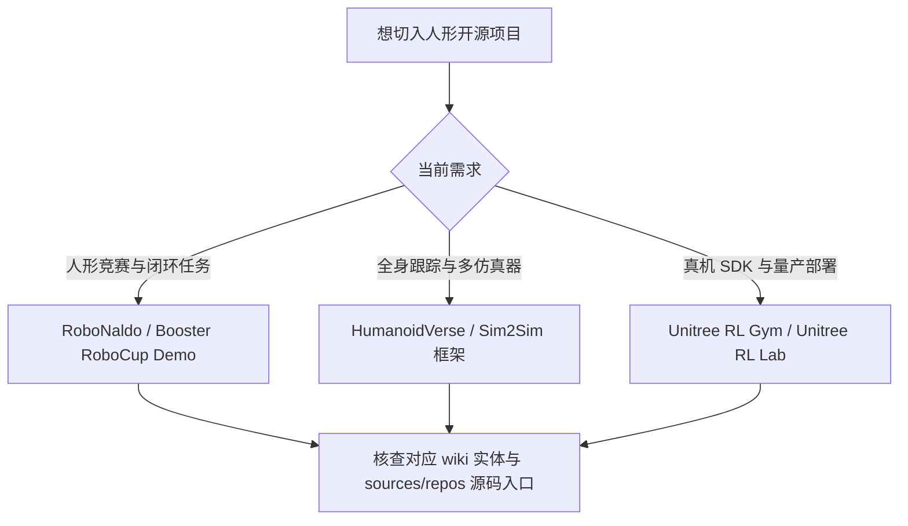

# Humanoid Projects（人形开源项目导航）

**首屏导读**：本页收录可直接上手的人形机器人开源工程项目（训练、感知、竞赛与真机部署），适合已掌握基础概念、需要找**端到端可跑仓库**作基线或硬件落地参考的读者。

## 按场景找项目

| 你的工程目标 | 优先入口 |
|---|---|
| 人形足球 / 射门与感知-控制闭环 | **RoboNaldo**（见下）· [Booster RoboCup Demo](../../wiki/entities/booster-robocup-demo.md) |
| 多仿真器迁移与全身动作跟踪（Sim2Sim / Sim2Real） | [HumanoidVerse](../../wiki/entities/humanoidverse.md) · [IsaacLab Decoupled WBC](../../wiki/entities/paper-notebook-kungfubot-2.md) |
| Unitree G1 / H1 官方强化学习训练与真机部署 | [Unitree RL Gym](../../wiki/entities/unitree-rl-gym.md) · [Unitree RL Lab](../../wiki/entities/unitree-rl-lab.md) |
| 低成本全开源人形样机与软硬件一体化基线 | [Berkeley Humanoid Lite](../../wiki/entities/berkeley-humanoid-lite.md) · [开源人形硬件对比](../../wiki/entities/open-source-humanoid-hardware.md) |

## 选读路径 / Reading Path

## 代表性开源项目

### 人形足球 / 射门

- **RoboNaldo**
  - **训练** [OpenDriveLab/RoboNaldo](https://github.com/OpenDriveLab/RoboNaldo) — Isaac Lab 三阶段 motion-guided curriculum RL（MIT）
  - **部署** [OpenDriveLab/RoboNaldo_Deploy](https://github.com/OpenDriveLab/RoboNaldo_Deploy) — G1 FreeKick FSM + 机载感知 / MuJoCo
  - 项目页：<https://opendrivelab.com/RoboNaldo/> · 论文 [arXiv:2606.11092](https://arxiv.org/abs/2606.11092)
  - Wiki：[paper-robonaldo-humanoid-soccer-shooting](../../wiki/entities/paper-robonaldo-humanoid-soccer-shooting.md)
  - Sources：[robonaldo.md](../../sources/repos/robonaldo.md) · [robonaldo-deploy.md](../../sources/repos/robonaldo-deploy.md)
- **[Booster RoboCup Demo](../../wiki/entities/booster-robocup-demo.md)** — 面向人形足球竞赛的感知 + 决策 + 运控全栈工程参考。

### 全身控制与多仿真器训练栈

- **[HumanoidVerse](../../wiki/entities/humanoidverse.md)** — 解耦仿真后端、任务与算法的多仿真器人形训练与 Sim2Sim 迁移框架。
- **[humanoid-gym](../../wiki/entities/humanoid-gym.md)** — 基于 Isaac Gym + MuJoCo 的人形 RL 训练与零样本 Sim2Sim/Sim2Real 起点。

### 量产平台与真机部署底座

- **[Unitree RL Gym](../../wiki/entities/unitree-rl-gym.md)** / **[Unitree RL Lab](../../wiki/entities/unitree-rl-lab.md)** — 面向宇树人形/四足机器人的训练与真机 SDK 对接仓。
- **[Berkeley Humanoid Lite](../../wiki/entities/berkeley-humanoid-lite.md)** — 从硬件 CAD、固件到 RL 策略的开源人形样机栈。

## 参考来源与收录边界

- [sources/repos/robonaldo.md](../../sources/repos/robonaldo.md) · [sources/repos/robonaldo-deploy.md](../../sources/repos/robonaldo-deploy.md)
- [sources/repos/humanoidverse.md](../../sources/repos/humanoidverse.md)
- [sources/repos/unitree_rl_gym.md](../../sources/repos/unitree_rl_gym.md)
- 各仓库的开源许可证、硬件依赖与真实运行入口请以对应 `wiki/entities/` 与 `sources/repos/` 核查档案为准。

## 关联页面

- [人形足球纵深路线](../../roadmap/depth-humanoid-soccer.md)
- [RL Frameworks](rl-frameworks.md)
- [Humanoid Hardware](../../references/papers/humanoid-hardware.md)
- [Sim2Real (Concept)](../../wiki/concepts/sim2real.md)
