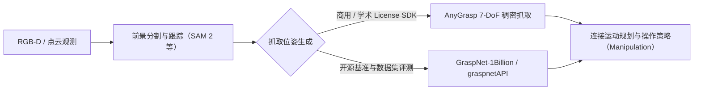

# Manipulation Perception（操作 / 抓取感知工具）

**首屏导读**：面向 **pick-and-place、bin picking、动态抓取** 等任务中「从视觉/深度到抓取位姿」这一层的开源与半开源工具索引。适合已理解 **[Manipulation](../../wiki/tasks/manipulation.md)** 任务划分、需要选型 **检测式抓取**、**基础视觉分割** 或 **SDK 集成** 的读者。

> 方法谱系总览（GraspNet → Contact-GraspNet → GSNet / Graspness / AnyGrasp）见 **[Grasp Pose Estimation](../../wiki/methods/grasp-pose-estimation.md)**。

## 按任务找感知工具

| 想解决的问题 | 优先入口 |
|---|---|
| 开箱即用的 7-DoF 稠密抓取检测与跨帧跟踪 | **[AnyGrasp](../../wiki/entities/anygrasp.md)**（预编译 SDK + License） |
| 6-DoF 抓取点云数据集与标准化评测接口 | **[GraspNet-1Billion](../../wiki/entities/painode-218-graspnet1billion.md)** · `graspnetAPI` |
| 前置物体分割与视频跨帧目标掩码跟踪 | **[SAM 2](../../wiki/entities/paper-sam2.md)** |
| 整条机器人视觉感知栈（检测/分割/建图）怎么选型？ | **[机器人视觉感知栈选型闭环](../../wiki/queries/robot-perception-stack-selection-loop.md)** |

## 选读路径 / Reading Path

## 工具与生态分组

### 稠密抓取与跟踪

- **[AnyGrasp](../../wiki/entities/anygrasp.md)**（[SDK](https://github.com/graspnet/anygrasp_sdk) · [论文](https://arxiv.org/abs/2212.08333) · [项目页](https://graspnet.net/anygrasp.html)）  
  **7-DoF 稠密抓取 + 跨帧关联**；**预编译库 + License**，实现参考 [graspnet-baseline](https://github.com/graspnet/graspnet-baseline)。

### 数据与评测接口

- **GraspNet 数据集与文档**：<https://graspnet.net/datasets.html>（站内索引见 [GraspNet-1Billion](../../wiki/entities/painode-218-graspnet1billion.md)）
- **graspnetAPI**（Python 评测/数据接口）：<https://github.com/graspnet/graspnetAPI>

### 通用分割与感知底座

- **[SAM 2](../../wiki/entities/paper-sam2.md)** — 图像与视频交互式分割，常作为开放词表抓取与物体跟踪的前端掩码模块。
- **[DemoGrasp](../../wiki/entities/cn-os-demograsp.md)** — 灵巧/多指抓取演示与数据链路参考入口。

## 原始资料与收录边界

- [sources/repos/anygrasp-sdk.md](../../sources/repos/anygrasp-sdk.md)
- [sources/repos/pai_awesome_method_218_graspnet-1billion.md](../../sources/repos/pai_awesome_method_218_graspnet-1billion.md)
- [sources/repos/sam2.md](../../sources/repos/sam2.md)
- 本页只索引抓取与感知工具入口；端到端 VLA / 模仿学习策略请转至 [Imitation Learning 论文导航](../papers/imitation-learning.md)。

## 关联页面

- [Manipulation (Task)](../../wiki/tasks/manipulation.md)
- [Grasp Pose Estimation (Method)](../../wiki/methods/grasp-pose-estimation.md)
- [抓取枢纽 (Hub Grasp)](../../wiki/overview/hub-grasp.md)
- [机器人视觉感知栈选型闭环](../../wiki/queries/robot-perception-stack-selection-loop.md)
- [Imitation Learning 论文导航](../papers/imitation-learning.md)
