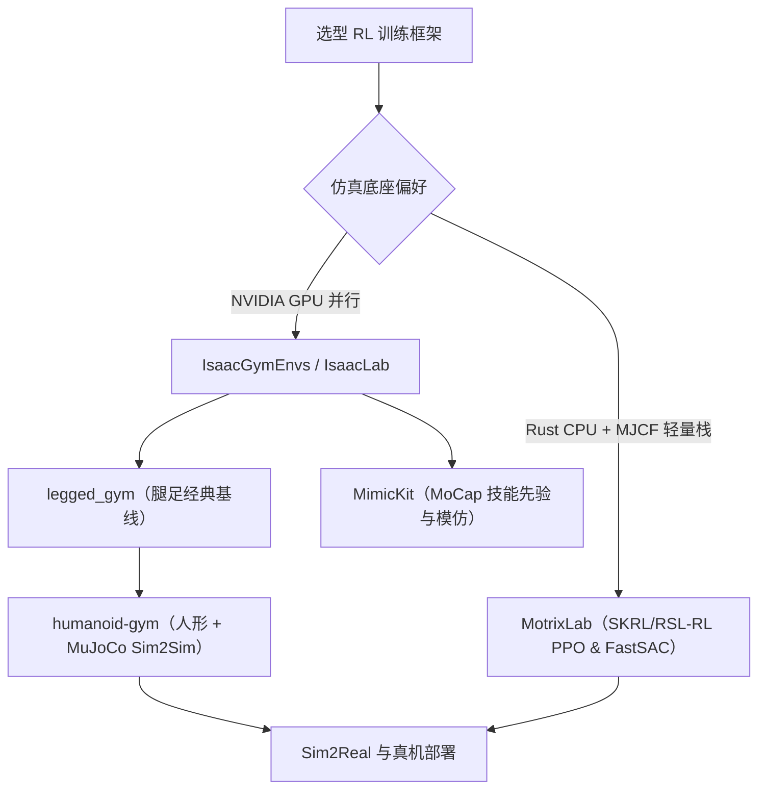

# RL Frameworks（强化学习训练框架导航）

**首屏导读**：本页整理人形与腿足机器人 RL 训练常用开源框架；按「底层物理并行引擎 → 标准行走基线 → 人形专项 / 技能迁移」组织，方便快速对比各框架的仿真依赖与 Sim2Sim/Sim2Real 路线。

## 按问题找框架

| 你的需求 | 优先查看 |
|---|---|
| 大规模 GPU 并行与最新官方维护生态 | [IsaacGym + IsaacLab](../../wiki/entities/isaac-gym-isaac-lab.md) · [Isaac Lab](../../wiki/entities/isaac-lab.md) |
| 快速读懂腿足 RL 最小可运行代码与奖励结构 | [legged_gym](../../wiki/entities/legged-gym.md) |
| 人形步态相位奖励 + MuJoCo Sim2Sim 验证 | [humanoid-gym](../../wiki/entities/humanoid-gym.md) |
| 动捕导入、重定向与 AMP/ASE 技能迁移 | [MimicKit](../../wiki/entities/mimickit.md) |
| 轻量高性能 CPU/MJCF 生态 + FastSAC（JAX/PyTorch） | [Motrix](../../wiki/entities/motrix.md) |

## 选读路径 / Reading Path

## 核心框架

### IsaacGym + IsaacLab

- **IsaacGymEnvs** — NVIDIA GPU 并行 RL 训练底座，适合大规模并行仿真
- **IsaacLab** — IsaacGym 的下一代，支持更复杂场景和人形机器人
- [NVIDIA Isaac Gym](https://developer.nvidia.com/isaac-gym)

### legged_gym

- 四足/人形腿式机器人 RL 训练框架，基于 IsaacGym
- 学走路、跑、越障的标准起点
- [leggedrobotics/legged_gym](https://github.com/leggedrobotics/legged_gym)

### humanoid-gym

- 人形机器人 RL 专用，基于 IsaacGym + legged_gym 范式
- 步态相位奖励、非对称 AC、MuJoCo sim2sim；XBot 零样本 sim2real（[arXiv:2404.05695](https://arxiv.org/abs/2404.05695)）
- [roboterax/humanoid-gym](https://github.com/roboterax/humanoid-gym)；社区 fork [roboman-ly/humanoid-gym-modified](https://github.com/roboman-ly/humanoid-gym-modified)（Pandaman + Gazebo）
- Wiki：[humanoid-gym](../../wiki/entities/humanoid-gym.md)

### MimicKit

- 模仿学习 + 技能迁移框架
- 支持 MoCap 数据导入和重定向
- [Stanford HAI Lab](https://motion.stanford.edu/research/mimickit)

### MotrixLab

- **MotrixLab** — 基于 MotrixSim (Rust) 的通用机器人训练平台
- 支持 SKRL / RSL-RL PPO 与自研 **FastSAC**；JAX 与 PyTorch 后端
- 内置 Microduck 行走与 **`microduck-ball-balance`**（蹬篮球平衡，FastSAC 约 5–10 min demo）
- [Motphys/MotrixLab](https://github.com/Motphys/MotrixLab)
- Wiki：[motrix](../../wiki/entities/motrix.md)、[microduck-ball-balance](../../wiki/tasks/microduck-ball-balance.md)

## 参考来源与收录边界

- [sources/repos/isaac_lab.md](../../sources/repos/isaac_lab.md) — Isaac Lab 官方仓库与版本归档
- [leggedrobotics/legged_gym](https://github.com/leggedrobotics/legged_gym)
- [roboterax/humanoid-gym](https://github.com/roboterax/humanoid-gym)
- [Motphys/MotrixLab](https://github.com/Motphys/MotrixLab)
- 框架安装环境要求与详细运行步骤请以对应 `wiki/entities/` 页面为准。

## 关联页面

- [isaac-gym-isaac-lab](../../wiki/entities/isaac-gym-isaac-lab.md) — Isaac Gym 实体页
- [legged-gym](../../wiki/entities/legged-gym.md) — legged_gym 实体页
- [humanoid-gym](../../wiki/entities/humanoid-gym.md) — 人形 RL 训练框架实体页
- [motrix](../../wiki/entities/motrix.md) — Motrix 实体页
- [simulation](simulation.md) — 仿真平台层
- [Humanoid Environments](../benchmarks/humanoid-environments.md)
