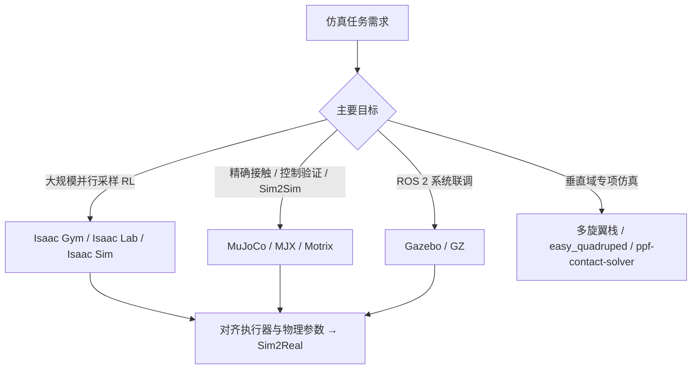

# 仿真平台与工具链

**首屏导读**：按用途整理的仿真与训练平台入口。若需理解仿真在控制—学习—部署链中的位置，见 [仿真（系统集成层）](../../tech-map/modules/system/simulation.md)。

## 按需求选仿真器

| 你的使用场景 | 优先查看 |
|---|---|
| 接触求解精细、控制器调试、Sim2Sim 验证或浏览器 WASM 演示 | [MuJoCo](../../wiki/entities/mujoco.md) · [MuJoCo WASM](../../wiki/entities/mujoco-wasm.md) · [dm_control](../../wiki/entities/dm-control.md) |
| GPU 大规模并行强化学习与渲染传感器仿真 | [Isaac Lab](../../wiki/entities/isaac-lab.md) · [Isaac Sim](../../wiki/entities/isaac-sim.md) · [Isaac Gym](../../wiki/entities/isaac-gym.md) |
| 轻量 MJCF 兼容 Rust CPU 引擎与快速 SAC Demo | [motrix](../../wiki/entities/motrix.md) |
| 传统 ROS/ROS 2 中间件集成与多传感器场景 | [Gazebo / GZ](../../wiki/entities/gazebo-sim.md) |
| 仿真器选型对比与物理保真度边界 | [仿真器选型指南](../../wiki/queries/simulator-selection-guide.md) |

## 选读路径 / Reading Path

## 平台分类入口

### 通用物理仿真与 GPU 并行底座

- [MuJoCo](../../wiki/entities/mujoco.md)（含浏览器 [MuJoCo WASM](../../wiki/entities/mujoco-wasm.md) 绑定）；连续控制基准与 Python 工具链见 [dm_control](../../wiki/entities/dm-control.md)
- [Isaac Gym](../../wiki/entities/isaac-gym.md)
- [Isaac Lab](../../wiki/entities/isaac-lab.md)
- [Isaac Sim](../../wiki/entities/isaac-sim.md)
- **[motrix](../../wiki/entities/motrix.md)** — Motphys 开发的高性能 Rust CPU 仿真引擎，兼容 MJCF

### ROS 系统集成与传统仿真

- [Gazebo / GZ](../../wiki/entities/gazebo-sim.md) — ROS/ROS 2 生态标准仿真后端

### 领域专项与高保真求解器

- **[multirotor-simulation-planning-control-stack](../../wiki/overview/multirotor-simulation-planning-control-stack.md)** — PX4 / AirSim / Flightmare / XTDrone / gym-pybullet-drones 等多旋翼仿真—规划—飞控栈（[catalog](../../sources/repos/multirotor_uav_stack_catalog.md)）
- **[easy_quadruped](../../wiki/entities/easy-quadruped.md)** — Pupper 步态控制 + MuJoCo 浮动机身闭环（[sources/repos/easy_quadruped.md](../../sources/repos/easy_quadruped.md)）
- **[ppf-contact-solver](../../wiki/entities/ppf-contact-solver.md)** — ZOZO GPU shell/solid/rod FEM+接触离线仿真（布料/软体高保真，非 RL 实时环）

## 参考来源与收录边界

- [sources/papers/simulation_tools.md](../../sources/papers/simulation_tools.md) — 仿真平台对比归档。
- [sources/repos/mujoco-menagerie.md](../../sources/repos/mujoco-menagerie.md) — MuJoCo 官方机器人资产库归档。
- [sources/repos/isaac_lab.md](../../sources/repos/isaac_lab.md) — Isaac Lab 仓库归档。
- [sources/repos/multirotor_uav_stack_catalog.md](../../sources/repos/multirotor_uav_stack_catalog.md) — 多旋翼仿真栈目录。
- 各仿真器的物理引擎假设与性能基准见对应 `wiki/entities/` 及 [仿真器选型指南](../../wiki/queries/simulator-selection-guide.md)。

## 关联页面

- [仿真（系统集成层）](../../tech-map/modules/system/simulation.md)
- [Sim2Real](../../wiki/concepts/sim2real.md)
- [RL Frameworks](rl-frameworks.md)
- [人形训练环境](../benchmarks/humanoid-environments.md)
- [仿真器选型指南](../../wiki/queries/simulator-selection-guide.md)
