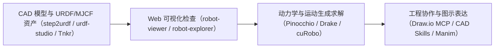

# Utilities（通用机器人工具链）

**首屏导读**：收录动力学计算、模型可视化、CAD/URDF 转换与工程辅助等通用工具链；按「动力学与控制计算 → Web 端可视化 → 设计工作站 → Agent 辅助图示与 CAD」分类，所有条目均链向站内独立实体页以核对安装入口与使用边界。

## 按用途找工具

| 你想解决的工程问题 | 优先查看 |
|---|---|
| 刚体动力学、解析导数与 GPU 无碰撞运动生成 | [Pinocchio](../../wiki/entities/pinocchio.md) · [Drake](../../wiki/entities/drake.md) · [cuRobo](../../wiki/entities/curobo.md) |
| 浏览器内免安装查看 URDF/MJCF/USD 与运动学检查 | [robot-viewer](../../wiki/entities/robot-viewer.md) · [robot-explorer](../../wiki/entities/robot-explorer.md) |
| 从 STEP/CAD 导出 URDF 并管理整机组装清单 | [step2urdf](../../wiki/entities/step2urdf.md) · [urdf-studio](../../wiki/entities/urdf-studio.md) · [Tnkr](../../wiki/entities/tnkr.md) |
| 用自然语言/Agent 生成技术架构图、CAD 或讲解动画 | [Next AI Draw.io](../../wiki/entities/next-ai-draw-io.md) · [FreeCAD MCP](../../wiki/entities/freecad-mcp.md) · [Manim](../../wiki/entities/manim.md) |

## 选读路径 / Reading Path

## 工具分类清单

### 动力学与控制计算

- **[Pinocchio](../../wiki/entities/pinocchio.md)**: 高性能刚体动力学库，支持分析导数。
- **RBDL**: 刚体动力学库。
- **[Drake](../../wiki/entities/drake.md)**: 专注于控制、仿真和分析。
- **[cuRobo](../../wiki/entities/curobo.md)**：NVIDIA 开源的 GPU 并行无碰撞运动生成库（初版与 cuRoboV2 论文见实体页）。

### Web 端可视化与分析

- **[robot-explorer](../../wiki/entities/robot-explorer.md)**: 交互式 3D 机器人探索工具，支持运动学分析与可操纵性椭球可视化。
- **[robot-viewer](../../wiki/entities/robot-viewer.md)**: 多格式（URDF/Xacro/MJCF/USD）查看器，集成 MuJoCo WASM 仿真与实时编辑。
- **[Open Duck Mini Viewer](../../wiki/entities/open-duck-mini-viewer.md)**: 浏览器内 Open Duck Mini V2 GUI（脚本步态 + URDF，无 MuJoCo）；在线 [Pages demo](https://mertcookimg.github.io/Open_Duck_Mini_Viewer/)。

### 机器人设计工作站

- **[urdf-studio](../../wiki/entities/urdf-studio.md)**: 专业级 Web 机器人设计与组装平台，支持 Skeleton/Detail/Hardware 全流程管理与 AI 辅助。
- **[step2urdf](../../wiki/entities/step2urdf.md)**: 浏览器端 STEP→URDF 转换；OpenCascade.js 本地解析、几何驱动关节识别与惯量估算，在线版 [step2urdf.top](https://step2urdf.top/)。
- **[Tnkr](../../wiki/entities/tnkr.md)**: 开源整机项目协作平台（CAD/线束/代码/部署一体），对接 GitHub、Onshape 与 AI 助手 Leonardo。

### Agent 驱动的图示与 CAD 桥

- **[Next AI Draw.io](../../wiki/entities/next-ai-draw-io.md)**: Next.js 聊天 + `@next-ai-drawio/mcp-server`；自然语言生成 draw.io XML，浏览器实时预览，Cursor/Claude 一行 npx。
- **[Draw.io Scientific Illustrator](../../wiki/entities/drawio-scientific-illustrator.md)**: Codex 插件；本机 MCP 可见操控 draw.io 画布，逐步重绘可编辑科研插图。
- **[FreeCAD MCP](../../wiki/entities/freecad-mcp.md)**: FreeCAD Addon RPC + MCP server，自然语言驱动桌面 CAD。
- **[HumanLayer Skills](../../wiki/entities/humanlayer-skills.md)**: Claude Code 迭代代理维护环（control-loop 设计、`<important if>` harness、GHA 调度）。
- **[CAD Skills](../../wiki/entities/cad-skills.md)**: build123d STEP-first Agent Skills（CAD/URDF/制造交接）。
- **[Three.js Game Skills](../../wiki/entities/threejs-game-skills.md)**: 浏览器 Three.js 游戏九件套 Agent Skills（导演路由 + Playwright QA + 可选 Tripo/Gemini/ElevenLabs）。
- **[Manim](../../wiki/entities/manim.md)**: Python 程序化数学/技术讲解动画（对外沟通层）。

## 参考来源与收录边界

- [Pinocchio SII 2019 论文通读归档](../../sources/papers/pinocchio_reading_hal_01866228_pin3.md)
- [robot_descriptions.py 仓库归档](../../sources/repos/robot-descriptions-py.md)
- [MIT Underactuated Robotics 课程归档](../../sources/courses/mit_underactuated_robotics.md)
- 本页定位为通用工程工具索引；各工具的 API 边界、许可证与源码入口见对应 `wiki/entities/` 页面。

## 关联页面

- [Whole-Body Control 论文导航](../papers/whole-body-control.md)
- [Simulation 平台与工具链](simulation.md)
- [系统工程与部署枢纽](../../wiki/overview/hub-systems-engineering.md)
- [动力学模块](../../tech-map/modules/robotics/dynamics.md)
