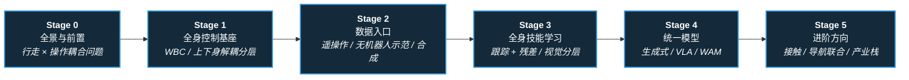

# 移动操作（Loco-Manipulation）

**首屏导读**：

- **为谁**：想让机器人边走边动手（搬箱、开门、端托盘）的人。
- **路径**：Stage 0–5 · 行走 × 操作耦合 → 全身控制基座 → 数据入口 → 全身技能学习 → 统一模型（生成式 / VLA / WAM）→ 进阶方向。
- **纵深路线**：[运动控制主路线](motion-control.md)的一条分支。

## 路线一览

## 这条路径怎么用

- 目标读者是已经分别摸过 locomotion 和 manipulation、想把两者在动力学与控制层面真正耦合起来的人
- 核心心智模型：移动操作不是"行走 + 操作"的简单叠加——手臂运动会干扰质心平衡，步态振动会干扰操作精度，**全身协调层**才是主角
- 每个阶段都有前置知识、核心问题、推荐做什么、推荐读什么、学完输出什么

**和主路线的关系：**
- 本路线是主路线 L4（WBC）与 L5（RL / IL）之后的综合应用方向，对应 L7.3 操作层的全身化扩展
- 上肢精细接触问题在 [接触操作纵深](depth-contact-manipulation.md) 展开，本路线聚焦"移动中的操作"
- 高层语义接口（听懂"把箱子搬到厨房"）依赖 [VLA 纵深](depth-vla.md)，全身行为先验依赖 [BFM 纵深](depth-bfm.md)

---

## Stage 0 全景与前置：行走 × 操作的耦合问题

**先建立问题意识：为什么"独立优化行走和操作再简单合并"通常不可行。**

### 前置知识
- 主路线 L2–L4 水平：理解浮动基动力学、质心动力学与 WBC 的基本概念
- 分别跑过一个 locomotion 策略和一个桌面操作策略（仿真即可）

### 核心问题
- 全身动力学耦合：手臂运动如何干扰质心平衡、步态如何干扰末端精度
- 接触丰富与多约束：足端地形接触与末端物体接触怎么并发管理
- 移动操作任务谱系：家务 / 体育 / 极端环境 / 人机协作各自考验什么能力

### 推荐做什么
- 在仿真里给行走中的人形加一个 2 kg 手持负载，观察不做补偿时的失稳模式
- 读任务页把 2024–2026 技术路线（分层 / 生成式 / VLA / 残差 / 触觉增强）过一遍，画一张自己的分类表

### 推荐读什么

- [ACAP｜单机异步控制组调度](../wiki/entities/paper-acap.md) — 区分同一机器人内的多组并行与多机器人协作；用真机耗时对照，并核对任务失败口径。
- [Heave-Ho｜去中心化长程多人形协作](../wiki/entities/paper-heave-ho-2611-22275.md) — Heave-Ho 把多智能体后训练的身体耦合控制与基于语音的领队—跟随者视觉语言技能规划结合，实现不依赖机器人间网络消息的长时程协作。（原文 arXiv:2611.22275；详见开放和实测边界）。
- [Loco-Manipulation 任务页](../wiki/tasks/loco-manipulation.md) — 本路线的任务地图与技术路线总入口
- [Whole-Body Control](../wiki/concepts/whole-body-control.md) 与 [Whole-Body Coordination](../wiki/concepts/whole-body-coordination.md)
- [Manipulation 任务地图](../wiki/tasks/manipulation.md) 与 [Humanoid Locomotion](../wiki/tasks/humanoid-locomotion.md)
- [ULTRA 统一移动操作综述](../wiki/tasks/ultra-survey.md)

### 学完输出什么
- 能解释移动操作为什么比"行走 + 操作"难，难在哪一层
- 拿到一篇新论文能判断它属于分层、生成式、VLA 还是残差路线

---

## Stage 1 全身控制基座：WBC 与上下身解耦分层

**工程上最常见的第一步：下身管平衡与行走，上身管操作目标，中间用接口解耦。**

### 前置知识
- Stage 0 内容
- [RL 纵深路线](depth-rl-locomotion.md) Stage 0–2 水平：能在仿真里训练 locomotion 策略

### 核心问题
- 经典分层（HLC 给末端目标 + LLC 全身执行）与端到端全身策略的取舍
- HOMIE / FALCON 一系上下身解耦的接口设计：上身关节目标 + 下身速度/姿态命令
- 感知怎么进低层：高程图 / 深度如何让 LLC 在楼梯与非结构化地形上稳住操作（PILOT）
- 力交互场景（推重物、拖拽）下 MPC 与 RL 怎么组合

### 推荐做什么
- 复现一个上下身解耦的开源工作（如 HOMIE 思路）：下身 RL 行走 + 上身关节直接跟踪
- 对比"上身固定 / 上身随机动作"两种课程下，下身策略的抗扰能力

### 推荐读什么
- [Humanoid Hanoi：共享 WBC 的长程技能组合](../wiki/entities/paper-notebook-humanoid-hanoi-investigating-shared-whole-body-c.md) — Stage 1 的统一低层控制接口与技能交接故障诊断；七次搬箱 DR 仿真 Extended 47%、Digit V3 真机 6/15，官方只开源基准环境。
- [FORGE：力感知多粒度移动操作](../wiki/entities/paper-forge-force-aware-loco-manipulation.md) — 速度/足端/双腕/载荷命令与冻结 locomotion 先验的残差协调。
- [PolyMorphWBC：跨臂形态四足移动操作](../wiki/entities/paper-polymorphwbc-quadruped.md) — 用末端轨迹预览自动协调底座与机械臂 IK。
- [HOMIE](../wiki/entities/paper-loco-manip-161-040-homie.md) 与 [FALCON](../wiki/entities/paper-loco-manip-161-109-falcon.md) — 上下身解耦锚点
- [PILOT](../wiki/entities/paper-pilot-perceptive-loco-manipulation.md) — 感知统一低层 LLC
- [AGILE](../wiki/entities/paper-agile-humanoid-loco-manipulation.md) — NVIDIA Isaac Lab + RSL-RL 全生命周期工作流（Prepare→Train→Evaluate→Deploy），描述符驱动 Sim2Sim/真机 I/O；G1 与 Booster T1 双机验证 locomotion/recovery/motion imitation/loco-manipulation 五类技能，上身专家微调 GR00T N1.5 仿真闭环 pick&place 90%；已开源
- [运动基座与全身跟踪（loco-manip 161 分类）](../wiki/overview/loco-manip-161-category-01-motion-base-wbt.md) 与 [上身接口](../wiki/overview/loco-manip-161-category-02-upper-body-interface.md)
- [HTD 解耦 WBC](../wiki/entities/paper-humanoid-touch-dream.md)（CMU/UTA/Bosch，IROS 2026）— [Humanoid Touch Dream](../wiki/entities/paper-humanoid-touch-dream.md) 的下肢+腰控制器实现：Isaac Lab 单 GPU 训 teacher，再 BC→DAgger 蒸馏出可部署 student，跟踪速度与极端躯干姿态并零样本落到 G1；把"上下身解耦"从接口图落成可跑代码（BSD-3-Clause 已开源），VR 遥操作与上层 HTD 策略仍待发布
- [Agility WBC Foundation Model（Motor Cortex）](../wiki/entities/agility-wbc-foundation-model.md) — 面向物流搬运的闭源 WBC 接口样本：用自由空间 SE(3) 手/躯干目标 + 根位置跟踪（而非关节角或纯速度）驱动 `<1M` LSTM，配合全工作空间均匀采样支撑 23 kg 级重物抗扰与迈步复原
- [MPC-WBC 集成](../wiki/concepts/mpc-wbc-integration.md)

### 学完输出什么
- 一个"下身行走 + 上身跟踪"的分层全身控制 demo
- 能说清解耦接口（关节 / 末端 / 速度命令）各自的表达力边界

---

## Stage 2 数据入口：遥操作、无机器人示范与合成数据

**移动操作的数据比桌面操作贵一个量级：全身遥操作、可穿戴采集与合成生成是三大入口。**

### 前置知识
- Stage 1 内容

### 核心问题
- 全身遥操作的方案谱系：外骨骼 / VR / 动捕，各自的带宽与成本
- 无机器人示范（UMI 一系、可穿戴设备）怎么绕过昂贵的真机采集
- 合成数据路线：单条演示怎么扩成千条轨迹（HumanoidMimicGen）、3DGS 合成怎么替代遥操作（LEGS）
- 人类视频（egocentric）到机器人动作的映射还差什么

### 推荐做什么
- 用键盘 / VR 在仿真里遥操作一个人形完成"走过去 + 拿起箱子"，感受接口带宽瓶颈
- 读 HumanoidMimicGen 的技能片段适配管线，画出"1 条演示 → 1000 条轨迹"的数据流图

### 推荐读什么
- [EgoLoAF](../wiki/entities/paper-egoloaf.md) — 从胸前手机视频重建躯干与手部动作，无需穿戴式运动跟踪；查看动作监督、显式手物条件与人时对照的边界。
- [Teleoperation 任务页](../wiki/tasks/teleoperation.md)
- [数据与遥操作（loco-manip 161 分类）](../wiki/overview/loco-manip-161-category-07-data-teleop.md) 与 [Loco-Manip 8 篇数据入口技术地图](../wiki/overview/loco-manip-8-papers-technology-map.md)
- [HumanoidMimicGen](../wiki/entities/paper-humanoidmimicgen.md) 与 [LEGS](../wiki/entities/paper-legs-embodied-gaussian-splatting-vla.md)
- [HumanX：XGen + XMimic](../wiki/entities/paper-hrl-stack-05-humanx.md) — 从单目人类视频重定向并合成锚点-物体交互数据，基于 PPO/DAggerBC 学全身交互；官方有 XGen 编辑器与 XMimic 仿真代码，完整真机部署仍需自建。
- [SUGARv2：合成交互参考驱动的视觉全身操作](../wiki/entities/paper-sugarv2-humanoid-interaction-reference.md) — 无初始遥操作示范，用任务模板生成机器人—物体轨迹与手部接触标签；对比本阶段的演示扩增路线（论文 §3.2）
- [HALOMI](../wiki/entities/paper-halomi-humanoid-loco-manipulation.md) — 主动感知 + 无机器人示范
- [HALO：人机对齐的全身移动操作示教](../wiki/entities/paper-halo-2611-16439.md) — Stage 2 有机器人示教分支：在采集时保留底盘非完整运动约束，联合训练双臂与底盘速度，和 HALOMI 无机器人路径互为对照

### 学完输出什么
- 能为给定预算（有 / 无真机、有 / 无动捕）选出可行的数据采集方案
- 一份自己任务上的数据入口对比笔记（遥操作 / 无机器人示范 / 合成）

---

## Stage 3 全身技能学习：跟踪 + 残差与视觉分层

**有了数据和基座，怎么把"搬箱子、开门"这类全身技能真正学出来并迁移到真机。**

### 前置知识
- Stage 2 内容
- [模仿学习纵深](depth-imitation-learning.md) Stage 2–3 水平（retargeting 与 Diffusion Policy）

### 核心问题
- 预训练全身先验 + 物体条件残差（ResMimic）为什么比从零训任务策略高效
- 视觉分层 sim2real（VisualMimic）：关键点跟踪低层 + 深度 visuomotor 高层怎么切
- 负载与动力学变化怎么在线适配（SplitAdapter 的因子化 latent）
- 全身模仿的数据侧技巧：上身全库 + 下身精选库（CWI）解决什么问题

### 推荐做什么
- 在开源全身跟踪基座（GMT / SONIC 类）上加一个物体条件残差任务，跑通仿真搬箱
- 逐项消融：去掉预训练先验、去掉残差、去掉物体观测，记录哪个环节掉点最狠

### 推荐读什么
- [PushMimic：自适应人形推箱](../wiki/entities/paper-pushmimic.md) — 动态参考增强与单阶段蒸馏；跑台验证仍需动捕与改装平掌。
- [ResMimic](../wiki/entities/paper-resmimic.md) 与 [VisualMimic](../wiki/entities/paper-notebook-visualmimic.md)
- [SUGARv2：合成参考 → 特权教师 → 视觉学生](../wiki/entities/paper-sugarv2-humanoid-interaction-reference.md) — 以共同的 reference-based mimic 奖励连接教师训练、蒸馏和 PPO；注意五任务策略分别训练（论文 §3.3、§4.1）
- [CWI](../wiki/entities/paper-cwi-composite-humanoid-whole-body-imitation.md) 与 [CoorDex](../wiki/entities/paper-coordex-dexterous-humanoid-loco-manipulation.md)
- [SplitAdapter](../wiki/entities/paper-splitadapter-load-aware-loco-manipulation.md)
- [Whole-Body Tracking Pipeline](../wiki/concepts/whole-body-tracking-pipeline.md)
- [SMPC-to-RL](../wiki/entities/paper-smpc2rl-loco-manipulation.md) — 仿真 SMPC 当可交互专家数据机，稀疏奖励 offline-to-online FastTD3 接冻结低层；Spot 推箱/扶胎与 G1 推箱真机可部署，策略比教师更快
- [FetchMan](../wiki/entities/paper-fetchman.md) — MolmoSpaces 15 万场景脚本演示 → BC → Flow-GRPO 突破 BC 天花板；G1 真机 loco-manip 零样本 73.3%；GitHub 占位仓（2026-09-01 前补代码）
- [OCLO](../wiki/entities/paper-oclo-online-posture-compliant-loco-manipulation.md) — 不用人体动作数据：从双末端目标在线生成骨盆/躯干姿态，并以力反馈参考偏移实现全身顺应
- [ResGAC](../wiki/entities/paper-resgac-precise-se3-end-effector-tracking.md) — 几何导纳控制（GAC）的 SE(3) 末端跟踪先验 + 残差 RL，G1 上协调手臂/腿/腰；站立插孔成功率 90%
- [RoboDuet](../wiki/entities/paper-roboduet-loco-manipulation.md) — locomotion 与 arm 两个协作策略控制带臂四足，移动中追踪末端 6D 位姿，并验证跨相近四足平台零样本迁移
- [WholeBodyMem](../wiki/entities/paper-wholebodymem.md) — 给人形 VLA 加对象引导的关键帧记忆，保留目标达成前事件，服务动态 loco-manipulation

### 学完输出什么
- 一个能在仿真里完成"走近 + 全身接触搬运"的技能策略
- 对"先验 + 残差"与"从零端到端"两条路线的成本收益判断

---

## Stage 4 统一模型：生成式、VLA 与 WAM

**前沿主战场：把视觉、语言和全身动作放进一个模型，或用世界模型联合预测未来与动作。**

### 前置知识
- Stage 3 内容
- [VLA 纵深](depth-vla.md) Stage 2 水平（知道 VLA 的三段式结构）

### 核心问题
- 统一生成式路线（diffusion / flow matching 全身序列）与分层路线的边界在哪
- 移动操作 WAM 怎么把"预测未来"与"移动 / 操作双动作头"联合（ABot-M0.5、MotionWAM）
- 统一全身 motion token 为什么能让腿执行任务驱动行为（踩踏板、踢球）
- VLA 扩展到全身移动操作还缺什么（数据、频率、安全）

### 推荐做什么
- 读 MotionWAM / ABot-M0.5 的架构图，标出"世界预测"与"动作生成"的信息流交汇点
- 用一个开源 VLA 在移动操作仿真基准（RoboCasa 类）上跑评测，记录失败模式

### 推荐读什么

- [WAM-Policy：四足前腿世界动作模型](../wiki/entities/paper-wam-policy.md) — 机械臂 WAM 跨形态迁移并经在线蒸馏和 RL 专家改进。
- [PGX：物理谓词阶段编排 + VLA 技能 + WCL](../wiki/entities/paper-pgx-2611-26596.md) — Stage 4 的分层执行对照：保持 VLA 权重不变，用真实物理事件守卫任务阶段并在世界系稳定站位/接触点；注意其不替代低层 WBC。
- [Awaken-HI：原人体运动 + 机器人动作共享专家](../wiki/entities/paper-awaken-hi.md) — Stage 4 的全身 40D VLA：50K h 人类预训练 + 150 h T800 后训练、八任务均值 93.75%（作者报告）；目前无可运行代码/权重。
- [WEVO：G1 全身 VLA 的部署域视频 WM 后训练](../wiki/entities/paper-wevo-world-model-enabled-vla-loco-manipulation.md) — 用仿真初始化、接触/行走 play 与少量真实自主轨迹校准 WM，SONIC–MuJoCo 执行全身目标；DICE-RL 在视频 WM 中后训练，三任务真机平均成功率 75.0%。
- [DiPLO：自蒸馏扩散全身搬运规划](../wiki/entities/paper-diplo-self-distilled-diffusion-planning.md) — 先用 SBTO 动态可行轨迹训练 DiT + RL 跟踪器，再经 SD:DPO 去除 IK 先验依赖、DA:PPO 对齐物体目标；Stage 4 的生成式全身规划代表。
- [VLA 与世界模型（loco-manip 161 分类）](../wiki/overview/loco-manip-161-category-09-vla-world-models.md)
- [MotionWAM](../wiki/entities/paper-motionwam-humanoid-loco-manipulation-wam.md) 与 [ABot-M0.5](../wiki/entities/paper-abot-m05-mobile-manipulation-wam.md)
- [Rhoda Mobile DVA](../wiki/entities/rhoda-direct-video-action.md#mobile-dva2026-11-03-统一移动与操作扩展) — 非人形移动底盘 + 机械臂共享因果视觉未来并统一解码动作的产业样本；公司自报短数据迁移与目标桌混淆失效，未提供代码/权重。
- [ω-0](../wiki/entities/paper-omega-0.md) — 潜空间未来观测 embedding 驱动的人形并发 loco-manipulation Joint WAM，G1 上 11 任务 Omni 成功率 81.8%；代码、数据与预训练检查点入口已公开，运行仍依赖外部模型资产（[官方 README](https://github.com/gentlefress/Omega-0/tree/2ca35a3ff9363c54c9c206ca101cdf58028824cb)）
- [CHAMP：全身运动先验与跨层动作专家](../wiki/entities/paper-champ-2611-30449.md) — 异构身体/手部运动预训练，SONIC 闭环回放接地后微调 CAE；读 §4.4 区分运动先验、控制接口与特征选层的作用。
- [Kimodo-Policy](../wiki/entities/paper-kimodo-policy.md) — 运动学生成骨干接视觉条件与实测历史，再由 SONIC 执行的 VLA 路线；与 WAM 对比时先检查是否显式预测世界后果，参见 [动作生成 Stage 4](depth-motion-generation.md)
- [HITCH：主动感知 + 分身体部位命令 + 学习型全身跟踪](../wiki/entities/paper-hitch.md) — 本 Stage 的**分层 Agent 基线**，不是端到端 VLA 或显式预测未来的 WAM；用仿真教师的五类基础任务轨迹训练 VLM 调用接口，真机 G1 搬箱 13/20、导航 6/10。比较时须对齐作者调整过的相机、任务指令与时限。
- [World Action Models（WAM）](../wiki/concepts/world-action-models.md) 与 [VLA](../wiki/methods/vla.md)
- [人形 Loco-Manip 161 篇技术地图](../wiki/overview/humanoid-loco-manip-161-papers-technology-map.md) — 十类能力形成顺序全景
- [RoboReact](../wiki/entities/paper-roboreact.md) — 单帧 egocentric RGB-D + 语言生成人类交互视频并编译成物体中心关键帧技能，测试时去掉 VLM 靠再接地 + HOMIE 执行；G1 长程双臂操作四任务均值 SR 81.3%
- [HAF](../wiki/entities/paper-haf-humanoid-vla-adaptation.md) — 三阶段层次 action flow + DCT 频谱潜空间 SAC，把通才 flow-matching VLA 适配到天工全身 loco-manipulation；均分 70.5%，超 π₀.₅（53.3%）与 GR00T N1.7（38.1%）
- [VioLA](../wiki/entities/paper-viola-human-data-control.md) — 配对 human/robot 动作编码器建共享潜空间，策略预测身体与手部运动潜变量、冻结控制器执行（G1 locomotion 100%、manipulation 88.6%）

### 学完输出什么
- 能画出"分层 / 生成式 / VLA / WAM"四条路线的架构对比图
- 一份移动操作基准上的 VLA 评测与失败模式分析

---

## Stage 5 进阶方向

### 前置知识
- Stage 4 内容

**方向 A：接触丰富的全身交互**
- 从"搬规则箱子"到倚靠、翻越、多点接触交互
- 关键词：[Loco-Manip 接触五段链路技术地图](../wiki/overview/loco-manip-contact-technology-map.md)、[接触操作纵深路线](depth-contact-manipulation.md)

**方向 B：导航–操作联合**
- 开放词汇移动操作（OVMM）：导航到哪、以什么姿态到，直接决定操作成败
- 关键词：[3D-IC](../wiki/entities/paper-3d-ic-joint-navigation-manipulation-planning.md)、[导航纵深路线](depth-navigation.md)

**方向 C：触觉与力觉增强**
- 把接触信号纳入全身策略，而不是只靠视觉与本体感受
- 关键词：[Humanoid Transformer with Touch Dreaming](../wiki/methods/humanoid-transformer-touch-dreaming.md)、[视触融合](../wiki/concepts/visuo-tactile-fusion.md)

**方向 D：产业级长程自主栈**
- 跟踪工业界把移动操作串成长时程任务的整机方案
- 关键词：[Flexion Reflect v1.0](../wiki/entities/flexion-reflect-v1.md)、[Curr-0](../wiki/entities/current-robotics-curr0.md)

---

## 快速入口汇总

| 阶段 | 核心问题 | 知识页入口 |
|------|---------|-----------|
| Stage 0 | 行走 × 操作耦合 | [Loco-Manipulation 任务页](../wiki/tasks/loco-manipulation.md) |
| Stage 1 | 全身控制基座 | [HOMIE](../wiki/entities/paper-loco-manip-161-040-homie.md) |
| Stage 2 | 数据入口 | [Loco-Manip 8 篇数据入口技术地图](../wiki/overview/loco-manip-8-papers-technology-map.md) |
| Stage 3 | 全身技能学习 | [ResMimic](../wiki/entities/paper-resmimic.md) |
| Stage 4 | 统一模型 | [人形 Loco-Manip 161 篇技术地图](../wiki/overview/humanoid-loco-manip-161-papers-technology-map.md) |
| Stage 5 | 进阶方向 | [Loco-Manip 接触五段链路技术地图](../wiki/overview/loco-manip-contact-technology-map.md) |

## 和其他页面的关系

- 完整成长路线参考：[主路线：运动控制 → 物理智能全栈成长路线](motion-control.md)
- 相关纵深路线（按主题邻近，完整目录见 [路线总览](motion-control.md#depth-optional-index)）：
  - [RL 运动控制](depth-rl-locomotion.md) — 行走底座
  - [接触操作](depth-contact-manipulation.md) — 操作侧的接触力与 IL
  - [遥操作](depth-teleoperation.md) — 上下身解耦采集的常见入口
  - [导航](depth-navigation.md) — 到点移动与全身协调的交界

## 参考来源

- [Loco-Manipulation 任务页](../wiki/tasks/loco-manipulation.md) 与 [人形 Loco-Manip 161 篇技术地图](../wiki/overview/humanoid-loco-manip-161-papers-technology-map.md)
- "Coordinating Locomotion and Manipulation of a Mobile Manipulator" (Yamamoto & Yun, 1994) — 移动操作协调控制起点
- "HOMIE: Humanoid Loco-Manipulation with Isomorphic Exoskeleton Cockpit" (2025) — 上下身解耦与遥操作数据入口代表
- "ResMimic: Residual Learning for Whole-Body Loco-Manipulation" (2025, arXiv:2510.05070) — 先验 + 残差路线代表
