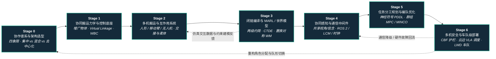

# 双/多机器人协作（Multi-Robot Collaboration）

**首屏导读**：

- **为谁**：想系统打通双机/多机物理闭链搬运、双足/移动操作臂协作用力与协调、MARL/多本体 VLA、协同感知与通信同步、任务分配规划，直至千机集群与真机车队安全部署的研究者与工程师。
- **路径**：Stage 0（协作谱系与架构选型）→ Stage 1（协同搬运力学与全身控制底座）→ Stage 2（双/多机搬运与互作用代表系统）→ Stage 3（闭链可组合动力学、MARL 与多体世界模型）→ Stage 4（协同感知、共享信念与通信中间件）→ Stage 5（神经符号任务规划与编队轨迹优化）→ Stage 6（安全护栏、云边 VLA 调度与车队落地）。
- **纵深路线**：衔接 [运动控制主路线](motion-control.md)，聚焦“**超过一台物理机器人如何共同完成紧/松耦合协作任务**”，并与 [移动操作 / Loco-Manipulation](depth-loco-manipulation.md)、[接触丰富操作](depth-contact-manipulation.md)、[人形集群表演](depth-humanoid-swarm-performance.md)、[人形足球](depth-humanoid-soccer.md) 与 [安全控制](depth-safe-control.md) 明确分工。

## 路线一览

## 这条路径怎么用

- **定位清晰**：本路线专攻**多台具备独立计算/执行/底座的机器人本体之间**如何通过物理接触、视觉耦合或网络协作完成共同目标；不把单机自身左右臂的闭链协同（见下述边界）混作主干，同时在力学公式上复用了阻抗/全身控制底座。
- **全节点 100% 满健康度保障**：本路线 7 个学习阶段挂载的 67 个核心概念、方法、对比与实体节点全部完成一手来源核对与完整骨架建设，可放心作为研究检索与工程架构选型手册顺次推进。
- **阅读策略**：
  - 做**双足/移动臂物理共载与搬运**的工程师重点精读 **Stage 0–3**（尤其增广物体力学、`decMHT`、`SAI`、`CHORUS`、`RoboCompiler-Humanoids`）；
  - 做**大规模机群编队、异构车队调度与云边部署**的团队重点精读 **Stage 0 & Stage 4–6**（聚焦共享信念、`ROS 2/DDS/LCM`、PDDL 神经符号调度、CBF 安全滤波及 `LWD`/`Robion` 车队管线）。

**和其他纵深路线的明确边界：**
- **vs [移动操作（Loco-Manipulation）](depth-loco-manipulation.md)**：移动操作纵深解决**单台机器人**边走边伸臂作业的质心–机械臂耦合；本路线研究当两台或多台移动操作臂/人形同时抓持同一物体或共享工作区时产生的**跨机闭链内力与多智能体分布偏移**。
- **vs [接触丰富操作（Contact-Rich Manipulation）](depth-contact-manipulation.md)**：接触丰富操作聚焦**单台或固定双臂机械臂**在毫米级装配、力位混合与触觉反馈下的交互；本路线仅引用其阻抗与力控底座，主战场移至跨机共享负载与多移动体碰撞耦合。
- **vs [人形集群舞蹈与协同表演](depth-humanoid-swarm-performance.md)** 与 **[人形足球](depth-humanoid-soccer.md)**：群舞和足球分别是多机协作为“轨迹齐步/时间艺术”和“对抗博弈”的垂直场景特化；本路线抽提出跨行业通用的**协同搬运、非对称学习、通信异步、多机规划与车队级工程闭环**骨架。
- **vs [安全控制（Safe Control）](depth-safe-control.md)**：安全控制纵深展开控制障碍函数（CBF）、安全滤波器与状态机的单机/通用理论推导；本路线仅在 Stage 5–6 重点对接它们如何防止多机挤压失稳、互相踩踏与通信断线误放行。

---

## Stage 0 协作谱系定义、架构分型与任务分配：先画清耦合与通信边界

**上马双/多机项目最常踩的坑，是用错了架构层——把只需要低频任务分区的任务硬做成全状态集中编译，或者用零通信视觉策略去硬杠微秒级闭链同步挤压。**

### 前置知识
- 掌握单台移动操作臂或双足机器人的基本动力学与控制概念（[主路线](motion-control.md) L1–L3 即可）
- 理解部分可观测（POMDP）与单机强化学习/模仿学习基础流程

### 核心问题
- **物理耦合 × 通信预算四象限如何划分？** 区分“松散空域避碰 → 顺序交接/共享空间 → 双体物理互作用 → 强闭链共载搬运”四级紧密度；哪几层能靠局部感知自愈，哪几层必须用显式协同总线
- **MRTA（多机器人任务分配）形式化边界**：Gerkey & Matarić (2004) 经典三轴（单/多任务机器 `ST/MT` × 单/多机任务 `SR/MR` × 瞬时/长时程分配 `IA/TA`）如何锁定你的调度复杂度
- **集中式 vs CTDE 混合 vs 纯去中心化如何选型？** 为什么全队状态拼接的集中式 `π₀.₅` VLA 反而会掉成功率，而单机各自模型在牵手切步侧步时却第 1 周期就摔倒
- **从自然语言到多机可验证执行计划的契约边界**：类型检查通过、局部节点回报完成，距离全队真实空间到达还有哪些隐式断层

### 推荐读什么
- [多机器人协作（Multi-Robot Collaboration）](../wiki/concepts/multi-robot-collaboration.md) — 概念总枢纽：五层协作谱系、两大支柱问题与工程避坑清单
- [人形多机协调（Humanoid Multi-Robot Coordination）](../wiki/concepts/humanoid-multi-robot-coordination.md) — 人形双足动态平衡制约下的通信带宽与协调模式分析
- [多机器人协同架构对比](../wiki/comparisons/multi-robot-coordination-architectures.md) — 全集中编译 / 轻量总线 CTDE / 零通信纯去中心化三路权衡表
- [Correctness Boundaries of Typed Plans](../wiki/entities/paper-typed-plans-fleet-control.md) — 20 机仿真上拆解“类型化任务分配 → MAPF → 真机位姿完成度”的契约落差

### 推荐做什么
- 针对你手头的场景填写一张《两机/多机协同边界表》：明确负载是否刚性接触、通信允许延迟上限（`<5 ms` / `<100 ms` / 无通信）、以及队友被遮挡时的退化保护策略

### 学完输出什么
- 一张清晰的**系统架构与通信预算选型说明**，在写第一行训练或控制代码前锁死物理耦合与信息共享边界

---

## Stage 1 协同搬运与物理闭链耦合底座：先把“别把队友扯翻”吃透

**当两台以上机器人的末端夹持同一个箱子或彼此牵手时，开放树动力学瞬间坍缩为闭合运动链（closed kinematic chain）——高增益位置跟踪误差会直接转化成致命的互扯内力。**

### 前置知识
- 刚体静力学与正逆动力学基础（[浮动基动力学](../wiki/concepts/floating-base-dynamics.md)）
- 理解单臂末端力控与柔顺阻抗概念

### 核心问题
- **增广物体模型（Augmented Object）与虚拟连杆（Virtual Linkage）**：Khatib (1996) 如何把多臂惯量直接累加到负载刚体惯量 $\Lambda_\oplus = \Lambda_o + \sum \Lambda_i$ 上，并用 Virtual Linkage 正交解耦“驱动运动的合力偶”与“只夹不动的零净运动内力”
- **去中心化力–位混合（无需关节广播的主从协同）**：为什么从机仅靠腕力传感器/零运动约束刚度即可按分配比例 $\alpha_i$ 分担负载，而不必高速广播队友全部关节角
- **浮动基与质心动力学耦合**：当搬运负载来自双足人形（Digit/G1）而非轮式底盘时，上肢施加的物体切向推拉力如何直接改写足底摩擦锥、质心线动量与角动量平衡
- **局部柔顺阻抗与安全落脚点调节**：如何在不重训底盘的前提下，通过阻抗、力位混合与全身协同（WBC）吸收闭链制造与定位偏差

### 推荐读什么
- [协同物体搬运（Collaborative Object Transport）](../wiki/concepts/collaborative-object-transport.md) — 刚体/柔体/晃动/交接四大协同搬运分型与力学解耦图
- [Loco-Manipulation](../wiki/tasks/loco-manipulation.md) 与 [双臂操作（Bimanual Manipulation）](../wiki/tasks/bimanual-manipulation.md) — 移动底座与闭链双末端耦合任务基线
- [阻抗控制（Impedance Control）](../wiki/concepts/impedance-control.md) · [力控基础（Force Control Basics）](../wiki/concepts/force-control-basics.md) · [力位混合控制](../wiki/concepts/hybrid-force-position-control.md) — 吸收机间位姿差而不炸坏结构的力控核心
- [接触动力学（Contact Dynamics）](../wiki/concepts/contact-dynamics.md) · [质心动力学（Centroidal Dynamics）](../wiki/concepts/centroidal-dynamics.md) · [浮动基动力学](../wiki/concepts/floating-base-dynamics.md) — 多支撑面与非固定基座的动力学语言
- [全身控制（Whole-Body Control, WBC）](../wiki/concepts/whole-body-control.md) 与 [全身协调（Whole-Body Coordination）](../wiki/concepts/whole-body-coordination.md) — 统一分配足底支撑力与末端协作扳手

### 推荐做什么
- 用简化的 2-DoF/6-DoF 双机抬杆算例计算一次：若两机转弯时外侧机未按 $v_i = v_o + \omega_o \times r_i$ 修正速度仅跟随中心线速度，1 cm 位置误差在 $K_p=2000\text{ N/m}$ 下会产生多大内力

### 学完输出什么
- 掌握**增广物体 + Virtual Linkage 内外力正交分解**以及将其接入移动操作臂/人形 WBC 底座的工程公式库

---

## Stage 2 多机协同搬运与互作用代表系统：人形、移动臂与无人机全景拆解

**从零通信 1–10 机人形搬运、非对称单遥操展被，到单权重异构 VLA 交接与三机扛篮无人机，看一线系统如何落地“不靠全维硬通信也能对齐队友”。**

### 前置知识
- 完成 Stage 0–1 的耦合谱系划分与闭链力控概念
- 了解 PPO / MAPPO / 模仿学习（ACT、Diffusion Policy、VLA）的基本输入输出形态

### 核心问题
- **如何把团队规模 `N` 从策略维度中剥离？** `decMHT` 如何借由物体局部附着坐标系 `A(r)=(T,w,d)` 让仅在 2 机上微调的策略零样本泛化到 10 机 50 kg 搬运与跨台阶交接；`TeamHOI` 如何靠队友 token 与 masked AMP 扩展到 2–8 人搬桌
- **没有双人同步遥操作设备，怎样低成本采出“会等队友”的模仿策略？** `SAI` 如何通过三阶段不对称单遥操作课程教会策略学会让步等待（Yield/Wait）；`CHORUS` 为何微调单一 `π₀.₅` 权重 + 身份 Prompt 竟能跑赢集中式 VLA
- **没有网络数据包时还能用什么同步？** `Heave-Ho` 如何在 `HH-Bench` 用语音指令和统一时间格调度分散人形团队；`RoboTalk` 如何靠 Wait-Release 规则与 FSM 校验训练小尺寸 VLM 协作对话
- **物理互作用与空中协同有何差异？** `Rhythm` 如何在两台真实 G1 上用 IAMR 重定向与图奖励做拥抱共舞；`CALM` 如何联合 MAPPO、单机 ESO 与偏航前馈压低空中三机篮筐摆动误差；`PAVE` 如何用价值函数引导先行机器人在交接前替后手整理好现场

### 推荐读什么
- **人形多人形搬运与互作用**：
  - [decMHT（去中心化多人形拾取与搬运）](../wiki/entities/paper-decentralized-multi-humanoid-pickup.md) — 物体局部附着 + 冻结下层行走，零样本 1→10 机搬运与 Digit V3 真机
  - [Heave-Ho（语音与时间格同步多人形）](../wiki/entities/paper-heave-ho-2611-22275.md) — 共享 SONIC + 残差 MAPPO 配合视觉规划与无网络广播语音同步
  - [Rhythm（双人形全身交互与真机 G1 部署）](../wiki/entities/paper-rhythm-dual-humanoid-interaction.md) — IAMR 解耦重定向消穿透 + IGRL 图奖励 + G1 拥抱共舞实机
  - [TeamHOI（2–8 人协同交互统一策略）](../wiki/entities/paper-amp-survey-17-teamhoi.md) — 队友 token + masked AMP 实现人数变化零重训搬运
- **移动操作臂与异构/柔体协同**：
  - [SAI（序贯非对称模仿学习）](../wiki/entities/paper-sai-sequential-asymmetric-imitation.md) — 单人遥操三阶段课程学出伙伴延迟下让步等待与桌布展平
  - [CHORUS（单一 VLA 权重多本体协作）](../wiki/entities/paper-chorus.md) — Kinova/ARX/YAM 三机开门抬篮 90% 成功率且权重数恒定
  - [MAWAM（多智能体世界–动作协同操作模型）](../wiki/entities/paper-mawam-coordinated-manipulation.md) — 跨智能体注意力联合预测各机私有相机未来与动作块
  - [PingpongDuo（双 Unitree G1 乒乓双打协同）](../wiki/entities/paper-pingpongduo.md) — 团队风险站位规划与高频敏捷轮换击球真机案例
  - [PAVE（面向交接的有利状态整理）](../wiki/entities/paper-pave.md) — CEM 读取下一台机器人价值函数改造交接环境（CoRL 2026）
  - [TangramBench & GOMA](../wiki/entities/paper-tangrambench-goma.md) — 多部件并发平面协同装配图策略 vs RRT 重规划
  - [RoboTalk](../wiki/entities/paper-agentic-2609-23997.md) 与 [分层闭环多臂框架（RSS 2026）](../wiki/entities/paper-agentic-2607-06990.md) — 多模态对话协议 Wait-Release 与局部自愈/全局重分配双层恢复
- **空中协同搬运**：
  - [CALM（去中心化多机空中操作）](../wiki/entities/paper-calm-decentralized-aerial-manipulation.md) — 3 架带 7-DoF 机械臂无人机抗风共载篮筐 + 偏航前馈对比缆绳与 RotorTM

### 推荐做什么
- 从上述系统里按自己的硬件（双人形 / 移动双臂 / 空地协同）挑出 1 个零通信方案和 1 个轻量广播方案，画一张它们的“输入观测表＋失效恢复分支表”对照卡片

### 学完输出什么
- 具备针对具体搬运/交接任务快速设计**策略接口、动作空间与训练课程（无通信附着 vs 序贯纠错 vs 多智能体共享骨干）**的能力

---

## Stage 3 闭链动力学建模、MARL 训练与多主体世界模型：把底层引擎与训练机制跑通

**仅有顶层协作思路还不够——真做闭链系统时，你需要搞定转子惯量、解析约束曲率与支撑模式快速切换的编译动力学，或者理清 CTDE 评论家特权字段、分关节 HAPPO 与可扩展多人世界模型的设计公式。**

### 前置知识
- 理解刚体空间惯量张量、Pinocchio/MuJoCo 基础建模以及标准单机 PPO
- 读过 Stage 2 至少两篇代表工作，对其训练机制产生具体工程疑问

### 核心问题
- **闭链手牵手多人形怎样避免为每种构型重推动力学方程？** 理解 [RoboCompiler-Humanoids](../wiki/entities/paper-robocompiler-humanoids-composable-dynamics.md) 如何把成员级约简和组合层支撑/连手约简分两级编译（3.5 ms 全队求值、35 µs 局部负载更新、20 次侧步切足零失稳）
- **CTDE（MAPPO / QMIX）vs 完全去中心化（IPPO）在多机上何时分道扬镳？** 集中式 Critic 需要喂哪些特权场（风矢量、质心偏移、队友隐态）才真正有效；多主体奖励怎么摆脱脆弱的手工调权
- **从多机扩展到单机多自由度的异构 MARL 视角**：`H²MARL` 将人形关节当作异构智能体、`quad-swarm-rl` 验证群体动力学、`ACAP` 用协调者按物理依赖异步放权多编码智能体
- **生成式世界模型能否作为多机策略“想象实验室”？** `γ-World`（SRAE 单纯形相位编码 + $O(N)$ Sparse Hub）如何做到 2 人训完零样本泛化 4 人并维持 24 FPS Rollout，同时看清生成画面与力级物理真值之间的差距

### 推荐读什么
- [RoboCompiler-Humanoids（可组合闭链人形动力学）](../wiki/entities/paper-robocompiler-humanoids-composable-dynamics.md) — 附开源仓库 `reproduce.py` 解析与两级约简实测
- [多智能体强化学习（MARL）](../wiki/methods/marl.md) 与 [CTDE vs 完全去中心化 MARL](../wiki/comparisons/ctde-vs-decentralized-marl.md) — 核心范式、信用分配与非平稳性深度拆解
- [H²MARL（分层异构人形 MARL）](../wiki/entities/paper-h2marl-hierarchical-heterogeneous-marl-humanoid.md) — HAPPO 异构物理描述符联合控制示例
- [奖励工程的终结（LLM 重塑多智能体奖励）](../wiki/entities/paper-end-of-reward-engineering.md) — 区分静态奖励生成与运行时自然语言协同激励
- [quad-swarm-rl](../wiki/entities/quad-swarm-rl.md) — Gym 兼容多机群组 RL 开源实验底座
- [Gamma-World（多智能体生成式世界模型）](../wiki/entities/paper-gamma-world-multi-agent.md) — SRAE 置换对称性与 `nv-tlabs/Gamma-World` 开源推理入口分析
- [ACAP（异步编码智能体共享空间协同）](../wiki/entities/paper-acap.md) — 多智能体按物理耦合依赖动态授权共享控制权限

### 推荐做什么
- 克隆并本地跑通 [RoboCompiler-Humanoids](https://github.com/Mehdi-Heydari-Shahna/RoboCompiler-Humanoids) 的 `python reproduce.py --profile smoke`，对比 `ip` 组合模型与 `decentralized`（忽略手连约束）在踩步切换阶段的最小足底法向力和摔倒步数；或跑通 [Gamma-World](https://github.com/nv-tlabs/Gamma-World) 推理样例验证多主体动作流生成

### 学完输出什么
- 能亲手在仿真里构建**闭链多机力学对照实验或 MAPPO/CTDE 多智能体训练脚本**，看懂每个损失、特权特征与约束乘子对协同稳定性的定量影响

---

## Stage 4 协同感知、共享信念与机间通信中间件：跨机状态到底怎么传、怎么信

**真机多机器人一上场，仿真里零延迟完美的全局状态就会立刻碎成有丢包、视野盲区、时钟漂移和异构频率的多股数据流。**

### 前置知识
- 具备 Linux 网络套接字 / ROS 2 topic 基础概念
- 了解视觉特征或多视图状态估计入门知识

### 核心问题
- **机间视角互补与带宽受限编码**：单机被队友或大物体遮挡时怎么办？`CoMind / Be My Eye` 如何把压缩后的预测性视觉上下文 token 在预算约束内传给队友 VLA；`CoRelNav` 如何按实体实例合并跨机证据纠正空间关系
- **跨机消息传递了“证据”之后，各自脑子里的信念（Belief）真同步了吗？** `CREG` 基准揭示弱模型常常不是不会推理图关系，而是跨机实体落地失败
- **空地协同搜索与对抗协同的感知–通讯取舍**：看懂 `AGOS-Agent`（UAV-UGV 城市协同目标搜索）与 RoboCup 人形足球两极对照（轻量 UDP+ACO 去中心化群体智能 vs `ARTEMIS` 分层集中式行为规划）
- **真机通信中间件怎么选与怎样对时？** [ROS 2](../wiki/concepts/ros2-basics.md) / [DDS](../wiki/concepts/dds-communication.md) 的发现机制与 QoS（`Reliable` vs `Best-Effort`）、[ROS 2 vs LCM](../wiki/comparisons/ros2-vs-lcm.md) 在毫秒级局域遥测广播上的取舍，以及 IEEE 1588 PTP / 相位软同步如何消除长时域双机动作相位累计漂移

### 推荐读什么
- [CoMind / Be My Eye（跨视角共享上下文）](../wiki/entities/paper-be-my-eye-comind.md) — 有通信预算下的对比视觉表征压缩与联合动作优化
- [CREG（证据驱动共享信念基准）](../wiki/entities/paper-creg-evidence-grounded-shared-belief.md) — 跨互联机器人的语义证据融合与实体对齐诊断
- [CoRelNav（多机空间关系语义导航）](../wiki/entities/paper-agentic-2609-27720.md) 与 [AGOS-Bench / AGOS-Agent（空地协同目标搜索）](../wiki/entities/paper-agentic-2609-08402.md) — 异构/跨机视角证据合并与事件驱动协同探索
- [人形足球群体智能（UDP + ACO + Flocking）](../wiki/entities/paper-humanoid-soccer-swarm-intelligence.md) vs [ARTEMIS 分层冠军系统](../wiki/entities/paper-notebook-a-hierarchical-model-based-system-for-high-perfo.md) — 去中心化轻通信与集中规划对照样本
- [ROS 2 基础](../wiki/concepts/ros2-basics.md) · [DDS 通信与 QoS](../wiki/concepts/dds-communication.md) · [ROS 2 vs LCM 对比](../wiki/comparisons/ros2-vs-lcm.md) · [时钟同步算法](../wiki/concepts/clock-synchronization-algorithms.md) — 多机硬件联调工程必考基础设施

### 推荐做什么
- 在两台同一局域网主机（或双容器）间分别测量 ROS 2 DDS 默认 `Reliable` 与 `Best-Effort` 或 `LCM UDP Multicast` 在 100 Hz 状态广播＋20% 人为丢包下的 P99 端到端延迟与相位抖动；部署一次 `chrony`/PTP 时钟同步验证标定误差

### 学完输出什么
- 一份**真机多机通信 QoS 配置文件与时钟/相位同步测试报告**，把真机实验因断链与漂移导致的失败提前消灭在桌面测试阶段

---

## Stage 5 神经符号任务规划、群组运动优化与编队控制：多机长程分解与密集避碰

**搞定了单次抓抬互作用，下一步是把“先开门、再双机过门放物、顺带避让动态障碍和十机穿越竹林”拆成无死锁、动态可行的长程任务流与连续轨迹。**

### 前置知识
- 熟悉图搜索、轨迹优化（B-spline / MPC）或基础经典规划语言（PDDL / 行为树）概念

### 核心问题
- **为什么纯 LLM/VLM 规划多机合作老产生自相矛盾的死锁调度？** 看懂 `NSDL` 与 `ICRA 2026 分层 LLM-PDDL`、以及 `IMR-LLM` 的共同设计哲学——让大模型做现场语义解析与子目标提案，把**资源冲突消解、依赖图闭合（Fast Downward / 析取图 FIFO）与工位排程**交给确定性符号求解器
- **多机探索搜救中的多对多代价矩阵与感知感知耦合**：`H-TRIP` 如何毫秒级精确批量算出全部机器人到全部前沿视点的测地距离；`PA-SaR` 揭示“多机散开乱探索不等于更高搜救成功率”，必须结合信赖感知与集中事件触发分配
- **密集机群与复杂障碍人群中的连续运动优化**：从差速小车视觉编队入门出发，进阶到 `SRL-MPC`（多边形精确几何 + 二阶高阶 HOCBF-MPC）、面向人形人群混行重定位的扩展社会力 MPC-CBF，直到无 GPS 竹林 10 机高速穿越的 [MINCO 时空优化集群](../wiki/entities/paper-swarm-micro-flying-robots-in-the-wild.md) 与开源 [EGO-Planner Swarm](../wiki/entities/ego-planner-swarm.md)

### 推荐读什么
- **神经符号与 LLM 多机任务规划**：
  - [NSDL（多机器人任务规划的神经符号分工）](../wiki/entities/paper-nsdl-multirobot-2611-16671.md) — VLM 现场草案 + 符号求解器补全协作依赖
  - [分层 LLM + Fast Downward PDDL 规划（ICRA 2026）](../wiki/entities/paper-agentic-2602-21670.md) — TextGrad 闭环纠错与类 MAML 元提示
  - [IMR-LLM（工业多臂产线规划与无冲突调度）](../wiki/entities/paper-agentic-2603-02669.md) — 析取图 FIFO 无冲突排程与三臂真机搬运
- **探索、搜救与编队/人群群控优化**：
  - [H-TRIP（精确多对多测地距离索引）](../wiki/entities/paper-htrip-distance-index.md) · [PA-SaR（感知感知多机搜救框架）](../wiki/entities/paper-pa-sar.md) — 前沿探索分配与信赖感知搜救仿真经验
  - [SRL-MPC（形状感知 HOCBF-MPC 群控）](../wiki/entities/paper-srl-mpc.md) · [扩展社会力 MPC-CBF 人形群体重定位](../wiki/entities/paper-social-force-mpc-cbf-group.md) — 带真实外形占空与社会规范的多机轨迹安全滤波
  - [视觉编队控制入门教程](../wiki/entities/paper-formation-control-tutorial.md) · [微型无人机野外集群（Science Robotics / EGO-Planner-v2）](../wiki/entities/paper-swarm-micro-flying-robots-in-the-wild.md) · [EGO-Planner Swarm](../wiki/entities/ego-planner-swarm.md) — 编队理论到无 GPS 野外实飞完整代码谱系

### 推荐做什么
- 基于开源 `EGO-Planner Swarm` 在仿真搭建 4–8 机同时对穿狭长走廊的轨迹冲突测试；或用 Fast Downward 验证一个双臂交叉工位搬运 PDDL 域，对比“无析取锁纯 LLM 规划”与“LLM+求解器校验”的死锁率差异

### 学完输出什么
- 掌握“**大模型语义提案 + 确定性求解器排错调度 + MINCO/MPC-CBF 连续无碰轨迹执行**”的三段式多机任务规划闭环

---

## Stage 6 多机安全护栏、云边推理调度与车队级规模部署：让几十到上千台机器稳跑上线

**实验室 2 台能跑通只是开始，真正在工厂和空中大规模铺开时，面临三大工程墙：全队永不误放行的安全运行时验证、数十台共用 GPU 集群的 VLA 实时 SLO 调度，以及 16→1024 机规模下的分布式在线进化。**

### 前置知识
- 完成 Stage 0–5 全脉络，熟悉真机安全调试常规或大型推理/ROS 2 集群架构

### 核心问题
- **通信失联或黑盒大模型发疯时，系统如何守住物理安全底线？** [Control Barrier Function](../wiki/concepts/control-barrier-function.md) 与 [Safety Filter](../wiki/concepts/safety-filter.md) 如何做运动学实时拦截；`RV-Fabric` 为什么严格区分“安全合规”与“通信丢包导致未收到告警”，杜绝把失联误判为无违规放行
- **工厂多机同时共享昂贵的 VLA GPU 集群时，怎样卡死控制周期 SLO？** 理解 `Armory` 的前瞻动作分块调度（吞吐 +18%）与 `Robion` 4 卡支撑 64 台机器人、达标率 98% SLO 的双流阶段解耦及动态 SM 算力切分机制
- **部署后团队能不能越跑越聪明，如何迈向百机/千机集群？** 深入学习 [LWD 车队级持续 RL 范式](../wiki/methods/lwd.md) 及其 16 台 AgiBot G1 双臂真机 0.95 成功率实证；落地 ROS 2 真飞平台 [Crazyswarm2](../wiki/entities/crazyswarm2.md)；以及前瞻尺度架构 `COMPASS`（32–64 机训练零样本泛化至 1024 机空间推理控制）与 `AeroWeaver`（角色条件化无需更新权重的蜂群在线自适应执行框架）

### 推荐读什么
- **物理安全护栏与运行时验证**：
  - [Control Barrier Function（CBF）](../wiki/concepts/control-barrier-function.md) · [Safety Filter](../wiki/concepts/safety-filter.md) · [机器人安全状态机](../wiki/concepts/robot-safety-state-machine.md) — 多机互碰防护、摩擦锥与团队急停互锁底座
  - [RV-Fabric（集群运行时安全保障与证据织体）](../wiki/entities/paper-agentic-2607-23532.md) — 平台/小队/任务三层验证与失联防误放行
- **车队云边 VLA 服务调度**：
  - [Armory（多机器人批处理动作分块调度）](../wiki/entities/paper-agentic-2608-00337.md) — 10 臂集群云端推理MDP调度
  - [Robion（机器人工厂多卡 VLA 服务与 SLO 管理）](../wiki/entities/paper-agentic-2609-12075.md) — 4 卡 64 机 98% SLO 达标调度系统
- **真机车队进化与千机尺度外推**：
  - [LWD（Learning While Deploying 方法总览）](../wiki/methods/lwd.md) 与 [LWD 16 机真机车队级 RL](../wiki/entities/paper-lwd-fleet-scale-rl.md) — 机队在线采集、分布式价值学习与流策略真机后训练
  - [Crazyswarm2](../wiki/entities/crazyswarm2.md) — ROS 2 真实集群实验平台标配
  - [COMPASS（1024 机空间 Transformer 推理控制）](../wiki/entities/paper-agentic-2609-28247.md) 与 [AeroWeaver（蜂群具身自适应执行框架）](../wiki/entities/paper-agentic-2609-18520.md) — 规模扩展与零权重微调角色协调新范式

### 推荐做什么
- 给你目前在研的多机系统设计一份《上线安全与降级验收单》：强制写入通信断联心跳超时动作（进入 `robot-safety-state-machine` 停机抱闸态而非继续沿最后参考推队友）、推演多机共享 GPU 推理排队 P99 延迟下动作块边界稳定性

### 学完输出什么
- 一套涵盖**硬件互锁急停、通信防误放行、边缘推理 SLO 与机队部署后持续进化**的完整多机器人工程上线核查表

---

## 快速入口汇总

| 阶段 | 核心问题 | 知识页入口 |
|---|---|---|
| Stage 0 | 协作谱系、架构选型与计划边界 | [多机器人协作](../wiki/concepts/multi-robot-collaboration.md) · [多机器人协同架构对比](../wiki/comparisons/multi-robot-coordination-architectures.md) · [人形多机协调](../wiki/concepts/humanoid-multi-robot-coordination.md) |
| Stage 1 | 闭链内外力解耦与全身控制底座 | [协同物体搬运](../wiki/concepts/collaborative-object-transport.md) · [Loco-Manipulation](../wiki/tasks/loco-manipulation.md) · [阻抗控制](../wiki/concepts/impedance-control.md) · [WBC](../wiki/concepts/whole-body-control.md) |
| Stage 2 | 搬运、交接与物理互作用代表系统 | [decMHT](../wiki/entities/paper-decentralized-multi-humanoid-pickup.md) · [SAI](../wiki/entities/paper-sai-sequential-asymmetric-imitation.md) · [CHORUS](../wiki/entities/paper-chorus.md) · [Rhythm](../wiki/entities/paper-rhythm-dual-humanoid-interaction.md) · [CALM](../wiki/entities/paper-calm-decentralized-aerial-manipulation.md) |
| Stage 3 | 可组合闭链编译、MARL 与多体 WM | [RoboCompiler-Humanoids](../wiki/entities/paper-robocompiler-humanoids-composable-dynamics.md) · [MARL](../wiki/methods/marl.md) · [CTDE vs 去中心化](../wiki/comparisons/ctde-vs-decentralized-marl.md) · [Gamma-World](../wiki/entities/paper-gamma-world-multi-agent.md) |
| Stage 4 | 共享视角信念与实时通信同步 | [CoMind](../wiki/entities/paper-be-my-eye-comind.md) · [CREG](../wiki/entities/paper-creg-evidence-grounded-shared-belief.md) · [ROS 2 vs LCM](../wiki/comparisons/ros2-vs-lcm.md) · [时钟同步](../wiki/concepts/clock-synchronization-algorithms.md) |
| Stage 5 | 神经符号规划、搜救与密集编队 | [NSDL](../wiki/entities/paper-nsdl-multirobot-2611-16671.md) · [IMR-LLM](../wiki/entities/paper-agentic-2603-02669.md) · [SRL-MPC](../wiki/entities/paper-srl-mpc.md) · [野外微型无人机集群](../wiki/entities/paper-swarm-micro-flying-robots-in-the-wild.md) |
| Stage 6 | CBF 安全、云边调度与车队级部署 | [CBF](../wiki/concepts/control-barrier-function.md) · [RV-Fabric](../wiki/entities/paper-agentic-2607-23532.md) · [Robion](../wiki/entities/paper-agentic-2609-12075.md) · [LWD 16机车队](../wiki/entities/paper-lwd-fleet-scale-rl.md) · [COMPASS](../wiki/entities/paper-agentic-2609-28247.md) |

## 和其他页面的关系

- 完整成长路线参考：[主路线：运动控制 → 物理智能全栈成长路线](motion-control.md)（本路线是主路线之外专门聚焦多主体协同的独立第 32 条纵深支线）
- 姊妹与上下游纵深路线（完整目录见 [路线总览](motion-control.md#depth-optional-index)）：
  - [移动操作（Loco-Manipulation）](depth-loco-manipulation.md) — 单机移动行走+上肢作业基础，本路线将其扩展至跨机闭链共载与协同交接
  - [接触丰富操作（Contact-Rich Manipulation）](depth-contact-manipulation.md) — 柔顺接触、力控与力位混合基础，本路线把内力分解边界拓展至多机器人共享负载
  - [人形集群舞蹈与协同表演](depth-humanoid-swarm-performance.md) — 多机群体编排在舞台齐步同步上的垂直特化场景
  - [人形足球](depth-humanoid-soccer.md) — 多智能体高动态对抗博弈与去中心化/集中战术决策场景特化
  - [模仿学习](depth-imitation-learning.md) — 为 Stage 2 中的 SAI 与 CHORUS 提供单机行为克隆与 VLA 基石
  - [安全控制（Safe Control）](depth-safe-control.md) — 为 Stage 5–6 的 CBF 防碰与车队级急停护栏提供严谨控制理论依据

## 参考来源

- Khatib, O., Yokoi, K., Chang, K., Ruspini, D., Holmberg, R., Casal, A., & Baader, A. (1996). *Coordination and Decentralized Cooperation of Multiple Mobile Manipulators*（[Stanford CS 原文通读归档](../sources/papers/khatib_1996_multiple_mobile_manipulators.md)）— 本方向增广物体、虚拟连杆与去中心化协作的力学底座里程碑（1996）
- Nakamura, Y., Nagai, K., & Yoshikawa, T. (1987). *Mechanics of Coordinative Manipulation by Multiple Robotic Mechanisms*, IEEE ICRA 1987（[历史题录元数据](../sources/papers/nakamura_1987_coordinative_manipulation.md)）— 本路线起始坐标点（1987）
- Gerkey, B. P., & Matarić, M. J. (2004). *A Formal Analysis and Taxonomy of Task Allocation in Multi-Robot Systems*, IJRR 2004（[MRTA 三维分类元数据](../sources/papers/gerkey_mataric_2004_mrta_taxonomy.md)）
- [decMHT arXiv:2609.17824 原文通读](../sources/papers/decentralized-multi-humanoid-pickup_arxiv_2609_17824.md) · [SAI arXiv:2606.16490 原文通读](../sources/papers/sai_sequential_asymmetric_imitation_arxiv_2606_16490.md) · [CHORUS arXiv:2606.12352 原文通读](../sources/papers/chorus_arxiv_2606_12352.md) · [Rhythm arXiv:2603.02856 原文通读](../sources/papers/rhythm_arxiv_2603_02856.md)
- [RoboCompiler-Humanoids arXiv:2610.14237 原文与源码入口](../sources/papers/robocompiler_humanoids_composable_dynamics_arxiv_2610_14237.md) · [CALM arXiv:2610.18425 原文通读](../sources/papers/calm_arxiv_2610_18425.md) · [Gamma-World arXiv:2605.28816 原文与官方仓库](../sources/repos/gamma_world.md)
