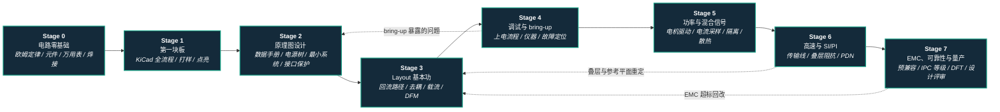

# PCB 设计（PCB Design）

**首屏导读**：

- **为谁**：没画过电路板、想学到能独立交付机器人驱动板 / 传感器板 / 主控载板的人。
- **路径**：Stage 0–7 · 电路零基础 → 第一块板（KiCad）→ 原理图 → Layout → 调试 bring-up → 功率与混合信号 → 高速 SI/PI → EMC 与量产。
- **纵深路线**：[力矩电机设计纵深](depth-torque-motor-design.md)与[整机硬件设计纵深](depth-humanoid-hardware-design.md) Stage 4 共用的板级能力底座。

## 路线一览

## 这条路径怎么用

- 目标读者：**完全没画过板**的软件 / 算法 / 机械背景同学，以及会画简单板、但想做电机驱动、高速接口与量产板的人；不默认会电路——Stage 0 从欧姆定律讲起
- **Stage 0–4 是通用主干**（"能独立做一块能用的板"），所有人都该走完；**Stage 5–7 是精通段**，可按项目调整顺序：做关节驱动先 Stage 5，做主控 / 相机载板先 Stage 6，准备量产先 Stage 7
- 每个阶段有前置知识、核心问题、推荐读什么、推荐做什么、学完输出什么；"推荐做什么"里的板子尽量选机器人上真用得到的
- 工具默认 [KiCad](../wiki/entities/kicad.md)（免费开源、工程文件可进 Git）；公司里用 [Altium Designer](../wiki/entities/altium-designer.md) 时，概念与流程一一对应，只是菜单不同
- **一手资料优先**：IPC 设计 / 验收标准、芯片厂商应用笔记（TI / ADI）、教材原文与 KiCad 官方手册；论坛帖与视频只当线索，结论回到一手资料核对
- 贯穿全程的一件事：维护一份**自己的发板前检查单**，每个 Stage 结束时把新踩的坑写进去——检查单的厚度就是经验的厚度

**和主路线及其他纵深的关系：**
- 本路线位于主路线 L0–L2 之下的**板级硬件底座层**，任意阶段可切入，不依赖控制或学习背景
- 与 [力矩电机设计纵深](depth-torque-motor-design.md)：那条路线 Stage 4"驱动 PCB 设计"默认你已经会画板，本路线 Stage 0–5 就是它的前置与展开
- 与 [整机硬件设计纵深](depth-humanoid-hardware-design.md)：那条路线 Stage 4 的 EMC、接地与 PDU 落板，Stage 5 的总线物理层，都要在板上兑现；本路线 Stage 3 / 6 / 7 给出板级做法
- 板子画完要跑固件：总线与接口的协议语义见 [电机驱动器底软通信协议总览](../wiki/overview/motor-drive-firmware-bus-protocols.md)；本路线只管"电气上能通、通得干净"

---

## Stage 0 电路零基础：先会看、会量、会焊

### 前置知识
- 初中物理的电压、电流概念即可；不要求编程

### 核心问题
- 电压、电流、电阻、功率是什么关系：欧姆定律 \(V = IR\)、功率 \(P = VI\)，以及基尔霍夫电流定律（节点电流和为零）与电压定律（回路电压和为零）
- 电容、电感、二极管、三极管（BJT）、MOSFET 各自"在电路里干什么"——先建立行为直觉，器件物理以后再补
- RC 充放电与时间常数 \(\tau = RC\)：为什么它同时决定了滤波、按键消抖、复位与上电时序
- 原理图符号与真实元件怎么对应：贴片封装尺寸代码（0603 / 0805 等）、极性标记、引脚编号
- 万用表的正确接法：电压并联、电流串联、测电阻和通断前先断电——接错档位是新手烧表的头号原因
- 焊接：温控烙铁、助焊剂、插件与贴片的手焊方法；安全（烫伤、助焊剂烟雾、锂电池短路）

### 推荐读什么
- Horowitz & Hill, *The Art of Electronics*（3rd ed., Cambridge University Press, 2015）第 1 章 — 电路基础的经典教材；先读直流电路、分压器、RC 电路几节
- [Tinkercad](../wiki/entities/tinkercad.md) 与 [Wokwi](../wiki/entities/wokwi.md) — 浏览器里先把电路搭起来、仿真看现象，不怕烧器件
- [TTL 串行逻辑电平](../wiki/concepts/ttl-serial-logic-level.md) — 第一次理解"3.3 V 和 5 V 器件不能随便直连"
- [UKMARSBOT](../wiki/entities/ukmarsbot.md) 与 [Micromouse](../wiki/concepts/micromouse.md) — 开源入门机器人，Gerber / BOM 齐全，适合当第一个"照着焊、照着读"的完整电路
- IPC J-STD-001（焊接的电气与电子组件要求）与 IPC-A-610（电子组件的可接受性）— 焊点"合格与否"的行业判据；本阶段只需对照图例看合格 / 不合格焊点长什么样

### 推荐做什么
- 面包板上搭三个电路并用万用表验证手算结果：分压器、LED 限流电阻、RC 延时点灯
- 用一块焊接练习板焊 20 个插件 + 20 个 0805 贴片，对照 IPC-A-610 图例自评焊点
- 在 Tinkercad / Wokwi 里用 MCU 读一个按钮、驱动一个 LED，弄清上拉电阻为什么存在

### 学完输出什么
- 能读懂一张十几个元件的简单原理图，并说出每个元件的作用
- 一套能用的个人工具：万用表、温控烙铁、镊子、助焊剂（条件允许再加一台可调限流电源）
- 一页手算笔记：欧姆定律、分压、RC 时间常数各一道例题，并附面包板实测值对照

---

## Stage 1 第一块板：用 KiCad 走通"原理图 → PCB → 打样 → 点亮"

### 前置知识
- Stage 0；会装软件、管理文件（会用 Git 更好，不会也能先做）

### 核心问题
- EDA 的数据链：符号（symbol）→ 网表 → 封装（footprint）→ 布局布线 → 规则检查 → 制造文件；每一步为什么都要有"对得上"的检查（ERC 查原理图，DRC 查 PCB）
- 符号和封装为什么是两个东西：引脚编号对不上时，板子照样能做出来，但芯片是"接反"的
- 双层板的基本组成：顶层 / 底层铜、过孔、阻焊、丝印、板框
- 板厂工艺能力（最小线宽线距、最小孔径、铜厚）如何变成 DRC 规则
- 制造文件包里有什么：Gerber、钻孔文件、BOM、贴片坐标；为什么下单前要用 Gerber 查看器逐层再看一遍

### 推荐读什么
- [KiCad](../wiki/entities/kicad.md) 与 [KiCad 10.0 官方中文文档](https://docs.kicad.org/10.0/zh/) 的"KiCad 入门"一章 — 照着官方入门，把第一个工程从原理图走到 Gerber
- [Altium Designer](../wiki/entities/altium-designer.md) — 了解商业 EDA 的同一套流程，知道进公司后会遇到什么
- 任意一家打样厂公开的工艺能力页 — 把最小线宽 / 线距 / 孔径抄进自己的 DRC 规则
- IPC-2221（印制板设计通用标准）— 先只看术语与电气间距部分，知道"间距规则"从哪来

### 推荐做什么
- 画一块不超过 50 × 50 mm 的双层板：USB 供电 + LDO 稳压 + 一颗 LED + 一个按钮 + 一组排针，全部用库内现成的符号与封装
- 跑通 ERC、DRC，导出 Gerber / 钻孔 / BOM，用 Gerber 查看器逐层检查后下单打样
- 板子回来后手焊、上电点亮；把"第一次出错的地方"记下来（几乎一定会有）

### 学完输出什么
- 一个完整的 KiCad 工程（进 Git）+ 一套制造文件 + 一块点亮的实物板
- 发板前检查单 v0：封装对照、极性、板框、孔径、丝印方向

---

## Stage 2 原理图设计：从"连上"到"设计对"

### 前置知识
- Stage 1；能看懂 MCU 的引脚定义表

### 核心问题
- 怎么读数据手册：绝对最大额定值 vs 推荐工作条件、典型应用电路、布局建议——为什么"典型应用电路"是最好的设计起点
- 电源树：输入保护（反接、TVS、保险丝）→ 开关降压（Buck）→ 线性稳压（LDO）；LDO 与 Buck 在效率、噪声、发热上的取舍，各路电源的上电顺序
- MCU 最小系统：电源与去耦电容、时钟（晶振与负载电容）、复位、启动模式引脚、调试口（SWD / JTAG）——最小系统做对，后面一半的问题不会出现
- 外设接口的电气层：UART / I2C / SPI 的电平与上拉，CAN / RS-485 收发器与终端电阻，USB 接口的 ESD 保护
- 器件选型与 BOM：封装是否好焊、供货与替代料、降额使用（不让器件长期工作在额定极限）
- 什么时候先仿真：用 SPICE 验证滤波器、运放放大电路、电源负载阶跃的直觉

### 推荐读什么
- 所选 MCU 厂商的官方硬件设计指南（STM32 / ESP32 / RP2040 等都有）— 最小系统的一手依据，比任何教程都权威
- *The Art of Electronics* 中稳压与电源变换相关章节 — 理解 LDO 与开关电源各自的代价
- [UART 串行通信](../wiki/concepts/uart-serial-communication.md)、[RS-485 串行总线](../wiki/concepts/rs-485-serial-bus.md)、[RS-232 串行接口](../wiki/concepts/rs-232-serial-interface.md)、[CAN FD](../wiki/concepts/can-fd.md) — 机器人最常用的板间接口，各页都写了物理层要点
- [Qucs-S](../wiki/entities/qucs-s.md) — 开源 SPICE 仿真前端；KiCad 原理图也内置 ngspice 仿真
- [Part-DB](../wiki/entities/part-db.md) — 元件库存与参数管理，从个人项目起就养成库管理习惯
- [atopile](../wiki/entities/atopile.md) / [tscircuit](../wiki/entities/tscircuit.md) — 用代码描述电路的新路线，可作"模块复用"思维的参照，不替代基本功

### 推荐做什么
- 设计一块**机器人传感器节点板**的原理图：Buck + LDO 两级电源、STM32 或 ESP32 最小系统、SPI 接 IMU、CAN 收发器 + 终端电阻、SWD 调试口、反接与 ESD 保护
- 为电源树做一张表：每路电压、最大电流、上电顺序、纹波要求；用 SPICE 仿真输入滤波与 LDO 的负载阶跃响应
- 请有经验的人做一次原理图评审；没有条件就按自己的检查单逐条过，并对每颗芯片逐引脚对照数据手册

### 学完输出什么
- 一份可评审的原理图 + 电源树表 + 带替代料的 BOM
- 发板前检查单 v1：加入"每颗芯片对照数据手册典型电路逐引脚核对""每个接口有保护"

---

## Stage 3 Layout 基本功：电流走的是回路，不是导线

### 前置知识
- Stage 2；理解电流必须形成闭合回路

### 核心问题
- **布局先于布线**：按信号流与功能分区摆放（电源入口 → 变换 → 负载；连接器靠边，晶振紧贴 MCU），布局决定了大部分结果
- **回流路径**：信号电流经参考平面回到源端，频率越高越紧贴信号线正下方——为什么完整地平面比"把地线画粗"有效，为什么信号跨越平面分割会出问题
- **去耦**：电容为什么要紧贴电源引脚、过孔就近打到地平面；电容的 ESR / ESL 决定它在哪个频段有效
- **载流与温升**：线宽、铜厚、过孔数怎么按 IPC-2152 估算；大电流铺铜与散热焊盘
- **四层板叠层**（如 信号 / 地 / 电源 / 信号）为什么比双层板好画得多，代价是什么
- **开关电源 layout**：输入电容–开关管–地 构成的高频回路面积最小化为什么是第一优先级
- **可制造性（DFM）与可装配性（DFA）**：焊盘图形（IPC-7351）、元件间距、测试点、拼板与工艺边、丝印与极性标识

### 推荐读什么
- Analog Devices, [MT-031: Grounding Data Converters and Solving the Mystery of "AGND" and "DGND"](https://www.analog.com/media/en/training-seminars/tutorials/MT-031.pdf) 与 MT-101 *Decoupling Techniques* — 接地与去耦的厂商一手教程
- TI, [AN-1149 *Layout Guidelines for Switching Power Supplies*（SNVA021）](https://www.ti.com/lit/snva021) — 开关电源 layout 的经典短文，含好 / 坏布局对照
- Henry W. Ott, *Electromagnetic Compatibility Engineering*（Wiley, 2009）的接地、去耦与 PCB 布局章节 — 回流路径与平面的系统论述
- IPC-2221（通用设计）、IPC-2152（载流能力）、IPC-7351（表贴焊盘图形）— 规则的一手出处；KiCad 的 PCB 计算器可做线宽 / 过孔粗算
- [机器人整机配电架构](../wiki/concepts/robot-power-distribution-architecture.md) — 看大电流板在整机里接的是什么

### 推荐做什么
- 把 Stage 2 的传感器节点板画成**四层板**，做两版布局（随手摆放 vs 按信号流与回流规划），写下每处取舍理由
- 对每条大电流走线用 IPC-2152 方法（或 KiCad 计算器）估算温升并标在图上
- 打样、焊接，与 Stage 1 的板对比，记录装配时哪里难焊、哪里丝印看不清

### 学完输出什么
- 一块四层板 + layout 说明（分区图、叠层、关键回路、载流估算）
- 发板前检查单 v2：加入去耦位置、开关回路、平面分割、测试点、DFM 项

---

## Stage 4 调试与 bring-up：让板子开口说话

### 前置知识
- Stage 3；手上有一块自己设计、尚未完全验证的板

### 核心问题
- **首次上电流程**：目检与短路检查 → 限流电源逐路上电 → 量每路电压 → 摸温度 / 热像 → 再烧录固件；每一步的中止判据是什么
- **仪器怎么用对**：示波器带宽与探头补偿；长接地夹为什么会"制造"出并不存在的振铃（测开关节点与纹波改用短接地弹簧）；逻辑分析仪解码 UART / I2C / SPI / CAN
- **故障定位方法**：分段隔离（预留 0 Ω 电阻 / 跳线）、对照原理图逐点测量、换料对比、热像找短路
- **返修与改版**：飞线、割线、热风枪拆焊；把每个问题写成 ECO（工程变更）记录，下一版闭环
- **固件联调**：先写最小测试固件（点灯、串口回显、读外设 ID）逐个验证外设，不要一上来就跑完整应用

### 推荐读什么
- Tektronix, [*ABCs of Probes*](https://www.tek.com/en/documents/whitepaper/abcs-probes-primer) — 示波器探头原理、补偿与接地误差的厂商一手入门
- [Serial Studio](../wiki/entities/serial-studio.md) — 串口遥测可视化，bring-up 时实时看传感器数据
- [Wokwi](../wiki/entities/wokwi.md) — 板子到货前先在仿真里写好测试固件
- [人形机器人测试流程](../wiki/concepts/humanoid-testing-workflow.md) — 测试左移：板级问题要在部件层暴露，而不是等装上整机
- [现场机器人排障 Query](../wiki/queries/field-robotics-troubleshooting.md) — 真机故障里有相当一部分源头在接触、供电与干扰

### 推荐做什么
- 为 Stage 3 的板写一份 bring-up 检查单并严格照做，记录每一步的实测值
- 故意制造三种故障（虚焊、电源短路、I2C 缺上拉）让同伴盲测排查，练定位流程
- 测 Buck 输出纹波两次：长接地夹 vs 接地弹簧，对比读数差异并解释原因

### 学完输出什么
- bring-up 检查单 + 实测记录 + ECO 清单（下一版修改项）
- 一块"所有外设验证通过"的板，以及配套的最小测试固件

---

## Stage 5 功率与混合信号：电机驱动板是机器人 PCB 的主战场

### 前置知识
- Stage 0–4；建议同时读 [力矩电机设计纵深](depth-torque-motor-design.md) Stage 0–3，知道 FOC 对硬件要什么

### 核心问题
- **三相逆变功率级**：MOSFET 选型（耐压、导通电阻、栅极电荷）、半桥与栅极驱动、自举供电、死区
- **功率回路 layout**：母线电容–上下管–地 构成的换流回路面积最小化；开关节点铜皮面积与 dv/dt 噪声的关系
- **电流采样**：低边 / 在线分流电阻、开尔文（四线）连接、差分放大、ADC 采样时刻与 PWM 的同步；为什么采样走线是整块板上最怕干扰的一段
- **模拟与数字共存**：按功能分区布局而不是随意割地；ADC 参考与滤波；编码器与传感器接口的防护
- **隔离**：数字隔离器、隔离电源；什么情况下必须隔离（高压母线、长线通信、安全要求）
- **散热与保护**：铜厚、散热过孔、器件热阻链；过流比较器硬件关断、母线过压 / 欠压、温度采样

### 推荐读什么
- TI, [*Best Practices for Board Layout of Motor Drivers*（SLVA959）](https://www.ti.com/lit/slva959) — 接地、热设计、电容放置、大电流回路与栅极走线的厂商一手指南
- [力矩电机设计纵深 Stage 4](depth-torque-motor-design.md) — 驱动板在关节里要满足的指标
- [磁场定向控制（FOC）](../wiki/concepts/field-oriented-control.md) — 电流采样时刻为什么要和 PWM 对齐
- 开源驱动板对照学习：[moteus](../wiki/entities/moteus.md)、[VESC](../wiki/entities/vesc.md)（KiCad 硬件）、[SimpleFOC](../wiki/entities/simplefoc.md) 参考板、[Tinymovr](../wiki/entities/tinymovr.md)（注意其开源快照的版本边界）
- [关节模组电磁隔离](../wiki/concepts/joint-module-electromagnetic-isolation.md) — 强电弱电共处时的分层隔离
- [关节编码器选型](../wiki/concepts/joint-encoder-selection.md) — 编码器接口在驱动板上的电气要求
- [执行器驱动链枢纽](../wiki/overview/hub-actuator-drive-chain.md) 与 [驱动链选型闭环 Query](../wiki/queries/actuator-drive-chain-selection-loop.md) — EDA → 固件 → 执行器建模 → 总线集成的全链视角
- [pcb-motor](../wiki/entities/pcb-motor.md) — 把 PCB 本身做成电机定子的特例，了解多层铜厚与载流的极限用法

### 推荐做什么
- 选一块开源驱动板（moteus 或 VESC），逐页读原理图与 layout，标出功率回路、采样走线、栅极驱动走线与地的连接方式，写一页"它为什么这样画"
- 自己设计一块低压三相 FOC 驱动板：栅极驱动芯片 + 分流采样 + MCU + CAN，先低电压、限流 bring-up
- 用示波器测开关节点波形与相电流采样噪声，改布局前后做对比

### 学完输出什么
- 一块能闭环驱动无刷电机的驱动板 + 功率回路 / 采样链路 / 热设计说明
- 一组实测：开关节点振铃、采样噪声、满载温升

---

## Stage 6 高速与 SI/PI：当走线变成传输线

### 前置知识
- Stage 3–4；理解电容、电感的阻抗随频率变化

### 核心问题
- 什么时候走线必须按传输线处理：取决于信号**上升时间**与走线长度的比较，而不只是时钟频率
- **受控阻抗**：微带线 / 带状线、叠层、介质参数如何决定特性阻抗；叠层与阻抗公差要和板厂一起定
- 反射与端接、串扰与间距、差分对（等长、耦合、对称）、过孔残桩
- **参考平面**：换层时回流怎么走（回流地过孔、缝合电容）；跨分割为什么同时是 SI 问题和 EMC 问题
- **电源完整性（PDN）**：目标阻抗思想、去耦电容组合、平面电容与封装电感
- 常见高速接口（USB、以太网、MIPI、DDR）的布线约束——优先看芯片厂商的布局指南
- 仿真与测量：场求解器算阻抗、TDR 与眼图的概念、开源 FDTD 结构仿真

### 推荐读什么
- Eric Bogatin, *Signal and Power Integrity — Simplified*（3rd ed., Pearson, 2018）— 本阶段主教材，重直觉与工程方法而非推导
- Howard Johnson & Martin Graham, *High-Speed Digital Design: A Handbook of Black Magic*（Prentice Hall, 1993）— 振铃、串扰、辐射噪声的经典
- IPC-2141A（高速受控阻抗电路板设计指南）— 阻抗设计规则、串扰与测试结构
- TI, [*High-Speed Interface Layout Guidelines*（SPRAAR7）](https://www.ti.com/lit/spraar7) — 差分对间距、对称、过孔、参考平面的厂商规则
- [openEMS](https://openems.de) — 开源 FDTD 电磁场求解器；社区有 KiCad → openEMS 的转换工具，但非 KiCad 官方支持，端口设置需自行验证
- [EtherCAT 协议](../wiki/concepts/ethercat-protocol.md) 与 [机器人整机通信架构](../wiki/concepts/robot-onboard-communication-architecture.md) — 机器人里最常见的"高速线"在哪、要多可靠

### 推荐做什么
- 和板厂确认一份四层或六层叠层，用场求解器（KiCad 计算器或板厂工具）算出 50 Ω 单端与 USB 90 Ω 差分的线宽线距
- 设计一块带 USB 2.0 高速或百兆以太网的主控 / 转接板，严格按芯片布局指南走线，验证链路速率与误码
- 做一个对照实验：同一信号分别走"完整参考平面"与"跨越平面分割"，用示波器或近场探头对比波形与辐射

### 学完输出什么
- 一份叠层与阻抗表（与板厂确认版）+ 高速网络布线约束表
- 一块高速接口稳定工作的板 + 测试记录

---

## Stage 7 EMC、可靠性与量产：从"能用"到"能卖、能长期用"（精通）

### 前置知识
- Stage 3–6；至少完整交付过一块多层板

### 核心问题
- **EMC 三要素**：骚扰源（开关电源、时钟、电机驱动）、耦合路径（传导 / 辐射）、敏感电路；板级用回路面积、滤波、屏蔽与接地把三者拆开
- **标准与预兼容**：发射按产品类别适用 CISPR 11（工业、科学、医疗设备）或 CISPR 32（多媒体设备）等，抗扰度看 IEC 61000-4 系列（如 -2 静电放电）；正式认证前先用近场探头与频谱仪做预测试
- **接口防护**：ESD、浪涌与连接器；TVS 的位置、外壳 / 屏蔽地的处理
- **可靠性等级**：IPC-6012 的 Class 1 / 2 / 3（一般电子 / 专用服务设备 / 高可靠）对孔铜、环宽、检验的不同要求；IPC-A-600（裸板验收）与 IPC-A-610（组件验收）
- **柔性与刚柔结合板**（IPC-2223）：关节走线、手指、触觉皮肤里的弯折寿命与叠构
- **可测试性（DFT）与产线**：测试点、ICT / FCT 夹具、烧录与校准工位、序列号与追溯
- **工程体系**：设计评审清单、元件库与料号管理、版本与 ECO、工程文件进 Git 并用 CI 自动导出
- **AI 与代码化 EDA**：可以用来加速，但生成结果的电气与制造结论仍需工程师复核签字

### 推荐读什么
- Henry W. Ott, *Electromagnetic Compatibility Engineering*（Wiley, 2009）— EMC 设计主教材
- IEC 61000-4-2（静电放电抗扰度）、CISPR 11 / CISPR 32（发射）— 在 [IEC Webstore](https://webstore.iec.ch/) 检索；具体适用哪一份取决于产品类别与目标市场
- IPC-6012、IPC-A-600、IPC-A-610、IPC-2223 — 见 [IPC 设计标准总览](https://www.ipc.org/ipc-design-standards)
- [机器人整机配电架构](../wiki/concepts/robot-power-distribution-architecture.md) 的「EMC 与接地」一节与 [整机硬件设计纵深 Stage 4](depth-humanoid-hardware-design.md) — 板级 EMC 要服从整机的接地约定
- [人形机器人线束类型与防护](../wiki/concepts/humanoid-wire-harness-types-protection.md) — 板外线束是 EMC 与可靠性问题的另一半
- [人形机器人量产工程能力](../wiki/concepts/humanoid-mass-production-engineering.md) — 良率、一致性与供应链
- [OpenTac](../wiki/entities/opentac.md) — 柔性 PCB 触觉皮肤的开源实例
- [KiCad](../wiki/entities/kicad.md) 的 kicad-cli、[Konnect](../wiki/entities/konnect.md)、[HeyPCB](../wiki/entities/heypcb.md) — 自动化导出与 AI 辅助设计的现状与边界

### 推荐做什么
- 对 Stage 5 的驱动板做一次 EMC 预测试：近场探头扫描找热点，改一处（加滤波 / 缩小回路 / 改接地）后复测对比
- 有条件时按 IEC 61000-4-2 的思路对接口做静电放电试验，记录失效现象并改进防护
- 把一块板做成"可量产版"：补齐测试点、拼板、替代料、FCT 测试规范，并写明 IPC 等级与验收要求
- 在 Git 仓库里配置 kicad-cli 自动导出 Gerber / BOM 并跑 DRC，作为每次改版的门禁

### 学完输出什么
- 一份 EMC 预测试报告（改前 / 改后频谱对比）
- 一套量产交付包：制造文件、IPC 等级与验收要求、测试规范、BOM 与替代料、版本记录
- 一份团队可复用的设计评审清单——能把自己踩过的坑写成别人不再踩的规则，是"精通"的标志

---

## 快速入口汇总

| 阶段 | 核心问题 | 知识页 / 一手资料入口 |
|------|---------|-----------|
| Stage 0 | 欧姆定律、元件直觉、万用表、焊接 | [Tinkercad](../wiki/entities/tinkercad.md) · [Wokwi](../wiki/entities/wokwi.md) · *The Art of Electronics* 第 1 章 |
| Stage 1 | KiCad 全流程、DRC、制造文件 | [KiCad](../wiki/entities/kicad.md) · [KiCad 10.0 中文文档](https://docs.kicad.org/10.0/zh/) |
| Stage 2 | 数据手册、电源树、最小系统、接口保护 | [UART](../wiki/concepts/uart-serial-communication.md) · [CAN FD](../wiki/concepts/can-fd.md) · [Qucs-S](../wiki/entities/qucs-s.md) |
| Stage 3 | 回流路径、去耦、载流、DFM | ADI MT-031 / MT-101 · TI AN-1149 · IPC-2152 / IPC-7351 |
| Stage 4 | 上电流程、仪器、故障定位、ECO | Tektronix *ABCs of Probes* · [人形测试流程](../wiki/concepts/humanoid-testing-workflow.md) |
| Stage 5 | 功率级、电流采样、隔离、散热 | TI SLVA959 · [moteus](../wiki/entities/moteus.md) · [VESC](../wiki/entities/vesc.md) · [力矩电机纵深 Stage 4](depth-torque-motor-design.md) |
| Stage 6 | 传输线、受控阻抗、PDN | Bogatin *SI/PI Simplified* · IPC-2141A · TI SPRAAR7 |
| Stage 7 | EMC 预兼容、IPC 等级、DFT、评审体系 | Ott *EMC Engineering* · IEC 61000-4-2 · IPC-6012 / IPC-A-610 |

## 和其他页面的关系

- 完整成长路线参考：[主路线：运动控制 → 物理智能全栈成长路线](motion-control.md)
- 相关纵深路线（按主题邻近，完整目录见 [路线总览](motion-control.md#depth-optional-index)）：
  - [力矩电机设计](depth-torque-motor-design.md) — Stage 4 驱动 PCB 是本路线 Stage 5 的应用场景
  - [人形整机硬件设计](depth-humanoid-hardware-design.md) — Stage 3–5 的配电、EMC 与通信要在本路线的板上兑现
  - [遥操作](depth-teleoperation.md) — 数据手套、力反馈设备同样是传感 + 通信板
- 关联知识页：
  - EDA 工具：[KiCad](../wiki/entities/kicad.md) · [Altium Designer](../wiki/entities/altium-designer.md) · [atopile](../wiki/entities/atopile.md) · [tscircuit](../wiki/entities/tscircuit.md) · [Qucs-S](../wiki/entities/qucs-s.md) · [Part-DB](../wiki/entities/part-db.md)
  - 接口与总线：[UART](../wiki/concepts/uart-serial-communication.md) · [TTL 电平](../wiki/concepts/ttl-serial-logic-level.md) · [RS-485](../wiki/concepts/rs-485-serial-bus.md) · [CAN FD](../wiki/concepts/can-fd.md) · [EtherCAT](../wiki/concepts/ethercat-protocol.md) · [硬件通信与协议枢纽](../wiki/overview/hub-communication.md)
  - 机器人板级场景：[Humanoid Hardware 101 · 05 能源与计算电子](../wiki/overview/humanoid-hardware-101-power-compute-electronics.md) · [执行器驱动链枢纽](../wiki/overview/hub-actuator-drive-chain.md) · [关节模组电磁隔离](../wiki/concepts/joint-module-electromagnetic-isolation.md)
  - 开源硬件对照：[moteus](../wiki/entities/moteus.md) · [VESC](../wiki/entities/vesc.md) · [SimpleFOC](../wiki/entities/simplefoc.md) · [WolfieMouse](../wiki/entities/wolfiemouse.md) · [UKMARSBOT](../wiki/entities/ukmarsbot.md) · [开源人形机器人硬件](../wiki/entities/open-source-humanoid-hardware.md)

## 参考来源

- 起点里程碑：Paul Eisler 的印制电路——1936 年在英国提交首个相关专利，1943 年提交关键专利申请，并在 1940 年代初做出采用印制线路的收音机（多份 PCB 史料对年份表述不一，这里取"1936 首个专利 / 1943 关键专利"的通行说法）
- 教材：Horowitz & Hill, *The Art of Electronics*（3rd ed., Cambridge University Press, 2015）；Bogatin, *Signal and Power Integrity — Simplified*（3rd ed., Pearson, 2018）；Johnson & Graham, *High-Speed Digital Design: A Handbook of Black Magic*（Prentice Hall, 1993）；Ott, *Electromagnetic Compatibility Engineering*（Wiley, 2009）
- IPC 标准：IPC-2221（印制板设计通用标准）、IPC-2152（载流能力）、IPC-7351（表贴焊盘图形）、IPC-2141A（高速受控阻抗设计指南）、IPC-2223（柔性 / 刚柔板设计）、IPC-6012（刚性板鉴定与性能，Class 1/2/3）、IPC-A-600（裸板可接受性）、IPC-A-610（组件可接受性）、J-STD-001（焊接要求）；以 IPC 当前有效版本为准
- EMC 标准：IEC 61000-4-2（静电放电抗扰度）及 IEC 61000-4 系列、CISPR 11（工业 / 科学 / 医疗设备发射）、CISPR 32（多媒体设备发射）
- 厂商应用笔记：TI SLVA959（电机驱动板布局）、TI SNVA021 / AN-1149（开关电源布局）、TI SPRAAR7（高速接口布局）、ADI MT-031（数据转换器接地）、ADI MT-101（去耦技术）、Tektronix *ABCs of Probes*
- 工具文档：[KiCad 10.0 官方文档](https://docs.kicad.org/10.0/zh/)、[openEMS](https://openems.de)
- 本库知识页：[KiCad](../wiki/entities/kicad.md)、[Altium Designer](../wiki/entities/altium-designer.md)、[机器人整机配电架构](../wiki/concepts/robot-power-distribution-architecture.md)、[关节模组电磁隔离](../wiki/concepts/joint-module-electromagnetic-isolation.md)
