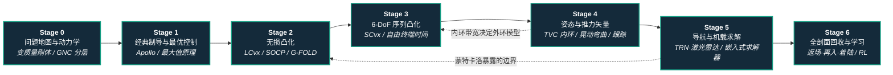

# 火箭回收控制

**首屏导读**：

- **为谁**：想让火箭自己飞回来、在指定点竖直落稳的人。
- **路径**：Stage 0–6 · 动力学基础 → 经典制导 → 无损凸化（3-DoF）→ 6-DoF 序列凸化 → 姿态与推力矢量 → 导航与机载求解 → 全剖面回收。
- **纵深路线**：数学上与[运动控制主路线](motion-control.md)的 L3 最优化、L4.3 轨迹优化 / MPC 同源，换了一个约束更硬、失败代价更高的被控对象。

## 路线一览

## 这条路径怎么用

- 目标读者是想做**可回收火箭、垂直起降飞行器或行星着陆器 GNC** 的控制 / 机器人工程师，也适合想借一个"硬约束 + 实时重规划"的典型问题吃透凸优化与轨迹优化的人
- 需要线性代数、常微分方程、基础控制（PID、状态空间）与 Python；凸优化和最优控制会随路线补
- 每个阶段有核心问题、推荐读什么、推荐做什么、学完输出什么；Stage 2–3 的论文与开源代码都能在笔记本上复现
- **资料边界**：SpaceX、Blue Origin 的飞控算法没有公开。本路线引用的工业事实只来自官方页面与当事工程师的公开文章；凡是"工业界大概这么做"的说法都标了"推测"

**和主路线的关系：**
- 本路线从主路线 **L3（控制基础与最优化）** 之后切入最顺：最优控制、凸优化、LQR 在这里直接变成制导律
- Stage 2–3 是主路线 [L4.3 轨迹优化 / MPC](motion-control.md) 的航天版本：同样是"离散化 → 凸子问题 → 在线重解"，只是约束从摩擦锥换成了推力锥、滑翔坡和万向节角
- Stage 4–5 与 [安全控制纵深](depth-safe-control.md)、[Sim2Real 纵深](depth-sim2real.md) 共享"约束保证"和"仿真到真机"的问题意识

---

## Stage 0 问题地图与动力学基础

### 前置知识
- 牛顿力学、刚体转动的基本概念
- 线性代数（矩阵、向量范数）与常微分方程数值积分
- Python + NumPy 能写一个简单仿真循环

### 核心问题
- 着陆问题的终端条件是什么：Blackmore 2016 的表述是高度归零时速度也要归零——速度先归零火箭会重新上升，减速太晚会撞地
- 为什么火箭是"变质量"系统：\(\dot m=-\alpha\|T\|\)，\(\alpha=1/(I_{sp}g_0)\)，推力越大掉质量越快
- 3-DoF（只管质心平移）与 6-DoF（质量、位置、速度、四元数、角速度共 14 维状态）各在什么时候够用
- 制导（算一条可飞的轨迹）、导航（估计当前状态）、控制（让箭体跟上轨迹）为什么要分层

### 推荐读什么
- [动力下降制导（Powered Descent Guidance）](../wiki/concepts/powered-descent-guidance.md) — 本路线的总览页，先通读
- [Blackmore：Autonomous Precision Landing of Space Rockets](../sources/papers/blackmore_autonomous_precision_landing_space_rockets.md) — SpaceX 着陆工程师写的 F9R 返回剖面与难点概述
- [单位四元数与 SO(3)](../wiki/formalizations/unit-quaternion-so3.md) 与 [SO(3) 旋转表示对比](../wiki/comparisons/so3-rotation-representations.md) — 6-DoF 姿态表示
- [李群与刚体运动](../wiki/formalizations/lie-group-rigid-body-motions.md) — 刚体运动学的统一写法
- [控制建模与求解](../wiki/concepts/modeling-and-solving-for-control.md) — "先建模、再选求解器"的总框架

### 推荐做什么
- 写一个 1-D 竖直下降仿真（含质量消耗与推力上下限），手算"满推力从哪个高度点火正好在地面停住"，再用仿真验证
- 把 1-D 扩展成 2-D 平面火箭（位置、速度、俯仰角、角速度 + 万向节摆角），先用开环推力剖面感受姿态与平移的耦合

### 学完输出什么
- 一个带质量消耗的 2-D 火箭仿真器，后面各 Stage 都在它上面挂制导和控制器
- 能用一张图说清 GNC 三层各自的输入、输出和更新频率

---

## Stage 1 经典制导与最优控制结构

### 核心问题
- Apollo 登月舱怎么做动力下降：机载程序控制姿态与下降发动机节流，地面预先计算制导目标，航天员可改选着陆点并在末段控制下降速率（Klumpp 摘要）
- 最大值原理给出的"最优推力结构"是什么：Gymnasium LunarLander 文档引述"it is optimal to fire the engine at full throttle or turn it off"；带推力下界的火星着陆算例里，最优推力在约 40–70 s 一段贴着下界（Malyuta 等 Part III），即推力在上下界之间切换
- 闭式制导律为什么不够：Blackmore 2010 把这类方法归为"忽略约束、求闭式解"，推力上下界、滑翔坡都没法显式保证

### 推荐读什么
- [Klumpp：Apollo Lunar Descent Guidance（1974）](../sources/papers/klumpp_1974_apollo_lunar_descent_guidance.md) — 本路线的历史起点（目前只核对了 NTRS 摘要）
- [最优控制（Optimal Control）](../wiki/concepts/optimal-control.md) 与 [HJB 方程](../wiki/formalizations/hjb.md) — 代价、约束、最大值原理
- [LQR](../wiki/formalizations/lqr.md) 与 [LQR / iLQR](../wiki/methods/lqr-ilqr.md) — 无约束二次问题的闭式解，后面用作跟踪控制器
- [CMU 最优控制课程](../wiki/entities/cmu-optimal-control-curriculum.md) — Lecture 22「Convex Relaxation and Landing Rockets」是本路线 Stage 1→2 的最好过桥

### 推荐做什么
- 在 Stage 0 的 1-D 模型上，对比三种推力剖面的燃料：恒定推力、"先关后满推力"、"满—最小—满"，体会最大值原理预言的切换结构
- 写一个最简单的闭式制导（例如按剩余时间算所需加速度），故意给它推力上限，观察它在什么初值下违反约束

### 学完输出什么
- 能说出燃料最优着陆的推力结构，以及它为什么让问题变难（推力下界是非凸约束）
- 一份"闭式制导在哪些初值下失效"的实验记录，作为 Stage 2 的动机

---

## Stage 2 无损凸化与 3-DoF 燃料最优制导

### 核心问题
- 推力下界 \(\|T\|\ge\rho_1\) 为什么非凸，松弛量 \(\Gamma\) 怎么把它填成凸锥，又为什么"放松了等于没放松"
- 变量替换 \(\sigma=\Gamma/m,\ u=T/m,\ z=\ln m\) 怎么让动力学变成线性、问题变成 SOCP
- 飞行时间 \(t_f\) 怎么处理（外层黄金分割搜索），目标点不可达时怎么办（先最小化着陆误差，再在该误差下最省燃料）
- 为什么凸化是"能上飞控"的关键：内点法有确定的停止准则和多项式复杂度

### 推荐读什么
- [无损凸化（Lossless Convexification）](../wiki/methods/lossless-convexification.md) — 本 Stage 的方法页
- [Blackmore, Açıkmeşe, Scharf（JGCD 2010）](../sources/papers/blackmore_2010_minimum_landing_error_pdg.md) — 完整问题、定理与数值结果，必读原文
- [Malyuta 等教程](../sources/papers/malyuta_2021_convex_trajectory_generation_tutorial.md) Part I — LCvx 的一般条件与适用边界
- [JPL G-FOLD × Masten Xombie 飞行试验](../sources/sites/jpl_gfold_xombie_flight_tests.md) — 2013 年实时改道约 0.8 km 的官方记录
- [凸函数](../wiki/formalizations/convex-functions.md) 与 [机器人凸松弛](../wiki/methods/convex-relaxation-robotics.md) — 凸优化基础与"一般松弛不是无损的"对照

### 推荐做什么
- 用 [CVXPY](https://www.cvxpy.org/) 按 Blackmore 2010 §V 的参数（干/湿质量 1505/1905 kg、推力 4972–13260 N、55 个节点）复现燃料最优轨迹，核对 399.4 kg 与 78.4 s 的量级
- 检查求出的推力模长是否处处 ≥ \(\rho_1\)（无损性的数值验证），并画出推力"满—低—满"的结构
- 把初速度改到目标不可达，实现两步法，复现"落在离目标几百米处、用尽燃料"的行为

### 学完输出什么
- 一个能在笔记本上秒级求解的 3-DoF 燃料最优制导器，附无损性检查
- 能讲清 LCvx 定理的前提（轨迹至多一点触及状态约束边界等），以及哪些约束加进来会破坏它

---

## Stage 3 6-DoF 序列凸化

### 核心问题
- 6-DoF 模型多了什么：四元数姿态、刚体欧拉方程、推力力矩，以及万向节角、倾角、角速度约束
- 自由终端时间怎么做：归一化时间 + 伸缩因子 \(\sigma\) 作为决策变量，不再做外层线搜索
- 每轮凸子问题怎么构造：一阶线性化 → FOH 离散（状态转移矩阵积分）→ 虚拟控制防人为不可行 → 信赖域限步长
- SCvx 能保证什么、不能保证什么：收敛到驻点而非全局最优；对缩放、初值和罚权敏感

### 推荐读什么
- [序列凸化（Successive Convexification, SCvx）](../wiki/methods/successive-convexification.md) — 本 Stage 的方法页
- [Szmuk & Açıkmeşe（2018）6-DoF 自由终端时间](../sources/papers/szmuk_2018_scvx_6dof_free_final_time.md) — 模型、离散化与算法细节
- [Szmuk, Reynolds, Açıkmeşe（2018）实时 6-DoF + 状态触发约束](../sources/papers/szmuk_2018_scvx_realtime_state_triggered.md) — 自由点火时间、升阻气动、"条件成立才施加"的约束；MATLAB + ECOS 最长 0.682 s
- [Malyuta 等教程](../sources/papers/malyuta_2021_convex_trajectory_generation_tutorial.md) Part II — SCvx 与 GuSTO 的对比和调参经验
- [轨迹优化](../wiki/methods/trajectory-optimization.md) 与 [轨迹优化 vs RL](../wiki/comparisons/trajectory-opt-vs-rl.md)

### 推荐做什么
- 跑通 PythonRobotics 的 `rocket_powered_landing`（单文件 6-DoF SCvx，见 [归档](../sources/repos/python_robotics.md)），再读 [EmbersArc/SCvx](../sources/repos/scvx_embersarc.md) 的自由终端时间版本
- 依次收紧万向节角上限、倾角上限、滑翔坡角，记录迭代次数、虚拟控制残差与是否收敛
- 故意去掉变量缩放，复现 Malyuta 等说的 "a very hard time converging"
- 进阶：读 [SCPToolbox.jl](../sources/repos/scptoolbox_jl.md) 的 `starship_flip` 示例，理解"翻身 + 着陆"类机动怎么写成 SCP

### 学完输出什么
- 一个 6-DoF 着陆轨迹生成器，以及一张"约束松紧 → 迭代次数 / 收敛率"的实验表
- 能判断一个着陆问题该用 LCvx（3-DoF、约束结构合适）还是 SCvx（6-DoF、气动、复杂约束）

---

## Stage 4 姿态控制、推力矢量与轨迹跟踪

### 核心问题
- 制导给的是参考轨迹，谁来跟：推力矢量控制（发动机万向节摆动）产生姿态力矩，姿态内环必须比平移外环快得多——这正是 3-DoF 制导成立的前提
- 运载火箭姿态控制要建模哪些动态：Greensite（NASA CR-820）的小扰动方程考虑了质心偏移、弹性弯曲、推进剂晃动和发动机惯性
- 大气内怎么控姿：Falcon 9 的四片栅格舵 "orient the rocket during reentry by moving the center of pressure"
- 跟踪控制器怎么选：增益调度 PID、LQR、MPC 各自对模型与算力的要求

### 推荐读什么
- [Greensite：NASA CR-820 Short Period Dynamics](../sources/papers/greensite_1967_nasa_cr820_short_period_dynamics.md) — 运载器姿态控制建模的经典报告（同系列还有 Attitude Control During Launch、Load Relief 等卷）
- [PID 控制](../wiki/methods/pid-control.md) 与 [伯德图](../wiki/concepts/bode-plots.md) — 姿态环的稳定裕度分析
- [LQR](../wiki/formalizations/lqr.md) 与 [模型预测控制（MPC）](../wiki/methods/model-predictive-control.md) — 轨迹跟踪的两条主流做法
- [非线性 MPC](../wiki/methods/nonlinear-model-predictive-control.md) 与 [MPC 调参指南](../wiki/queries/mpc-tuning-guide.md)
- [控制环路延迟建模](../wiki/formalizations/control-loop-latency-modeling.md) — 万向节作动器延迟与采样延迟的预算
- [鲁棒控制范式](../wiki/overview/robot-control-paradigm-robust-control.md) 与 [H∞ 控制](../wiki/methods/h-infinity-control.md) — 晃动、弯曲等未建模动态下的鲁棒性
- [多旋翼仿真—规划—控制开源栈](../wiki/overview/multirotor-simulation-planning-control-stack.md) — 同样是"推力 + 姿态内环"的飞行器，开源栈可借鉴分层结构

### 推荐做什么
- 在 Stage 0 的 2-D 火箭上实现万向节摆角 → 俯仰力矩 → 姿态的内环（带摆角与摆速饱和），扫增益画伯德图，看相位裕度
- 给箭体加一个简单晃动摆模型，观察原来调好的姿态环是否出现振荡
- 用 LQR（沿参考轨迹线性化）或线性 MPC 跟踪 Stage 3 生成的轨迹，测终端位置 / 速度 / 姿态误差

### 学完输出什么
- 一个"SCvx 轨迹 + 姿态内环 + 跟踪外环"的完整闭环仿真
- 能说明内环带宽、作动器饱和、晃动模态分别怎样限制外环可用的轨迹激进程度

---

## Stage 5 导航、机载求解与实时验证

### 核心问题
- 导航从哪来：IMU 惯性推算 + 外部测量融合；NASA SPLICE 在 New Shepard NS-13（2020-10-13）上测试了地形相对导航（IMU + 相机比对预载地图）和导航多普勒激光雷达（测速度与高度）
- 求解器怎么上飞控：Blackmore 2016 写明 SpaceX 用 CVXGEN 生成定制机载凸优化代码；SCvx 论文用 ECOS 等嵌入式内点法求子问题
- 重规划频率与失败处理：G-FOLD 2013 年飞行中新轨迹 "was first calculated only one second earlier"；求解失败时退回什么
- 怎么证明"大概率不出事"：蒙特卡洛散布（初值、推力偏差、风、导航误差）与处理器在环测试

### 推荐读什么
- [NASA SPLICE × New Shepard](../sources/sites/nasa_splice_new_shepard.md) — 精确着陆传感器、算法与计算机的飞行试验
- [JPL G-FOLD × Masten Xombie](../sources/sites/jpl_gfold_xombie_flight_tests.md) — 机载实时改道的官方记录
- [状态估计](../wiki/concepts/state-estimation.md)、[卡尔曼滤波](../wiki/formalizations/kalman-filter.md)、[EKF](../wiki/formalizations/ekf.md)、[传感器融合](../wiki/concepts/sensor-fusion.md)
- [IMU 原理、算法与相机同步](../wiki/concepts/imu-principles-algorithms-camera-sync.md) — 惯导误差与视觉辅助的基础
- [MPC 求解器选型](../wiki/queries/mpc-solver-selection.md)、[OSQP](../wiki/entities/osqp.md)、[acados](../wiki/entities/acados.md) — 嵌入式优化求解器的选型思路（ECOS 用于 SOCP：<https://github.com/embotech/ecos>；CVXGEN：<https://cvxgen.com/>）
- [处理器在环 Sim2Real](../wiki/concepts/processor-in-the-loop-sim2real.md) — 把求解器放到目标处理器上测时延

### 推荐做什么
- 在 Stage 4 闭环里加入带噪声与偏置的 IMU + 高度 / 速度测量，用 EKF 估计状态，比较"真值制导"与"估计值制导"的落点散布
- 把 Stage 2 的 SOCP 改用 ECOS 或 Clarabel 直接求解，统计 1000 次随机初值下的求解时间分布与失败率
- 做一次 ≥500 次的蒙特卡洛：初始位置 / 速度、推力偏差、风扰随机化，输出落点误差与燃料余量的分布

### 学完输出什么
- 一份**着陆 GNC 验收报告**：落点误差分布、燃料余量、求解时延 P99、求解失败率
- 能说清导航误差、求解时延、执行误差各自吃掉了多少落点精度

---

## Stage 6 全剖面回收与学习型方法

### 核心问题
- 助推器回收不只最后几十秒：分离 → 返场点火（boostback）→ 再入（栅格舵调姿）→ 着陆点火 → 落到着陆腿上或被塔臂接住（Starship 第五次试飞 2024-10-13 首次塔臂捕获，捕获前须满足 "Thousands of distinct vehicle and pad criteria"）
- 前几段为什么要尽量压缩误差：留给着陆点火的改道能力有限（Blackmore 2016）
- 学习型着陆能做到什么：Gaudet 等用 PPO 直接输出四台推力器指令，测试 10,000 次落点误差米级、推理 <1 ms，但作者承认无最优性与稳定性保证；Sánchez-Sánchez & Izzo 用监督学习拟合间接法最优轨迹
- 学习方法和凸优化方法怎么结合（推测）：用学习方法给 SCvx 提供初值或热启动、或做故障检测，凸优化保留约束保证——Malyuta 等的参考文献里已有学习热启动 SCP 的工作

### 推荐读什么
- [SpaceX 官方页面：Falcon 9 回收硬件与 Starship 第五次试飞](../sources/sites/spacex_reusable_booster_pages.md)
- [Blackmore：Autonomous Precision Landing of Space Rockets](../sources/papers/blackmore_autonomous_precision_landing_space_rockets.md) — 全剖面误差收敛的思路
- [Gaudet 等：DRL 6-DoF Powered Descent（2018）](../sources/papers/gaudet_2018_drl_6dof_powered_descent.md) 与 [Sánchez-Sánchez & Izzo（2016）](../sources/papers/sanchez_izzo_2016_dnn_optimal_landing.md)
- [Gymnasium LunarLander](../sources/sites/gymnasium_lunar_lander.md) — 平面、无质量变化的入门环境
- [PPO](../wiki/methods/ppo.md)、[域随机化](../wiki/concepts/domain-randomization.md)、[MPC vs RL](../wiki/comparisons/mpc-vs-rl.md)
- [控制障碍函数（CBF）](../wiki/concepts/control-barrier-function.md) — 给学习策略加安全过滤层的一种做法

### 推荐做什么
- 在 `LunarLander-v3`（`continuous=True`、开风扰）上训练 PPO，记录达到 200 分所需步数与失败模式
- 在自己的 2-D 火箭上训练 PPO（加质量消耗与推力下界），与 "SCvx + LQR 跟踪" 在同一组蒙特卡洛初值上比较落点误差、燃料和约束违反次数
- 把返场 / 再入简化成一段弹道 + 一段气动减速，串上 Stage 3–5 的着陆段，跑一次全剖面仿真

### 学完输出什么
- 一份"优化型 vs 学习型着陆"的对比表：落点精度、燃料、约束违反、推理时延、可证明性
- 能画出助推器回收全剖面，并指出每一段由谁负责、误差怎样传给下一段

---

## 快速入口汇总

| 阶段 | 核心问题 | 知识页入口 |
|------|---------|-----------|
| Stage 0 | 变质量动力学与 GNC 分层 | [动力下降制导](../wiki/concepts/powered-descent-guidance.md) |
| Stage 1 | 经典制导与最优推力结构 | [最优控制](../wiki/concepts/optimal-control.md) |
| Stage 2 | 推力下界的无损凸化 | [无损凸化](../wiki/methods/lossless-convexification.md) |
| Stage 3 | 6-DoF 非凸问题的迭代凸化 | [序列凸化](../wiki/methods/successive-convexification.md) |
| Stage 4 | 推力矢量姿态内环与跟踪 | [模型预测控制](../wiki/methods/model-predictive-control.md) · [PID](../wiki/methods/pid-control.md) |
| Stage 5 | 导航融合与机载求解 | [状态估计](../wiki/concepts/state-estimation.md) · [MPC 求解器选型](../wiki/queries/mpc-solver-selection.md) |
| Stage 6 | 全剖面回收与学习型着陆 | [PPO](../wiki/methods/ppo.md) · [MPC vs RL](../wiki/comparisons/mpc-vs-rl.md) |

## 和其他页面的关系

- 完整成长路线参考：[主路线：运动控制 → 物理智能全栈成长路线](motion-control.md)
- 相关纵深路线（按主题邻近，完整目录见 [路线总览](motion-control.md#depth-optional-index)）：
  - [传统模型控制](depth-classical-control.md) — 同一套 MPC / 轨迹优化工具，被控对象换成人形
  - [安全控制](depth-safe-control.md) — CBF / CLF 给控制器加可证明约束，可对照凸优化制导的约束保证
  - [Sim2Real](depth-sim2real.md) — 仿真到真机、蒙特卡洛与执行器建模
  - [RL 运动控制](depth-rl-locomotion.md) — Stage 6 学习型方法的通用背景
- 关联知识页：
  - [动力下降制导](../wiki/concepts/powered-descent-guidance.md) · [无损凸化](../wiki/methods/lossless-convexification.md) · [序列凸化](../wiki/methods/successive-convexification.md)
  - [轨迹优化](../wiki/methods/trajectory-optimization.md) · [机器人凸松弛](../wiki/methods/convex-relaxation-robotics.md) · [控制建模与求解](../wiki/concepts/modeling-and-solving-for-control.md)

## 参考来源

- [Klumpp, Apollo Lunar Descent Guidance, *Automatica* 10(2), 1974](../sources/papers/klumpp_1974_apollo_lunar_descent_guidance.md)
- [Blackmore, Açıkmeşe, Scharf, Minimum-Landing-Error Powered-Descent Guidance for Mars Landing Using Convex Optimization, *JGCD* 33(4), 2010](../sources/papers/blackmore_2010_minimum_landing_error_pdg.md)
- [Blackmore, Autonomous Precision Landing of Space Rockets, 2016](../sources/papers/blackmore_autonomous_precision_landing_space_rockets.md)
- [Szmuk & Açıkmeşe, Successive Convexification for 6-DoF Mars Rocket Powered Landing with Free-Final-Time, 2018](../sources/papers/szmuk_2018_scvx_6dof_free_final_time.md)
- [Szmuk, Reynolds, Açıkmeşe, Successive Convexification for Real-Time 6-DoF Powered Descent Guidance with State-Triggered Constraints, 2018](../sources/papers/szmuk_2018_scvx_realtime_state_triggered.md)
- [Malyuta 等, Convex Optimization for Trajectory Generation, 2021（arXiv）/ 2022（IEEE CSM）](../sources/papers/malyuta_2021_convex_trajectory_generation_tutorial.md)
- [Greensite, NASA CR-820 Short Period Dynamics, 1967](../sources/papers/greensite_1967_nasa_cr820_short_period_dynamics.md)
- [Gaudet, Linares, Furfaro, DRL for 6-DoF Planetary Powered Descent and Landing, 2018](../sources/papers/gaudet_2018_drl_6dof_powered_descent.md)
- [Sánchez-Sánchez & Izzo, Real-Time Optimal Control via DNN: Landing Problems, 2016](../sources/papers/sanchez_izzo_2016_dnn_optimal_landing.md)
- [JPL G-FOLD × Masten Xombie 官方页面](../sources/sites/jpl_gfold_xombie_flight_tests.md) · [NASA SPLICE × New Shepard](../sources/sites/nasa_splice_new_shepard.md) · [SpaceX 官方页面](../sources/sites/spacex_reusable_booster_pages.md) · [Gymnasium LunarLander](../sources/sites/gymnasium_lunar_lander.md)
- 开源代码：[SCPToolbox.jl](../sources/repos/scptoolbox_jl.md) · [EmbersArc/SCvx](../sources/repos/scvx_embersarc.md) · [PythonRobotics](../sources/repos/python_robotics.md)
- 起点里程碑：NASA Apollo 11 任务页 <https://www.nasa.gov/mission/apollo-11/>（1969 年 7 月，登月舱 Eagle 动力下降着陆）
