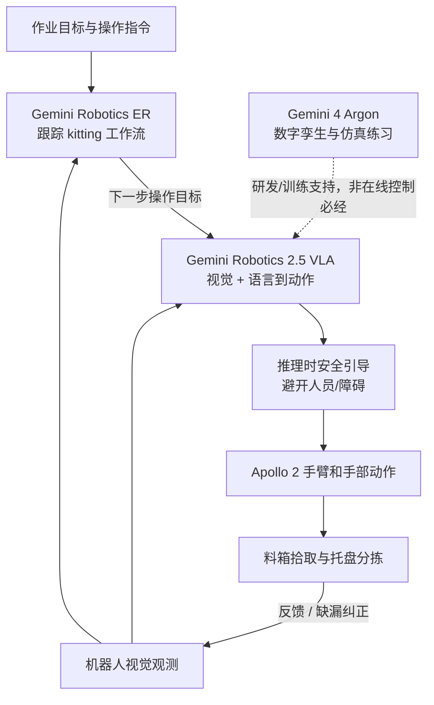

# Gemini Robotics 2.5 accelerates real-world general dexterity / Gemini Robotics 2.5 加速真实世界通用灵巧操作

> 来源归档（blog / Google DeepMind 官方一手发布，归纳笔记而非全文转载）

- **标题：** Gemini Robotics 2.5 accelerates real-world general dexterity
- **类型：** blog
- **作者 / 组织：** Carolina Parada / Google DeepMind（Gemini Robotics team）
- **原始链接：** <https://deepmind.google/blog/gemini-robotics-2-5-accelerates-real-world-physical-intelligence/>
- **产品入口：** <https://deepmind.google/models/gemini-robotics/>
- **VLA 产品子页：** <https://deepmind.google/models/gemini-robotics/vla/>
- **发表日期：** 2026-11-10
- **入库日期：** 2026-11-11
- **核对范围：** 通读官方发布博客正文全部小节（扩展灵巧、奔驰试点、实时避险和 Agentic 安全、Gemini 4 Argon 辅助研发、致谢和相关版本）；交叉核对 Gemini Robotics 产品主页及 VLA 产品子页，检查 Hugging Face ASIMOV-Agentic 仓中的 ASIMOV-Jailbreak 说明。网页演示视频未逐帧复核；没有可供通读的 2.5 技术报告或 VLA 源码。
- **通读：** 已完成
- **一句话说明：** Google DeepMind 发布 Gemini Robotics 2.5 VLA，以 200 余种任务、Apollo 2 汽车零件分拣试点及推理时安全引导报告灵巧性、可靠性和安全性的进步；模型面向合作伙伴提供，而不是公开可复现的 VLA 权重。

## 已核实的事实（官方发布自报，非独立复现）

| 维度 | 官方公布 | 如何正确引用 |
|------|----------|--------------|
| 任务广度 | 200 多种不同任务（文中另写「200 distinct tasks」） | 范围覆盖夹取食物、系礼盒蝴蝶结、液体移液等；不是开源的统一评测集 |
| 任务成功率 | 视任务类型，相对先前基线提升 30%–100% | 这里是官方汇总的相对改进，并非全部任务的绝对成功率 |
| 完成速度 | 相比先前基线，完成任务快 20%–30% | 任务完成耗时的比较；不能等同于控制频率或模型推理延迟 |
| 奔驰工厂试点 | Apollo 2 在匈牙利 Kecskemét、德国 Sindelfingen 生产线上执行零件 kitting，成功率 96% | 有真实工厂验证，但属于 proof-of-concept，未公开完整失败分类、样本数或生产级 SLA |
| 障碍物安全 | 推理时 reasoning guidance 令障碍物周围的安全任务完成表现提升 33% | 发布方内部评测；不是「事故下降 33%」 |
| 人员邻近安全 | 人员附近的安全任务完成表现提升 43% | 发布方内部评测；不能转换为人员伤害概率 |
| 安全 jailbreak | Gemini 4 Argon：99.5%；之前的 Gemini Robotics ER 2 基线：82% | **属于 Argon 的 ASIMOV-Jailbreak 抗越狱率**，不属于 GR 2.5 VLA 的行动成功率 |

官方条形图提供细分示例：`pack pastries with tongs` 由 5% 到 100%，`untie ribbon bows` 由 0% 到 70%，`close lid of black toolbox` 由 0% 到 93%。这些是**选定任务/场景**的图示，不能外推成总体成功率。

## 系统分工与关键操作流程

1. **Gemini Robotics ER（具身推理 / 任务监督）**：在奔驰试点中跟踪 kitting 工作流，协调多步任务并判断执行进度；产品页当前列出的 ER 版本为 **ER 2**。
2. **Gemini Robotics 2.5（VLA 动作模型）**：接收视觉和语言条件，控制 Apollo 2 的手臂和手执行伸入料箱、抓取金属支架、放入排序托盘、纠正遗漏。官方另展示 Franka Duo 双臂双指夹爪任务、Apollo 2 五指 SharpaWave 手（22 DoF）等。
3. **推理时安全引导（safety steerability）**：通过 reasoning guidance 调整行为以绕开物理危险；博客未披露低层控制器、推理频率、具体约束求解器或安全独立性证明，不应自行补写。
4. **Gemini 4 Argon（研发辅助，不是 GR 2.5 的动作头）**：从真实相机场景生成数字孪生和成千上万条差异化仿真练习，结合真实示范帮助训练和分析失败；不能把 Argon 99.5% 越狱抗性当成 VLA 性能。

### 按发布描述整理的数据/控制流



> 此图表示官方**功能级**模块与信息流，不是公开源码执行拓扑；ER 向动作模型交付「下一步目标」是对官方工作流描述的抽象，不暗示存在特定公开 API 或消息协议。

## 开放状态与一手材料边界（2026-11-11 核查）

- **Gemini Robotics 2.5 VLA：合作伙伴 rollout。** 官方正文只称 rolling out to robotics partners，产品页未给出 2.5 VLA 代码、模型权重、训练数据或公众部署 API；**不能声称开源**。
- **Gemini Robotics ER 2：** 产品页有单独入口和 AI Studio 试用链接；此前已公开的 [robotics-samples](https://github.com/google-gemini/robotics-samples) 仅为 ER API/机器人工具编排示例，**不是** 2.5 VLA 源码。
- **ASIMOV-Jailbreak：** Google 在 [Hugging Face `google/asimov_agentic`](https://huggingface.co/datasets/google/asimov_agentic) 现有公开项目中增加 `asimov_physical_safety_eval.py` 和 `physical_safety_duo/`；其 README 含 845 条多轮越狱 episode 评测入口。该**评测代码和数据**开放不代表 GR 2.5 权重开放。
- **未提供 2.5 完整技术报告 / 训练入口：** 精确策略架构、数据规模、评测统计显著性、真实世界 safety case 未在本次官方发布博客充分披露；只记录可核实内容。
- **感知模态澄清：** 产品页明确 VLA 由视觉和语言转为 motor control；用户语音交互属于产品线的 ER / 交互层。博客没有独立证明 GR 2.5 VLA 本身原生处理原始音频。

## 与已有实体的映射

- [Gemini Robotics](../../wiki/entities/gemini-robotics.md) — **合并到已有模型族单一实体**，保留 1.0 → 1.5 → 2 → 2.5 版本沿革。
- [Gemini 4 Argon](../../wiki/entities/gemini-4-argon.md) — 数字孪生与安全测试所用通用推理/研发模型，与 VLA 分离。
- [Gemini Robotics 产品页归档](../sites/gemini-robotics.md) — 实时开放状态与产品分工。
- [Gemini Robotics 2 发布归档](./gemini_robotics_2_whole_body.md) — 前版本对照。

## Citation

```bibtex
@misc{parada2026geminirobotics25,
  title        = {Gemini Robotics 2.5 accelerates real-world general dexterity},
  author       = {Parada, Carolina},
  howpublished = {Google DeepMind Blog},
  year         = {2026},
  month        = {11},
  url          = {https://deepmind.google/blog/gemini-robotics-2-5-accelerates-real-world-physical-intelligence/},
  note         = {Accessed 2026-11-11; vendor-reported evaluations}
}
```
