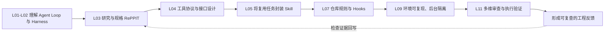

# Stanford CS146S Fall 2026：公开讲义逐页阅读记录

> 阅读日期：2026-11-12；仅针对**2026 秋季版**。这是教师原始课件的阅读笔记，不将社区转述、2025 年旧版幻灯片或未取得的课堂实录混写成当期一手资料。

- **主来源：** <https://themodernsoftware.dev/>（Fall 2026，Syllabus）
- **核对范围：** 已从官方课程页面关联的 Google Slides 原始链接，通过 Google 提供的 `/htmlpresent` 只读视图，逐页读取第 1、2、3、4、5、7、9、11 讲，共 **8 套、127 页**的公开文本、页标题和可见图表标签；各讲日期、页数和链接见下表。该视图不能保证完整呈现所有插图、动画、讲师演示和课堂发言，因此只对可见课件文本与可见图示信息负责。未能取得的讲次另列为未核读，不声称整学期所有讲义均已通读。
- **通读：** 已完成

## 一手讲义索引（逐页读取）

| 讲次 | 日期 | 页数 | 原始讲义只读入口 | 阅读状态 |
|---|---|---:|---|---|
| L01 课程简介、200 行 Coding Agent | 09-22 | 15 | [Lecture 9/22/26](https://docs.google.com/presentation/d/1uztIhjHAG6O_9QOD1N_3wdhwhABml1fANXEN2dGwdbg/htmlpresent) | 公开文本 15/15 页 |
| L02 现代 Coding Agent 的 Harness | 09-24 | 17 | [Lecture 9/24/26](https://docs.google.com/presentation/d/1RZu-p18Qybbgm8WVP2RH04ESc4Bn377B-T9j5-TBFdQ/htmlpresent) | 公开文本 17/17 页 |
| L03 上下文工程、RePPIT 与 Spec | 09-29 | 18 | [Lecture 9/29/26](https://docs.google.com/presentation/d/17brqoQQZHF3K82WgYaV6urAV3Q7iIwyGUBYRvSuY8QY/htmlpresent) | 公开文本 18/18 页 |
| L04 MCP、工具调用与接口设计 | 10-01 | 17 | [Lecture 10/1/26](https://docs.google.com/presentation/d/1q2cB1a7P4XsR0UJqE0RmtZFeggNOLdPaSnOpbBVewHA/htmlpresent) | 公开文本 17/17 页 |
| L05 Agent Skills | 10-06（课件标 10-07） | 15 | [Lecture 10/7/26](https://docs.google.com/presentation/d/15bPu5c-i8D8McTh6l7SpUPk2n9M_Y-CdDQLfyzL8RD8/htmlpresent) | 公开文本 15/15 页 |
| L07 仓库指令、Hooks 与 Subagents | 10-13 | 14 | [Lecture 10/13/26](https://docs.google.com/presentation/d/152VaUifBKH4T6hxd6fCKKM9kJTSAuBmkF8zSYwuTYAo/htmlpresent) | 公开文本 14/14 页 |
| L09 Agent-Ready Codebases | 10-20 | 15 | [Lecture 10/20/26](https://docs.google.com/presentation/d/1yCxocmUrGIN7IrC42WB6NW08PtYYFLe1ombDj3Ay6_8/htmlpresent) | 公开文本 15/15 页 |
| L11 Agentic Code Review | 10-27 | 16 | [Lecture 10/27/26](https://docs.google.com/presentation/d/1u8WYtFj0O9yc4H4JX9D4URYKhDzvrAGKLzn38DXSrak/htmlpresent) | 公开文本 16/16 页 |

## 各讲原文要点（依据教师课件，不是课堂逐字稿）

### L01｜从 LLM 到 Coding Agent（第 2–14 页）

- 课程主张学习可迁移的工程**原则**而不只追逐工具。开发者侧重系统架构、产品理解、沟通、上下文质量和校验代码。
- 最小 Agent 的闭环：用户在客户端输入任务 → LLM 选择直接作答或发出工具请求 → 客户端在模型外执行工具 → 结果并入下一轮上下文。示例工具是 `Read_file`、`List_dir`、`Edit_file`。
- 第 9 页描述该课程有作业、开源贡献和期末项目三类交付；讲义中的“10x”属于讲师的课程目标/观点，非独立评测结论。

### L02｜Harness 不只是模型与提示词（第 4–16 页）

- 把 **system prompt、配置文件、tool list、plan mode、subagents、skills、hooks、compaction** 放在完整 Harness 中分析。
- 工具名称、描述与完整参数签名也进入模型上下文；工具多不一定更好，讲义主张“更少、功能更强的工具”与可维护的上下文。
- 子智能体用新上下文完成子任务，再将结果交回主任务；并行能提高吞吐，但带来令牌开销。Compaction 用摘要代替部分历史，可能损失信息，需验证保留的约束。

### L03｜Research → Propose → Plan → Implement → Test（第 4–18 页）

- 课程从陌生代码库上手、复杂任务的规格化和逐步实施讲起；RePPIT 的五步分别产出事实、方案、计划、实现与测试证据。
- 强调提交规格前人工细读、大任务拆解；每完成一项留下可供下一步引用的工作记录。
- 讲义第 13–14 页把上下文靠近上限时的理解能力下降称为 “dumb zone”，给出“约 1/2–3/4”使用区间的经验建议；它不是经本课程量化验证的普适阈值。
- 对照 Superpowers（包含测试驱动及技能式工作流）与 OpenSpec（规格变更追踪），强调规格的归档和决策痕迹。

### L04｜MCP 与 Agent 工具接口（第 4–17 页）

- 课程以 M×N 对接问题解释 MCP 标准化：**Host → MCP Client（每 Server 的会话）→ MCP Server → Tool**。客户端调用 `tools/list` 得到工具名、描述和 JSON schema，再由模型决定调用；传输方式包括 stdio、Streamable HTTP。
- 两类接口设计：① 围绕**任务结果**组织工具，而非照搬多个微粒度 REST endpoint；参数明确、命名可发现、错误可诊断。② 面对大量工具，用按需 `search` / `execute` 的 Code Mode 取代一次把所有 schema 送入上下文。
- 讲义中出现的 “90+% token reduction” 属课件引用的方案宣传/论断，没有列出此课的对照实验；不可误写为课程亲测结果。
- 区分 API（供代码调用的服务接口）、MCP（可调用工具的统一协议）、Skills（编排可复用任务步骤的能力包）。

### L05｜Skill 设计与验证（第 4–14 页）

- Skills 适合代码理解与规划、验证、风格规范、浏览器操作等**高复用、有明确适用范围**的工作。
- 原则：一个 Skill 聚焦一个任务；写清触发语句；按需加载详细文件（progressive disclosure）；大型流程以可组合的技能分解。
- 从日常 Agent 对话中反复纠正的步骤提炼 Skill，而不是把零散提示无限加入默认 system prompt；用 verification skill 构成检查闭环。

### L07｜配置文件、Hooks、Subagents 各司其职（第 6–13 页）

- `AGENTS.md`/ `CLAUDE.md` 应说明**仓库地图、准确的 build/test 命令、代码规范、测试、安全及特定坑点**；避免复制容易过期的代码片段，根目录文档可作为子目录指令的路由入口。
- 讲义建议注意长度（示例为少于 300 行），这是一条写作经验而非平台统一硬性上限。
- Hooks 可在 `PreToolUse`、`PostToolUse`、`UserPromptSubmit`、`PreCompact` 等生命周期事件运行确定性校验；可用于阻止危险操作、格式化、验证。
- Subagents 适合分离上下文、代码探查、任务后简化或端到端测试；不要把它等同于把所有约束塞进一份仓库指令。

### L09｜Agent-Ready 仓库与后台 Agent（第 5–15 页）

- 人类开发者能临时克服的缺陷（缺文档、不可靠构建、测试不足、日志缺失等），会直接削弱 Agent 的完成与自我验证能力。
- 最小检查清单：**足够的测试、可复现/隔离的构建、文档化一致约定、可验证检查、Agent 专用操作手册**。
- 后台多任务工作流额外依赖开发环境隔离、可恢复验证。Git worktree 能隔离工作目录，但数据库、端口等共享资源仍可能冲突。
- 第 12 页列示的不同年代效率百分比与“2x+”属于课件的趋势叙述，并非课程提供的受控实验结果。

### L11｜智能体辅助代码审查（第 4–15 页）

- 审查不仅要找 bug，还帮助团队共享系统模型；检查正确性、可维护性、性能、安全和团队约定。
- 课程展示从人工全审 → 单智能体审查 → **按风险分层的多智能体审查**：安全、架构、质量、性能等专门审查器，再汇总判定。
- 审查器应取得必要上下文、与代码生成模型形成互补，必要时在可执行环境中验证，而不只是从 diff 推断缺陷。
- 评测可用历史上已确认缺陷的 PR 或回滚事件；把不同任务分配到成本和推理能力合适的模型。课件的分层方案是设计模式，不保证在任意仓库都有收益。

## 已排查但未作“通读”声明的讲次（截至 2026-11-12）

课程 2026 秋季课表共 **20 次讲次**，其中 11 月 12 日以前排定 15 讲，未来 5 讲（L16–L20）不能当作已发生的课程资料。只确认以下范围：

- **L06（10-08，Lee Robinson 嘉宾讲）：** 原始讲义入口为 [Lee_Stanford_Talk.pdf](https://drive.google.com/file/d/1b8WiBk_lcB3ue-jZMLijSUMLj6SDiF6Z/view?usp=drive_link)；公开 Drive 预览在当前读取方式下只返回加载页面，未取得 PDF 全部图文。讲者发布的 [2026 课堂录像](https://www.youtube.com/watch?v=L1OBRtfPS34) 能验证视频存在，但不等于已读完原始 PDF。
- **L08、L10、L12、L14（嘉宾讲）和 L13（安全）、L15（后台 Agent）：** 确认课程日历中有这些讲次；未能从可核查公开入口取得其**完整当期幻灯片**。L10 有另一场早期补充访谈，不能冒充 10-22 课堂实录。
- **L16–L20（11-12 至 12-03 排程）：** 在核查时刻属于当天尚未核验/未来安排，不标为已读。
- **2025 年历史版：** 官网另有 Fall 2025 课程，讲义不能等同于 Fall 2026 讲义，本次明确不混入。
- 以上“缺少公开入口”仅代表此次查找没有获得全文，**不等于学校未发布、无资料或该讲取消**；课件/录播可能在 Stanford Canvas、授课班级权限或后来发布。

## 归纳后的工程验证路径

此图为**针对公开幻灯片的学习路径归纳**，不是 2026 课程正式完整实施时序，也不是某一框架的源码调用图。

## Wiki 映射

- [CS146S：The Modern Software Developer](../../wiki/entities/cs146s-modern-software-developer.md)
- [课程前五周作业原文核读](cs146s-modern-software-developer.md)
