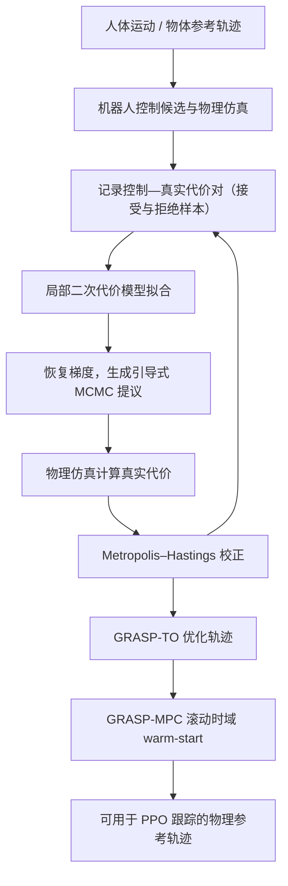

# GRASP（arXiv:2611.05754）

> 来源归档（paper）

- **标题：** GRASP: Gradient-Guided Sampling for Contact-Rich Physics-Based Motion Retargeting
- **类型：** paper
- **arXiv：** <https://arxiv.org/abs/2611.05754>
- **PDF：** <https://arxiv.org/pdf/2611.05754>
- **项目页：** <https://computationalrobotics.seas.harvard.edu/GRASP/>
- **代码：** <https://github.com/ComputationalRobotics/GRASP_code>
- **入库日期：** 2026-11-05
- **线索来源：** [人能稳稳提起的罐子，换一双机器手怎么提？](../blogs/wechat_embodied_station_43_papers_grasp_mesa_airoa_2026-11-05.md)（具身智能小站，2026-11-05）
- **一句话说明：** 人的手指能扣住提手，换一双指长和关节都不同的机器手，同样的手势却可能让容器滑落。

## 开源状态

- **已开源**（步骤 2.5 核查，2026-11-05）：仓库可达（git ls-remote）。项目页 HTTP 200。

## 核心摘录（公众号转述，未核验原文表格）

- 换一双机器手，怎样复现提罐和倾倒？。GRASP 在物理仿真里同时跟踪手与物体，利用试过的控制轨迹来调整手指的落点和握持姿势，让机器手也能提起容器、稳稳倾倒。
- 人的手指能扣住提手，换一双指长和关节都不同的机器手，同样的手势却可能让容器滑落。
- 指标：公众号转述：真机灵巧手展示了开环提拿和倾倒，整批成功率来自仿真。

## 对 wiki 的映射

- [paper-grasp](../../wiki/entities/paper-grasp.md)
- [接触丰富的手物重定向、分项泛化评测与手持夹爪示范：具身智能小站 11-05 期 43 篇阅读坐标](../../wiki/overview/embodied-station-2026-11-05-43-papers-technology-map.md)

## 一手资料补充核验（2026-11-11）

- 作者：Yang Liu、Tong Wang（共同一作）、Yiming Bao、Heng Yang；机构：Harvard University, School of Engineering and Applied Sciences。
- arXiv 首版：2026-11-03；论文共 26 页（含参考文献和附录）。
- 论文摘要：OakInk2 的 1,352 条双手示范成功率 **92.8%**；项目主页目前列出 Sharpa 双手 **94.2%**，且跨本体展示 Sharpa 94.2%、Wuji 92.4%、XHand 95.0%。**两份一手材料口径存在差异，不能直接互换，须在后续版本核对样本与成功定义。**
- 官方项目页定义成功条件：物体平均位置误差小于 10 cm，平均旋转误差小于 0.5 rad；执行失败计入失败。
- 项目主页报告的 Sharpa 对照：Dex-retargeting 28.6%、SPIDER mjwp 71.4%、SPIDER mjwp_act 77.1%、Do-as-I-Do 81.0%、GRASP 94.2%；项目页提示各基线评估集不完全一致，不能视为严格同协议横向对比。
- 核心算法：GRASP-TO 在 tempered SMC 中用历史 rollout 的控制—代价对拟合局部二次代理模型，恢复梯度引导 MCMC rejuvenation；用真实物理仿真代价与正反提议密度进行 Metropolis–Hastings 接受率校正。GRASP-MPC 采用 warm-start 的滚动时域规划扩展到长示范。
- 不需要可微分模拟器，也不需要任务专用接触奖励；优化参考轨迹用于 PPO 转笔和人形与物体交互跟踪；作者展示真机灵巧手和人形运动，但不能把仿真成功率解释为真机成功率。
- 源码地址：https://github.com/ComputationalRobotics/GRASP_code （与项目展示网站仓库 https://github.com/ComputationalRobotics/GRASP 区分）。
- 核验范围：本次核对 arXiv 摘要与官方项目页的方法、指标和表格；**未逐页通读 PDF 的全部 26 页，未逐文件审计源码，未运行实验**。

### 论文方法流程（依据官方项目页）

### 一手来源

1. [arXiv:2611.05754（摘要与版本）](https://arxiv.org/abs/2611.05754)
2. [Harvard GRASP 官方项目主页（方法、评估表格、成功定义）](https://computationalrobotics.seas.harvard.edu/GRASP/)
3. [官方代码仓库](https://github.com/ComputationalRobotics/GRASP_code)
