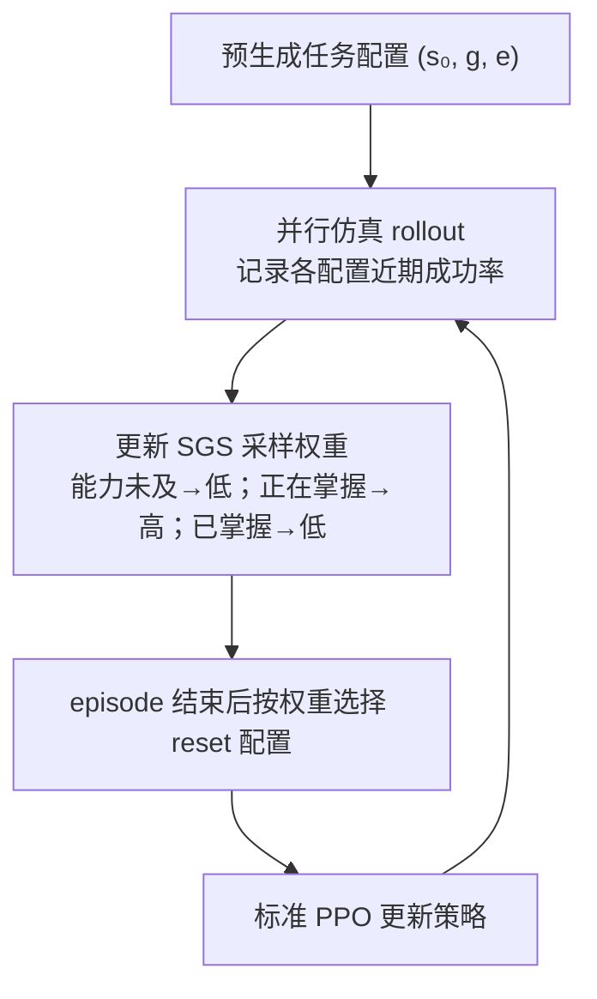

# A Balanced Data Diet: Addressing the Exploration Bottleneck in Mega-Scale RL for Robot Control

> 来源归档（ingest · arXiv v1）

- **类型：** paper / reinforcement learning / robot locomotion / contact-rich manipulation / sim-to-real
- **版本：** arXiv:2610.12465v1，2026-10-08
- **作者：** Octi Zhang, Mateo Guaman Castro, Patrick Yin, Ignacio Dagnino, Abhishek Gupta, Rosario Scalise, Byron Boots
- **单位：** University of Washington；NVIDIA（官网作者脚注）
- **会议：** CoRL 2026（arXiv comments 与项目页均标注 CoRL 2026）
- **论文：** [arXiv abstract](https://arxiv.org/abs/2610.12465) · [HTML](https://arxiv.org/html/2610.12465v1) · [PDF](https://arxiv.org/pdf/2610.12465v1)
- **项目页：** [SGS](https://sgs-rl.github.io/)
- **代码状态：** 项目页标为 **Code (coming soon)**；截至 2026-10-13 未提供官方仓库 URL，故不登记为已开源。
- **核查更新：** 2026-10-14（明确 Franka Panda 型号）
- **入库日期：** 2026-10-10
- **核对范围：** arXiv:2610.12465v1 PDF 全部 21 页的文字层（第 1-9 页正文、第 10-13 页参考文献、第 14-21 页附录 A-C 及全部表格）逐段读完；图（Fig. 1/3/4/5/7/8/9/10/11）只读到图注与正文引用的数字，未逐图目视，图 5 曲线上的具体点值未从图中读取；未读项目页视频；未运行任何代码。项目页表格数字（下文标「项目页」）不在 PDF 文字层内，属项目页独有来源。
- **通读：** 已完成
- **一句话说明：** Success-Guided Sampling（SGS）不改 PPO 更新本身，而根据每个任务配置近期成功率自适应调整 reset 采样权重，把大规模并行仿真中的训练预算集中到当前策略“正在学、但尚未掌握”的难度区域。

## 摘要与主要贡献（原归档摘录，章节出处见下节）

论文指出：大量并行环境并不自动带来更多有效学习信号。若对任务配置均匀采样，训练会持续抽到策略早已掌握的简单配置，以及当前能力下几乎不可能成功的极难配置。SGS 根据策略在配置上的成功率动态调度采样，让模拟 RL 批次更多落在能力边界附近。

作者在最高 $2^{20}$（超过一百万）并行环境下评测复杂四足多地形 locomotion 与接触丰富装配；进一步把 manipulation policy 蒸馏为 RGB 输入策略，在真实硬件上零样本迁移。具体硬件配置经论文正文核实：UR5e 使用 Robotiq 2F-85 夹爪与操作空间控制；Franka Panda 使用平行夹爪与关节位置控制。项目页也展示 ANYmal C/D、Franka 和 UR5e。

## 方法摘录

1. **保留普通 PPO。** policy、rollout、transition buffer 与 PPO 更新流程维持标准做法；改变的是 episode 结束后的任务配置 reset 分布。
2. **离线固定配置集合。** 预先生成大量任务配置。项目页将配置定义为三元组 $ (s_0,g,e) $：机器人初始状态、目标、环境（例如地形或场景布局）。
3. **按成功率调整采样。** 每个配置维护近期成功历史；失败率很高时权重低，策略开始取得进展但尚未稳定成功时权重上升，掌握后再下降。它不是简单地只抽“失败案例”，而是强调可学的能力前沿。
4. **任务覆盖。** 项目页展示 ANYmal C/D 多地形 locomotion；UR5e / Franka Panda 的 nut-on-bolt、rod-in-hole、gear-mesh、BNC / waterproof connector 等装配任务。装配配置混合 reaching、stable-grasp、near-goal 等 reset 策略。
5. **视觉 sim-to-real。** 训练在仿真进行；manipulation policy 蒸馏为 RGB-based policy 后在真实 UR5e 上执行。项目页展示 nut、rod、gear mesh 等演示。

### 训练采样逻辑

## 关键实验与评测

官网给出的多地形 locomotion（ANYmal D）成功率，均为三种子均值 ± 95% 置信区间：

| 并行环境数 | SGS | PLR | Uniform | Linear curriculum |
|---:|---:|---:|---:|---:|
| 4K | 0.46 ± 0.02 | 0.00 ± 0.00 | 0.00 ± 0.00 | 0.00 ± 0.00 |
| 32K | 0.49 ± 0.11 | 0.13 ± 0.01 | 0.42 ± 0.04 | 0.32 ± 0.03 |
| 256K | 0.72 ± 0.05 | 0.55 ± 0.14 | 0.00 ± 0.00 | 0.00 ± 0.00 |
| 1M | 0.73 ± 0.01 | 0.54 ± 0.13 | 0.00 ± 0.00 | 0.00 ± 0.00 |

官网给出的 Franka Panda nut-and-bolt manipulation 成功率：

| 并行环境数 | SGS | PLR | Uniform |
|---:|---:|---:|---:|
| 4K | 0.00 ± 0.01 | 0.00 ± 0.00 | 0.00 ± 0.00 |
| 32K | 0.06 ± 0.01 | 0.00 ± 0.00 | 0.00 ± 0.00 |
| 256K | 0.10 ± 0.14 | 0.02 ± 0.04 | 0.01 ± 0.04 |
| 1M | 0.70 ± 0.19 | 0.05 ± 0.11 | 0.06 ± 0.13 |

注意：项目页明确列出的是 Franka Panda nut-and-bolt 的规模结果；不能把该表误读成所有装配任务的统一成功率。论文完整实验、配置与统计口径请以 arXiv 原文为准。

## 硬件与控制设置摘录

- **UR5e：** 六项 NIST Assembly Taskboard 装配任务，配 Robotiq 2F-85 夹爪，采用操作空间控制；相机为第三人称相机和腕部相机。
- **Franka Panda：** nut-and-bolt 装配，采用平行夹爪与关节位置控制。
- **ANYmal C / D：** 多地形运动仿真，展示不同复杂地形任务。

来源：论文 [HTML 正文附录 C.1](https://arxiv.org/html/2610.12465v1)；项目页提供机器人类别和演示范围。

## 对 wiki 的映射

- SGS 单一项目实体：[paper-sgs-2610-12465.md](../../wiki/entities/paper-sgs-2610-12465.md)
- 官方项目页归档：[sgs-rl-github-io.md](../sites/sgs-rl-github-io.md)

## 原始入口

- arXiv:2610.12465v1：题名、作者、摘要、提交日期与论文正文。
- SGS 官方项目页：任务配置定义、采样机制图示、官网公开的成功率表、机器人与演示范围、代码发布状态。

## 通读补充（2026-11-12，据 PDF 全文）

> 以下数字与设置均来自论文正文 / 附录，括号内为章节或表号；与上文项目页摘录冲突时以此节为准。

### 方法细节（§3）

- 任务配置 τ=(s0, g, e)（§3.1）。离线固定 N 个配置：manipulation N=32,768，locomotion N=104,000（§3.2）；locomotion 配置构成见 A.1：每地形类型 2 个 seed、10 难度级、20 起点、20 目标，13 类地形，共 104,000 个（2×13×10×20×20，乘法为本归档核算）。
- 每配置保留最近 H=100 次布尔成功结果，均值为成功率 p_i（§3.2，B.2 环形缓冲）。
- 权重 w_i=(p_i+ε)^{κt}(1−p_i+ε)^{κ(1−t)}（式 1，Beta(1+κt,1+κ(1−t)) 的 mode-concentration 形式），logit ℓ_i=log(w_i+ε)，下一配置从温度 T 的 softmax 中 i.i.d. 采样（式 2）。
- 超参：locomotion t=0.66、ε=1e-8、κ=5；manipulation t=0.5、ε=1e-4、κ=1；T=2（§3.2）。B.2 实现：w 下限 ε、Teff=max(T,1)。
- 共享奖励：每个域一个奖励，式 3 为布尔任务成功项加小的机器人相关逐步正则项（§3.3）；locomotion 权重 λsucc=50、λfail=-50 等（A.3.1），manipulation λsucc=100、λfail=1（A.3.2）。
- 不使用示范训练 RL（§1, §2）；论文自称「不主张全新课程原则」，SGS 与 SFL 的 p(1−p) 同属「强调中等成功率」原则（§2）。

### 实验设置与结果（§4、附录 B）

- 缩放实验：并行环境 4K / 32K / 256K / 1M，每规模 3 个训练 seed，评估重置从训练分布新采样；PPO mini-batch 数固定，batch 随环境数增大；locomotion 训练 5K 次 PPO 迭代、nut-and-bolt 7.5K 次；每 GPU 最多 32,768 / 16,384 环境（L40S 与 H200）；训练约 36 小时（locomotion）、128 小时（Franka nut-and-bolt）（§4.3）。
- 1M 环境：locomotion SGS 73% vs PLR 54%；Franka nut-and-bolt SGS 70% vs uniform 6% vs PLR 5%（§4.3, Fig. 5）。
- UR5e rod-in-hole：32K 环境时 SGS 成功而 uniform 与 PLR 为零，256K 时各方法约 98%（§4.3, §4.4, Fig. 5c）。
- SFL 对比（locomotion，Table 1）：4K SFL final 0.255±0.051 / SFL best 0.289±0.015 / SGS 0.456±0.019；32K SFL final 0.051±0.142 / best 0.421±0.032 / SGS 0.494±0.113。SFL 末期性能下降（B.1）。
- 4K 环境下 baseline「完全学不会」、SGS 在许多地形非零成功（§4.4, Fig. 8）。
- 敏感性（B.2, Table 3，locomotion 32K，两 seed）：各超参设置成功率 0.39–0.53，名义设置 0.49；history H=25 为 0.39；配置密度 p=10→20（52,000→104,000 配置）成功率 0.38→0.49，p=40 为 0.48。
- reset 覆盖消融（B.3, Table 4，UR5e rod-in-hole，3 seed）：去掉 Near-Goal 后成功率 0.0；去掉 Reaching 基本不变；去掉 Stable Grasp 平均下降且其中一个 seed 崩溃。
- 重力课程消融（B.4, Table 5）：1M 环境 Franka nut-and-bolt，无重力课程单 seed 为 0.694±0.040，有课程 0.702±0.039（均为 512 评估 episode 的 95% CI，不跨训练 seed）；作者称主缩放实验用了重力课程且「后来发现不必要」（§4.2）。
- UR5e 六任务（B.5, Table 6，Reaching 初始分布）：nut-and-bolt（256K 环境）SGS 90.04 / uniform 48.83 / PLR 59.77；其余五个插入任务（64K 环境）SGS 与 uniform 相近，rectangular-peg 上 PLR 84.18 低于 uniform 92.09 与 SGS 92.77。作者把 UR5e 与 Franka 的 nut-and-bolt 差距主要归因于控制接口（OSC vs 关节位置控制），并说明机械臂、夹爪、10 Hz vs 25 Hz 也不同（B.5，作者归因，未做消融）。

### 真机与迁移（§4.5、附录 C）

- 蒸馏：点云 teacher → RGB student（两路 ResNet-18：侧面与腕部相机），用 DAgger，约两天、4 块 L40S、每块 480 环境；保留 6.67% 环境做留出评估（§4.5, C.3）。
- Table 2：nut-and-bolt 仿真 teacher 90.04 / student 89.05，真机 37.5%（18/48）、first-try 12.5%、0.23 次成功/分钟；rod-in-hole 仿真 95.70 / 93.36，真机 61%（30/49）、first-try 28.57%、0.71；gear mesh 仿真 96.09 / 96.42，真机 94%（47/50）、first-try 76.0%、3.08。
- 真机评估时用胶带覆盖抛光亚克力板以避免腕部相机倒影与低摩擦（C.1）；板用 command strips 固定（C.5）；夹爪垫摩擦从 OmniReset 的 µ=100 降到 µ=2（C.2，只有 µ=2 训练稳定）。
- 评估时长约 83 / 42 / 15 分钟，分别收集 48 / 49 / 50 条轨迹（C.5）。
- 另外：对称感知 reset 与成功判据将 OmniReset peg insertion 的 RGB student 仿真成功率从 55.45 提到 98（C.3, Table 7）。

### 作者自承的局限（§5）

1. 离散 K 个配置（K=32,768 够用），连续或更大任务空间需要学习式 / 层级式打分表示。
2. SGS 只在给定分布上采样，不构造分布，依赖 OmniReset 等 reset 多样性方法；「选择哪些配置可用」的闭环是开放问题。
3. sim-to-real 差距仍在，真机成功率未达仿真水平。
