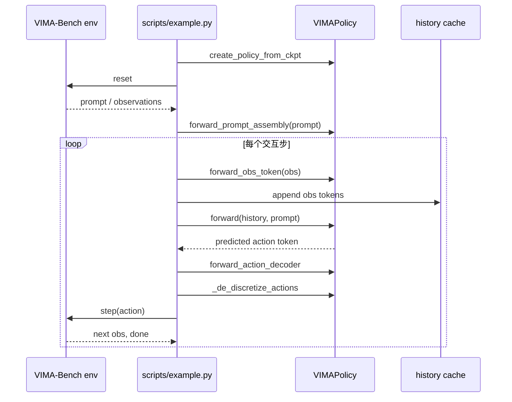

# VIMA: General Robot Manipulation with Multimodal Prompts / 多模态提示的通用机器人操作

- **类型：** paper
- **论文：** https://arxiv.org/abs/2210.03094
- **全文：** https://arxiv.org/html/2210.03094
- **版本：** arXiv:2210.03094v2，2023-05-28；ICML 2023
- **作者：** Yunfan Jiang, Agrim Gupta, Zichen Zhang, Guanzhi Wang, Yongqiang Dou, Yanjun Chen, Li Fei-Fei, Anima Anandkumar, Yuke Zhu, Linxi Fan
- **论文官方出版页：** https://proceedings.mlr.press/v202/jiang23b.html
- **官方算法代码：** https://github.com/vimalabs/VIMA
- **官方基准：** https://github.com/vimalabs/VIMABench
- **通读：** 已完成
- **核对范围：** arXiv v2 正文 §1–§7；附录 A 的仿真器、B 的 17 个任务及成功条件、C 的模型/tokenization/动作解码、D 的训练配置、E 的量化扩展实验、F 的相关工作、G 的局限、H 的完整表格；另外查看作者代码仓脚本 `scripts/example.py` 与 `vima/policy/vima_policy.py` 的推理入口。未执行模型训练或复现实机。
- **映射 Wiki：** [VIMA canonical 论文节点](../../wiki/entities/paper-pai-2210-03094-vima.md)。

## 方法原理（正文 §2–§4 与 Appendix C）

1. **多模态 prompt 接口**：把自然语言、单物体图像、整景图像或视频帧按次序交错放入 prompt；同一模型覆盖视觉目标到达、陌生概念指代、单次演示模仿、视觉约束与推理。
2. **目标中心 tokenization**：整景 RGB 由微调 Mask R-CNN 解析实例；bbox `(cx,cy,h,w)` 与裁剪图 ViT（32×32 输入、16 patch）各自编码后投影为 object tokens。T5-base 111M 编码 prompt，仅微调最后两层（附录 C.2 Table 2）。前/俯视观测同样形成 object tokens，再拼接夹爪/末端状态；历史动作通过两层 MLP 编码。
3. **控制器**：因果 decoder 交替采用 history 内 causal self-attention 与 `Q(history), K/V(prompt)` cross-attention。每次环境交互输出一个 waypoint 命令。附录 C.2 将两端位姿分解为离散预测头，xy bins 50/100，旋转 bins 50；这不是关节级力矩控制。
4. **训练**：离线 scripted-oracle 示教行为克隆、动作分类负对数似然；训练时对错误检测做数据增强。不能将仿真 oracle 视为真实遥操作采样。

## VIMA-Bench：实验与消融（正文 §3、§5；Appendix E/H）

- 17 个模板任务，6 类 prompt 场景；其中 4 个任务用于最困难的 zero-shot 新任务评估。每个训练任务 50k oracle 轨迹，合计 **650k 成功轨迹**；abstract 写 600K+ 是同一数量级，并非额外数据。
- 四级评测：L1 物体位置随机、L2 已见概念新组合、L3 新物体与纹理、L4 新任务/新 prompt 模板；成功率是二值回合成功比，而非轨迹每一步成功率。
- 扫描 2M、4M、9M、20M、43M、92M、200M 控制器参数（不含固定的 T5-base 111M）。摘要 **至多 2.9×** 是特定模型规模与 L4 相对 VIMA-Gato 的倍率，不能跨任务泛化。
- Appendix E.3 Table 11：92M 控制器使用全部数据，L1/L2/L3/L4 成功率约 **79.3/80.1/81.9/49.6%**；用 10% 数据时约 **76.3/75.8/73.2/46.0%**，说明数据效率但 L4 仍明显困难。
- 对比 VIMA-Gato、VIMA-Flamingo、VIMA-GPT；物体 token 优于单整图 token/纯 patch 方案；cross-attention 在小模型和 L4 更有利。T5-small/base/large 效果近似，不能说大语言模型越大必然越好。
- Appendix E 检验额外 distractors、不完整 prompt / 随机词腐蚀；效果依具体破坏强度而定。

## 原文局限与迁移边界（Appendix G）

- **依赖外部目标检测**：Mask R-CNN 错检、遮挡、OOD 物体会影响动作；理论上可换更强 detector，但未经本文真机证明。
- **仿真器任务和动作原语有限**：PyBullet/Ravens 桌面、脚本化 `pick/place` 与 `wipe`，不等同真实灵巧操作、连续接触力控或移动操作。
- **成本与泛化边界**：L4 新任务成功率显著低于已见任务；prompt 稳健性不是物理安全保证。

## 代码级运行时序（已核验路径，未执行）

官方 `scripts/example.py` 的 `main(cfg)` 通过 `create_policy_from_ckpt()` 创建策略和 VIMA-Bench 环境，首次 reset 解析 prompt 调 `forward_prompt_assembly`，每步调用 `forward_obs_token`、策略的 forward 预测与 `forward_action_decoder`，对离散动作调用 `_de_discretize_actions`、执行 `env.step(actions)`；缓存 observation/action tokens 并循环。对应模型方法见 `vima/policy/vima_policy.py`。这说明实际代码入口路径，但不代表本次已验证环境或权重可运行。

> **边界**：论文及其附录已通读，代码只核对了以上入口和函数调用，未实际下载/运行数据和训练。跨论文机器人性能比较需另设协议。
