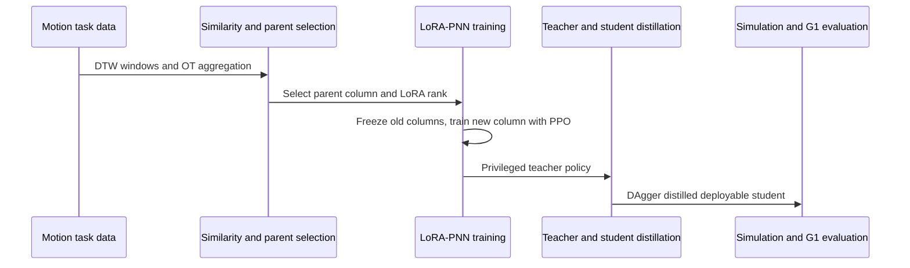

# Continual Humanoid Motion Learning 代码入口归档

- **项目/论文：** [Continual Humanoid Motion Learning](https://arxiv.org/abs/2610.04231)
- **论文中给出的代码入口：** https://anonymous.4open.science/r/continual-humanoid-learning-35D3
- **关联实体：** [paper-continual-humanoid-motion-learning](../../wiki/entities/paper-continual-humanoid-motion-learning.md)

## 入口状态

论文摘要提供了匿名代码入口。当前可访问的索引信息未暴露仓库 README、源码目录、许可证、依赖版本或运行命令，因此本归档只记录入口，不将训练参数表误写成可直接执行的安装/复现指南。开始复现前应在项目页确认源码是否仍可访问、许可证及依赖环境。

## 论文描述的运行流程

下图依论文方法部分抽象：输入新动作任务，计算动作相似度并选择既有 PNN 列，以 LoRA 适配新列；训练教师后蒸馏学生，最后进行仿真及 Unitree G1 跟踪评测。匿名源码的文件名与模块边界未核验，本图不代表仓库目录结构。

## 复现信息（论文报告）

- 数据/任务：LAFAN1 与 Kungfu 动作；walk、run、jump、dance、fight、fall-and-up。
- 仿真训练：每任务 50k iterations、1,024 并行环境；每任务 100 个评测 episode。
- 实机平台：Unitree G1；论文报告 30 个动作、每动作 10 次尝试。
- 这些是论文实验设置，不能替代未核验的具体配置文件、依赖锁定和运行命令。

## 来源

- [arXiv 摘要与代码链接](https://arxiv.org/abs/2610.04231)
- [arXiv HTML v1](https://arxiv.org/html/2610.04231v1)
- [匿名代码入口](https://anonymous.4open.science/r/continual-humanoid-learning-35D3)
- [论文来源摘录](../papers/continual_humanoid_learning_arxiv_2610_04231.md)
