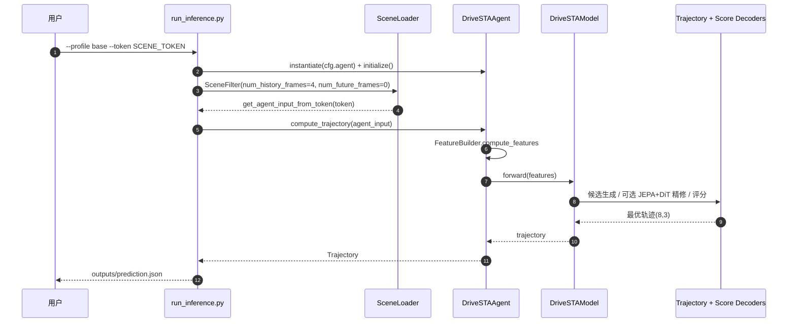

# DriveSTA：Rtwotwo/DriveSTA 官方开源实现

- **地址：** https://github.com/Rtwotwo/DriveSTA
- **论文：** https://arxiv.org/abs/2611.27515（原文未成功读取）
- **项目：** https://rtwotwo.github.io/DriveSTA/
- **资产入口：** https://huggingface.co/Rtwotwo/DriveSTA
- **许可：** Apache-2.0（主仓原始代码；third_party 与外部数据需分别查许可）
- **核对日期：** 2026-11-23
- **核对范围：** README、docs/CODE_STRUCTURE.md、INFERENCE.md、MINING.md、MODEL_CONFIGS.md、VALIDATION.md、navsim/planning/script/run_inference.py、navsim/agents/drivesta/drivesta_agent.py、navsim/agents/drivesta/drivesta_model.py；源码为静态阅读，未执行训练或评测。
- **通读：** 已完成

## 开源范围

| 内容 | 状态 | 核对入口 |
|---|---|---|
| 推理/评测 | **已开源** | `run_inference.py`、`scripts/evaluation/run_drivesta_pdm_score_evaluation.sh` |
| 训练与配置 | **已开源** | `scripts/training/train_drivesta.sh`、Hydra `training/*.yaml` |
| 轨迹挖掘/筛选 | **已开源** | `feedback/`、`docs/MINING.md` |
| 四种 profile | README 提供 | `base_proposal`、`base`、`scale_proposal`、`scale` |
| 模型权重与轨迹归档 | README 列出 | 外部 HF 资产页面未直接核查下载 |
| HUGSIM 全量复现 | **不包含在单一 NAVSIM v1 脚本里** | `docs/INFERENCE.md` 明确依赖独立 benchmark |

## 代码职责

- `navsim/planning/script/run_inference.py`：解析 profile / token，读取 Hydra checkpoint profile，建立 SceneLoader，调用 agent，写入 JSON。
- `navsim/agents/drivesta/drivesta_agent.py`：DriveSTAAgent 初始化、严格加载 checkpoint、FeatureBuilder、调用 DriveSTAModel、计算最终轨迹。
- `navsim/agents/drivesta/drivesta_model.py`：场景编码、轨迹候选生成、可选 JEPA + DiT 残差精修、ScoreDecoder 评分及 argmax 选择。
- `navsim/agents/drivesta/{encoders,decoders,losses}/`：DINOv2、JEPA、轨迹 / 评分头、训练目标。
- `feedback/src/drivesta_feedback/`：离线采样、评分与候选 bank 处理。

## 已核对的推理时序



> 此图是公开源码静态调用关系，**不是已经在本机成功执行的 trace**。八个位姿为自车系 `(x_m,y_m,heading_rad)`，0.5 秒间隔、4 秒时域。

## 官方复现入口

```bash
python scripts/download_assets.py --profiles base
export OPENSCENE_DATA_ROOT=/path/to/openscene
source scripts/environment.sh
python -m navsim.planning.script.run_inference --profile base --token SCENE_TOKEN --split test --device cuda --output outputs/prediction.json

bash scripts/training/train_drivesta.sh base_proposal
bash scripts/training/train_drivesta.sh base agent.checkpoint_path=/path/to/proposal_checkpoint.ckpt
GPUS_PER_NODE=1 bash scripts/evaluation/run_drivesta_pdm_score_evaluation.sh base
```

**依赖边界：** 官方 PDMS 还需要匹配的 NAVSIM 地图、metric cache 和日志；全量 NAVTEST 需 12,146 场景齐全。官方 VALIDATION.md 记录 2026-11-18 的发布验证，但**未重新跑整套训练或全基准**。

## 对 wiki 的映射

- [DriveSTA](../../wiki/entities/paper-drivesta.md)
- [论文归档](../papers/drivesta_arxiv_2611_27515.md)
- [项目页](../sites/drivesta.md)
