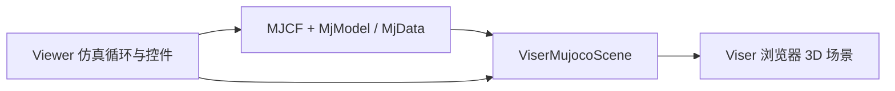

# mjviser

> 来源归档

- **标题：** mjviser
- **类型：** repo / MuJoCo 浏览器 3D 查看器
- **官方仓库：** https://github.com/mujocolab/mjviser
- **关联项目：** [MuJoCo](https://github.com/google-deepmind/mujoco)、[Viser](https://github.com/viser-project/viser)、[mjlab](https://github.com/mujocolab/mjlab)
- **许可证：** Apache-2.0
- **核查版本：** 0.0.14（读取仓库 `pyproject.toml`，2026-10-12）
- **入库日期：** 2026-10-12
- **一句话说明：** 将 MuJoCo 模型与状态接入 Viser，提供浏览器里的实时 3D 场景、仿真控制和状态检查；它是查看器，不是训练框架或物理引擎。
- **沉淀到 wiki：** 是 → [`wiki/entities/mjviser.md`](../../wiki/entities/mjviser.md)

---

## 核心定位

mjviser 是面向 MuJoCo 的网页查看器。它基于 Viser 创建浏览器可视化，把 MuJoCo 的模型（`MjModel`）和运行状态（`MjData`）呈现在交互式场景中。它可以单独加载 MJCF 模型，也可以嵌入自定义仿真循环。

应区分三个层次：

| 层 | 项目 | 职责 |
|---|---|---|
| 物理模型与仿真 | MuJoCo | 加载 MJCF、维护状态并推进物理 |
| 3D 场景与网页查看器 | mjviser + Viser | 把模型/状态呈现在浏览器，提供视图和控制交互 |
| 强化学习训练 | mjlab | 组织并训练机器人策略；可与 mjviser 查看器配合 |

因此，称其为“mjlab 的渲染器”不够准确：mjviser 是独立包；mjlab 可依赖它作为可视化层，mjlab 本身承担训练环境与训练工作流。

---

## 使用方式

### 命令行

安装后可用 `mjviser path/to/model.xml` 启动查看器；仓库也提供 `uvx mjviser path/to/model.xml` 的临时运行方式。默认端口为 8080，可用 `--port` 指定端口。对于当前目录下的模型，也支持按名称模糊匹配，例如 `mjviser humanoid`。

### Python API

基本模式是用 MuJoCo 加载模型与数据，再启动 Viewer：

```python
import mujoco
from mjviser import Viewer

model = mujoco.MjModel.from_xml_path("robot.xml")
data = mujoco.MjData(model)
Viewer(model, data).run()
```

Viewer 提供接近 MuJoCo 原生查看器的常用交互，包括仿真播放/暂停/单步/重置、关节与执行器滑块、相机跟踪、关键帧，以及接触和力的显示。自定义应用可以传入 `step_fn`、`render_fn`、`reset_fn`；也可以直接使用 `ViserMujocoScene`，自行管理仿真循环和 GUI。

---

## 内部结构与数据流



- **`ViserMujocoScene`：** 场景渲染基础层，从 MuJoCo 模型构建几何，并根据 `MjData` 更新位姿；处理相机跟踪、contact/force、geom/site 分组等可视内容，不负责仿真循环。
- **`Viewer`：** 在场景层上管理实时步进、播放控制、重置、速度、关键帧、关节/执行器滑块和物理标记。
- **转换工具：** MuJoCo 几何和网格通过转换逻辑接入 Viser 场景；Viser 的网页客户端提供浏览器端 3D 呈现。mjviser 的定位是模型查看与调试，不替代 MuJoCo 的动力学计算。

---

## 与 mjlab 的关系

mjlab 的训练环境可使用 mjviser 作为可视化工具。mjlab 侧通过 `MjlabViserScene` 扩展 `ViserMujocoScene`，补充训练/仿真相关的调试可视化与 MuJoCo Warp 适配。训练任务、策略更新和大规模并行 rollout 属于 mjlab；通用场景查看、交互控件和网页呈现由 mjviser/Viser 提供。

Draft 仓库依赖分组区分了不同用途：浏览器参数编辑器的 `editor` extra 使用 Viser；`figures` extra 显式包含 mjviser 用于渲染论文展示图；`rl` extra 包含 mjlab 用于训练。若指论文中的静态白底渲染图，仓库依赖线索指向 mjviser；若指交互式参数编辑器，则它直接使用 Viser。二者都不应笼统称为“mjlab 渲染器”。

---

## 适用场景与边界

| 适合 | 不负责 |
|---|---|
| 在浏览器查看 MJCF 机器人/场景与运动状态 | 机器人模型参数化生成（如 Draft） |
| 快速检查关节、执行器、接触与力可视化 | 训练算法、奖励函数、课程设计 |
| 为自定义控制器接入可视化回调 | MuJoCo / MuJoCo Warp 物理内核 |
| 远程运行仿真并通过浏览器观察 | CAD 设计或通用 DCC 内容制作 |

仓库 README 标注的限制之一是鼠标直接点击/拖拽刚体和键盘回调受上游 Viser 能力限制。

---

## 关键依赖与来源

- 官方仓库 README：<https://github.com/mujocolab/mjviser>
- 依赖与版本：<https://github.com/mujocolab/mjviser/blob/main/pyproject.toml>
- 开发架构说明：<https://github.com/mujocolab/mjviser/blob/main/CLAUDE.md>
- Viser 网页 3D 可视化库：<https://github.com/viser-project/viser>
- MuJoCo 物理引擎：<https://github.com/google-deepmind/mujoco>
- mjlab 训练框架：<https://github.com/mujocolab/mjlab>

## 对 wiki 的映射

- [`wiki/entities/mjviser.md`](../../wiki/entities/mjviser.md)：查看器的定位、架构与使用方法
- [`wiki/entities/mujoco.md`](../../wiki/entities/mujoco.md)：物理引擎与 MJCF 模型
- [`wiki/entities/mjlab.md`](../../wiki/entities/mjlab.md)：训练框架及与查看器的分工
