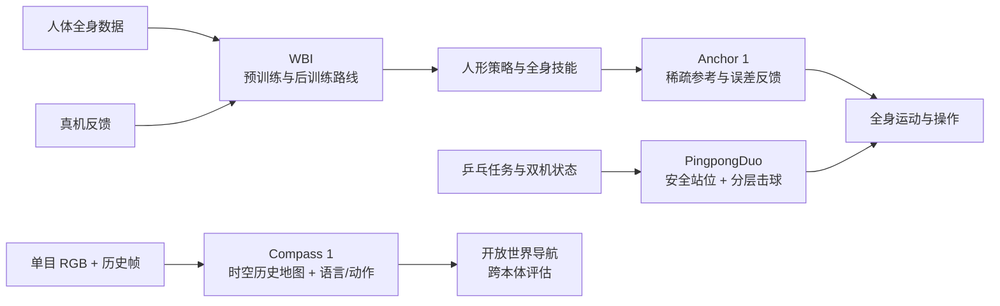

# 源策未来（Archon Robotics）Research 栏目核查（2026-11-16）

- **官方 Research：** <https://www.archon.tech/research>
- **机构：** 源策未来（Archon Robotics）
- **核验日期：** 2026-11-16
- **核对范围：** Research 列表全部四项及其发布时间；分别核对项目页面的方法、公开评测与代码/权重入口；Compass 1 另核验 OpenDriveLab/Compass README。未逐帧核对视频，论文细节以既有独立论文节点及其原文归档为准。
- **通读：** 已完成
- **开放状态：** WBI 为技术观点；PingpongDuo 未提供源码入口；Anchor 1 权重、部署与遥操作工具标记 2026 年末预计发布；Compass 1 官方展示仓现为 OpenDriveLab/Compass，数据、部署代码与真机权重标记 2026 年 12 月预计发布，计划不是已发布。
- **映射：** [源策未来公司页](../../wiki/entities/archon-robotics.md)；公司时间线数据 `docs/company-roadmaps.json`。

## 官网 Research 列表（按官方发布日期排列）

| 日期 | 官方栏目 | 研究定位 | 独立 wiki 页 | 直接来源 |
|---|---|---|---|---|
| 2026-07-13 | Whole-Body Intelligence（Perspective） | S2/S1/S0.5/S0 分层，人类全身数据预训练、真机后训练；技术路线而非已发表完整模型 | [WBI](../../wiki/entities/archon-whole-body-intelligence.md) | <https://www.archon.tech/research/whole-body-intelligence> |
| 2026-10-15 | PingpongDuo（X-Lab） | 两台 G1 乒乓球双打；团队风险过滤站位 + 分层步法/击球 + 球拍臂残差 | [PingpongDuo](../../wiki/entities/paper-pingpongduo.md) | <https://www.archon.tech/research/pingpongduo>；<https://arxiv.org/abs/2610.20579> |
| 2026-10-30 | Anchor 1（System 0） | 骨盆、双腕、双踝 5 个稀疏位姿目标；校准映射、离线重定向监督与独立跟踪误差反馈 | [Anchor 1](../../wiki/entities/paper-anchor-1.md) | <https://www.archon.tech/research/anchor1>；<https://arxiv.org/abs/2611.00193> |
| 2026-11-09 | Compass 1（Navigation） | 单目 RGB 历史关键帧 + History Representation Map；结构化 VQA、异步语言/视频动作生成；跨四种本体评估 | [Compass 1](../../wiki/entities/paper-compass-1-navigation.md) | <https://www.archon.tech/research/compass1>；<https://arxiv.org/abs/2611.12087> |

## 方法与实验信息（按官方对应协议）

- **WBI：** 该文定义全身智能的预训练路径；不是已验证通用人形基础模型的性能报告，未给公开权重。
- **PingpongDuo：** 仿真平均连续回合 4.87 ± 0.74（学习站位）对比规则 3.79 ± 0.36；回球成功率 55.6 ± 9.76%（含手臂残差），无残差 44.2 ± 12.97%。网站展示真实双机严格交替连续击球；仿真指标不外推至真机。
- **Anchor 1：** 真机 Reachability 子集 51 条，腕部全局位置误差 44.58 mm，对照 MimicLite 53.59 mm；In-House 真机子集 72 条分别 75.69 mm 与 105.74 mm。两种设置的局部/全局分数不同，且推理无需在线关节空间重定向，不代表离线训练没有重定向。
- **Compass 1：** 320 次 Go2 真机开放世界测试成功 254 次（79.4%），最强基线 17.8%；记忆回溯专项 58%。公开跨本体零样本演示覆盖四足 Go2、人形 Booster K1、轮式平台、无人机。79.4% 是指定真实场景协议，非统一通用导航成绩。

## 开放与归属边界

- 官网 Research 列有 **四篇内容**，与“公司至 2026-10 仅 1 篇博客”这一历史快照不同。
- RoboNaldo（2026-06，<https://arxiv.org/abs/2606.11092>）和 EgoHumanoid-V2（2026-09，<https://arxiv.org/abs/2609.37181>）虽不在 Research 列表，但已有 Archon 联合署名的独立论文节点；公司路线仍保留，不能把官网栏目数量误写为全部公司署名论文数量。
- Compass 1 项目页 GitHub 链接为 <https://github.com/OpenDriveLab/Compass>；旧路径 `OpenDriveLab/Compass1` 已重定向。2026-11-16 读取 README：论文和项目展示已发布；数据、真机部署与 checkpoint 勾选仍未完成，标明 2026-12 *Expected*。
- Anchor 1 官网显示 GitHub / Hugging Face “Available soon”，预计 2026 年末；PingpongDuo 页面提供论文、视频与交互回放，未发现官方实现仓。
- 公司 / OpenDriveLab 合作研究不自动意味着公司拥有全部源码或已发布基础模型；这里以官网、论文及仓库显式状态为准。

## 主流程与关系（整理视角）

上图是**研究主题对照**而非官方统一产品系统图：官网没有声明 WBI、Anchor 1、PingpongDuo、Compass 1 已部署成单一集成运行栈。
