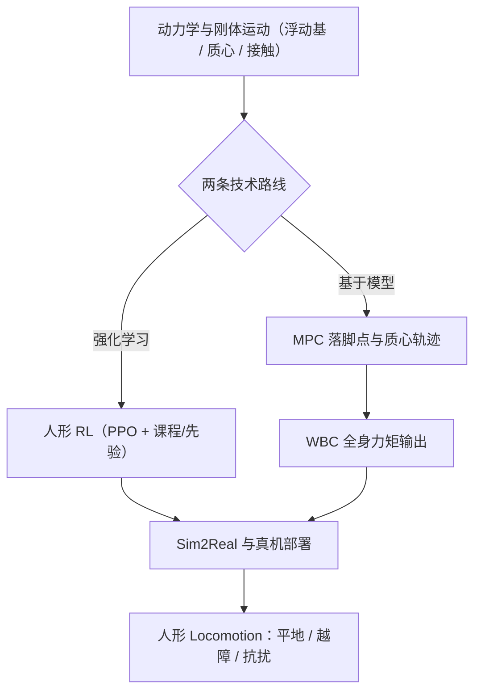

# 人形 Locomotion（双足行走 · 技术栈模块）

人形双足行走要同时解决三件事：**怎么迈步**（步态与落脚点）、**怎么不摔**（平衡与扰动恢复）、**地形变了怎么办**（感知与自适应）。它是本站的主线任务之一，传统控制（MPC + WBC）与强化学习两条路线都在这里正面相遇。

## 在全栈中的位置

## 核心内容与站内入口

- **任务与指标定义**：[Locomotion 任务页](../../../wiki/tasks/locomotion.md)
- **强化学习路线**：[强化学习 Locomotion 纵深路线](../../../roadmap/depth-rl-locomotion.md) · [人形强化学习模块](../rl/humanoid-rl.md)
- **模型控制路线**：[MPC 模块](mpc.md) · [WBC 模块](whole-body-control.md)
- **工程避坑指南**：[常见失败模式](../../../wiki/queries/locomotion-failure-modes.md) · [奖励设计指南](../../../wiki/queries/locomotion-reward-design-guide.md)

## 上下游模块

- **上游依赖**：[动力学](../robotics/dynamics.md) · [运动学](../robotics/kinematics.md) · [全栈技术域总览](../../overview.md)
- **下游落地**：[仿真（系统集成层）](../system/simulation.md) · [部署（上真机）](../system/deployment.md)

## 参考来源与收录边界

- [sources/papers/mpc.md](../../../sources/papers/mpc.md) — 模型预测控制与腿足步态规划归档
- [sources/papers/sim2real.md](../../../sources/papers/sim2real.md) — 腿足/人形 Sim2Real 迁移档案
- 论文索引见 [Locomotion RL 论文导航](../../../references/papers/locomotion-rl.md) 与 [Locomotion 评测](../../../references/benchmarks/locomotion-benchmarks.md)。
