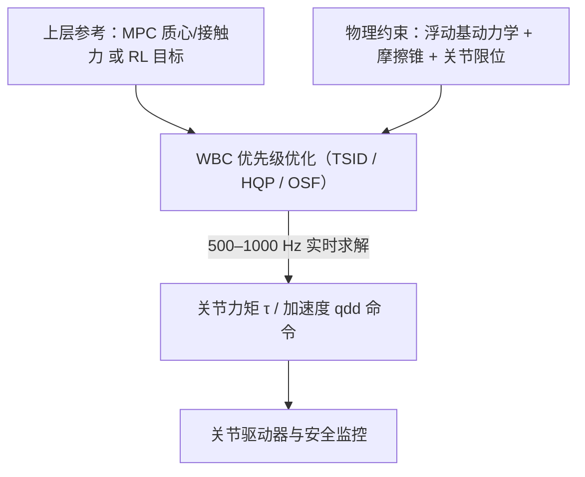

# WBC（全身控制 · 技术栈模块）

**WBC** 负责把上层给出的多个任务目标（质心轨迹、末端位姿、姿态、接触力）与机器人的物理约束（动力学、关节限位、摩擦锥）一起写成一个优化问题，解出这一拍该发给每个关节的力矩。它是人形运控栈里承上启下的那一层：上面是 MPC / 规划 / 策略，下面是关节驱动器。

## 在全栈中的位置

## 核心内容与站内入口

- **概念与公式化**：[Whole-Body Control](../../../wiki/concepts/whole-body-control.md) · [TSID](../../../wiki/concepts/tsid.md) · [HQP](../../../wiki/concepts/hqp.md)
- **实现与调参指南**：[WBC 实现指南](../../../wiki/queries/wbc-implementation-guide.md) · [WBC 调参](../../../wiki/queries/wbc-tuning-guide.md)
- **路线选型**：[什么时候用 WBC、什么时候用 RL](../../../wiki/queries/when-to-use-wbc-vs-rl.md) · [WBC vs RL](../../../wiki/comparisons/wbc-vs-rl.md)

## 上下游模块

- **上游输入**：[MPC 模块](mpc.md) · [动力学](../robotics/dynamics.md) · [运动学](../robotics/kinematics.md) · [全栈技术域总览](../../overview.md)
- **下游落地**：[人形 Locomotion](humanoid-locomotion.md) · [部署（上真机）](../system/deployment.md)

## 参考来源与收录边界

- [Sentis & Khatib ICRA 2006 原文归档](../../../sources/papers/sentis_khatib_icra_2006_wbc_framework_reading_wbc.md)
- [Khatib & Sentis IJHR 2004 原文归档](../../../sources/papers/khatib_sentis_ijhr_2004_whole_body_dynamic_behavior.md)
- 完整经典论文谱系见 [Whole-Body Control 论文导航](../../../references/papers/whole-body-control.md)。
