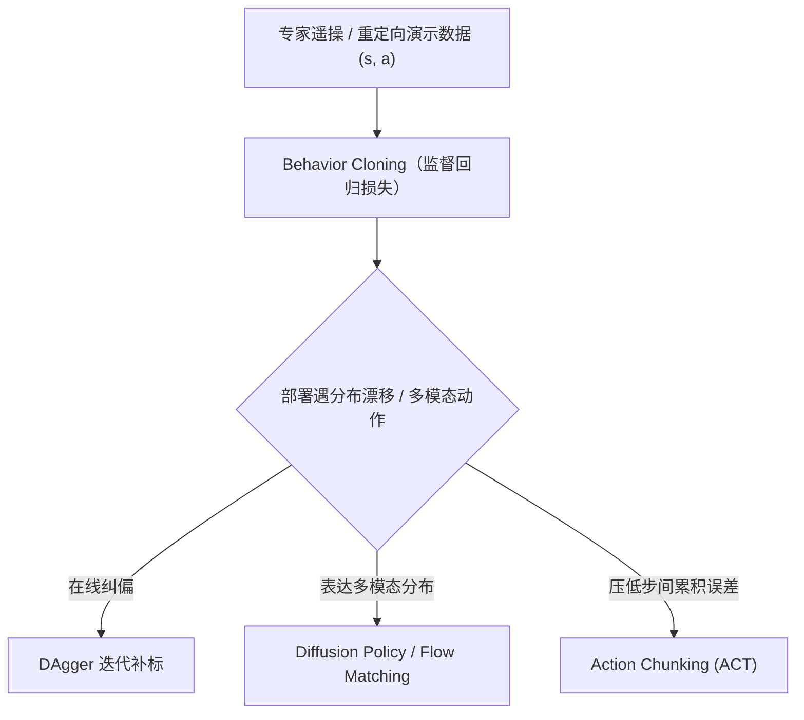

# Behavior Cloning（行为克隆）

**BC** 把「学策略」直接当成监督学习：收集专家的「状态 → 动作」数据对，训一个网络去拟合。它是模仿学习里门槛最低的一条路，也是 Diffusion Policy、VLA 等后续方法的共同底座；主要代价是分布漂移——一旦机器人走到演示没覆盖过的状态，误差会累积。

## 在全栈中的位置

## 核心内容与站内入口

- **方法定义与损失推导**：[Behavior Cloning](../../../wiki/methods/behavior-cloning.md) · [BC 损失函数](../../../wiki/formalizations/behavior-cloning-loss.md)
- **上位方法与选型**：[模仿学习](../../../wiki/methods/imitation-learning.md) · [操作任务怎么用 IL](../../../wiki/queries/il-for-manipulation.md)
- **相关文献索引**：[Imitation Learning 论文导航](../../../references/papers/imitation-learning.md)

## 上下游模块

- **上游数据链路**：[Motion Retargeting](motion-retarget.md) · [全栈技术域总览](../../overview.md)
- **演进模块**：[Diffusion Policy](diffusion-policy.md) · [策略网络架构](policy-network-architecture.md)

## 参考来源与收录边界

- [sources/papers/imitation_learning.md](../../../sources/papers/imitation_learning.md) — 模仿学习核心文献归档
- [DAgger 原文归档（arXiv:1011.0686）](../../../sources/papers/dagger_reading_arxiv_1011_0686.md) — 协变量偏移理论界归档
- 具体训练配方与操作案例见对应 `wiki/` 页面。
