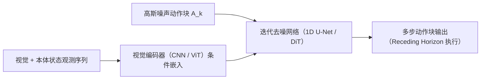

# Diffusion Policy（技术栈模块）

**Diffusion Policy** 把动作生成写成一次去噪过程：不再直接回归单个动作，而是从噪声出发迭代生成一段动作序列（action chunk）。这让策略能表达多模态的动作分布——同一个场景下「从左边绕」和「从右边绕」都是对的，而回归式 BC 往往会把它们平均成一个错误的中间动作。

## 在全栈中的位置

## 核心内容与站内入口

- **方法页与论文实体**：[Diffusion Policy 方法页](../../../wiki/methods/diffusion-policy.md) · [原始论文实体](../../../wiki/entities/paper-diffusion-policy.md)
- **操作策略选型**：[操作策略架构选型](../../../wiki/queries/manipulation-vla-architecture-selection.md) · [模仿学习纵深路线](../../../roadmap/depth-imitation-learning.md)

## 上下游模块

- **上游基础**：[Behavior Cloning](behavior-cloning.md) · [全栈技术域总览](../../overview.md)
- **相关模块**：[策略网络架构](policy-network-architecture.md) · [部署（上真机）](../system/deployment.md)

## 参考来源与收录边界

- [Diffusion Policy 原文通读归档（arXiv:2303.04137）](../../../sources/papers/diffusion_policy_reading_arxiv_2303_04137.md)
- [sources/papers/diffusion_and_gen.md](../../../sources/papers/diffusion_and_gen.md) — 生成式策略家族文献归档
- 推理延迟与动作块执行协议见对应 `wiki/` 页面。
