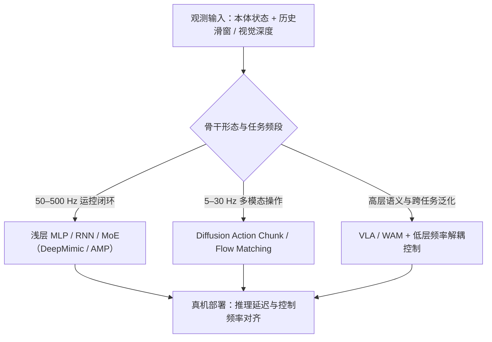

# 人形策略网络架构

从浅层 MLP（DeepMimic / AMP）到 Diffusion chunk、VLA 与 WAM 的策略骨干演化；强调论文 Method 常见披露项与「小 MLP + 强系统」的真机现实。

## 在全栈中的位置

## 核心内容与站内入口

- **深度归纳**：[人形与腿式策略的网络架构](../../../wiki/concepts/humanoid-policy-network-architecture.md)
- **基础架构全景**：[AI 架构地图](../../../wiki/overview/ai-architecture-map.md) · [人形策略观测输入](../../../wiki/concepts/humanoid-policy-observation-inputs.md)
- **部署频率取舍**：[控制频率与推理频率解耦](../../../wiki/concepts/control-inference-frequency-decoupling.md)

## 上下游模块

- **上游与同层**：[Behavior Cloning](behavior-cloning.md) · [Diffusion Policy](diffusion-policy.md) · [PPO](../rl/ppo.md) · [全栈技术域总览](../../overview.md)
- **下游落地**：[人形强化学习](../rl/humanoid-rl.md) · [部署（上真机）](../system/deployment.md)

## 参考来源与收录边界

- [DeepMimic 通读归档（arXiv:1804.02717）](../../../sources/papers/deepmimic_reading_arxiv_1804_02717_dm1.md)
- [AMP 通读归档（arXiv:2104.02180）](../../../sources/papers/amp_reading_arxiv_2104_02180_r7.md)
- [AI 架构地图一手论文簇](../../../sources/papers/ai_architecture_foundations.md)
- 各类网络骨干的详尽参数对比见 [人形与腿式策略的网络架构](../../../wiki/concepts/humanoid-policy-network-architecture.md)。
