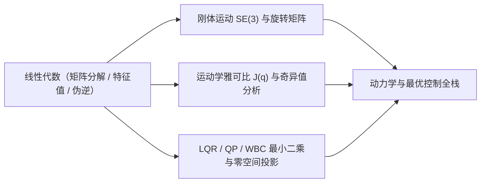

# 线性代数（技术栈模块）

机器人场景里的线性代数重点是能直接用上的那几块：向量空间与矩阵变换（坐标系与位姿）、特征值分解（稳定性与主方向）、最小二乘与伪逆（超定 / 欠定求解，WBC 与 IK 的常客）、以及雅可比相关的计算。

## 在全栈中的位置

## 核心内容与站内入口

- **课程策展与教材脉络**：[线性代数学习策展（L0）](../../../wiki/entities/linear-algebra-curriculum.md)
- **特征值与稳定性分析**：[特征值与特征向量](../../../wiki/formalizations/eigenvalues-eigenvectors.md)
- **学习路线对应阶段**：[运动控制路线 L0](../../../roadmap/motion-control.md#l0-数学与编程基础)

## 上下游模块

- **上游与总览**：[全栈技术域总览](../../overview.md)
- **下游直接依赖**：[刚体运动](../robotics/rigid-body-motion.md) · [运动学](../robotics/kinematics.md) · [WBC 模块](../control/whole-body-control.md)

## 参考来源与收录边界

- [MIT 18.06 特征值与向量讲义归档](../../../sources/courses/strang_mit_18_06_ila5_eigenvalues.md)
- [Linear Algebra Done Right 4e 教材归档](../../../sources/courses/axler_linear_algebra_done_right_4e.md)
- [线性代数教学资料策展归档](../../../sources/courses/linear_algebra_teaching_materials_curated.md)
- 具体定理证明与工程代码片段见对应 `wiki/formalizations/` 与 `wiki/entities/` 页面。
