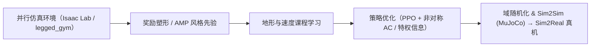

# 人形强化学习

把 RL 用到人形上，难点不在算法本身，而在 **奖励怎么设计、仿真怎么建、随机化开多大、策略怎么迁到真机**。这条模块线索串起训练栈的五个模块（环境、奖励、课程、网络、迁移），也是本站 sim2real 内容的主要来源。

## 在全栈中的位置

## 核心内容与站内入口

- **方法总览与实践手册**：[人形 RL 运控方法总览](../../../wiki/overview/humanoid-rl-motion-control-methods.md) · [人形 RL Cookbook](../../../wiki/queries/humanoid-rl-cookbook.md)
- **学习路线与训练框架**：[强化学习 Locomotion 纵深路线](../../../roadmap/depth-rl-locomotion.md) · [RL Frameworks](../../../references/repos/rl-frameworks.md)
- **奖励与失败分析**：[奖励设计指南](../../../wiki/queries/locomotion-reward-design-guide.md) · [常见失败模式](../../../wiki/queries/locomotion-failure-modes.md)

## 上下游模块

- **上游算法与动作输入**：[PPO](ppo.md) · [Motion Retargeting](../il/motion-retarget.md) · [策略网络架构](../il/policy-network-architecture.md) · [全栈技术域总览](../../overview.md)
- **下游验证与部署**：[仿真（系统集成层）](../system/simulation.md) · [部署（上真机）](../system/deployment.md) · [人形 Locomotion](../control/humanoid-locomotion.md)

## 参考来源与收录边界

- [sources/papers/humanoid_motion_control_know_how.md](../../../sources/papers/humanoid_motion_control_know_how.md) — 人形运控 RL 工程经验归档
- [P³ 论文摘录（arXiv:2607.25541）](../../../sources/papers/p3_arxiv_2607_25541.md) — 人形 RL 潜在空间训练参考
- [sources/papers/sim2real.md](../../../sources/papers/sim2real.md) — Sim2Real 核心文献归档
- 开源项目与评测环境见 [人形训练环境](../../../references/benchmarks/humanoid-environments.md)。
