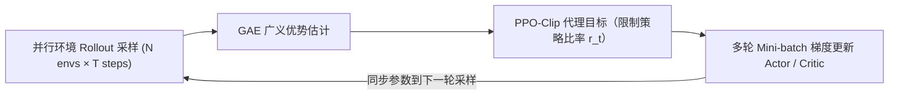

# PPO（近端策略优化 · 技术栈模块）

**PPO** 用一个裁剪过的目标函数限制每次更新的策略变化幅度，换来「调参不那么容易崩」的稳定性。它算法上不是最先进的，却是机器人 RL 里事实上的默认起点：并行仿真友好、超参相对鲁棒、几乎所有腿足运控的开源训练栈都以它为基线。

## 在全栈中的位置

## 核心内容与站内入口

- **算法原理与实现细节**：[PPO](../../../wiki/methods/ppo.md) · [强化学习方法页](../../../wiki/methods/reinforcement-learning.md)
- **算法对照与超参调优**：[PPO vs SAC](../../../wiki/comparisons/ppo-vs-sac.md) · [RL 算法选型](../../../wiki/queries/rl-algorithm-selection.md) · [超参数指南](../../../wiki/queries/rl-hyperparameter-guide.md)

## 上下游模块

- **上游与总览**：[全栈技术域总览](../../overview.md)
- **下游应用与框架**：[人形强化学习](humanoid-rl.md) · [策略网络架构](../il/policy-network-architecture.md) · [RL Frameworks](../../../references/repos/rl-frameworks.md)

## 参考来源与收录边界

- [PPO 原文通读归档（arXiv:1707.06347）](../../../sources/papers/ppo_reading_arxiv_1707_06347.md)
- [sources/papers/policy_optimization.md](../../../sources/papers/policy_optimization.md) — PPO/SAC/TRPO/BRRL 算法谱系归档
- [RobotsHub：万字解析运控 PPO](../../../sources/blogs/wechat_robotshub_ppo_locomotion_fundamentals.md) — 运控 PPO 实现细节对照
- 数学推导与代码对照见 [PPO 方法页](../../../wiki/methods/ppo.md)。
