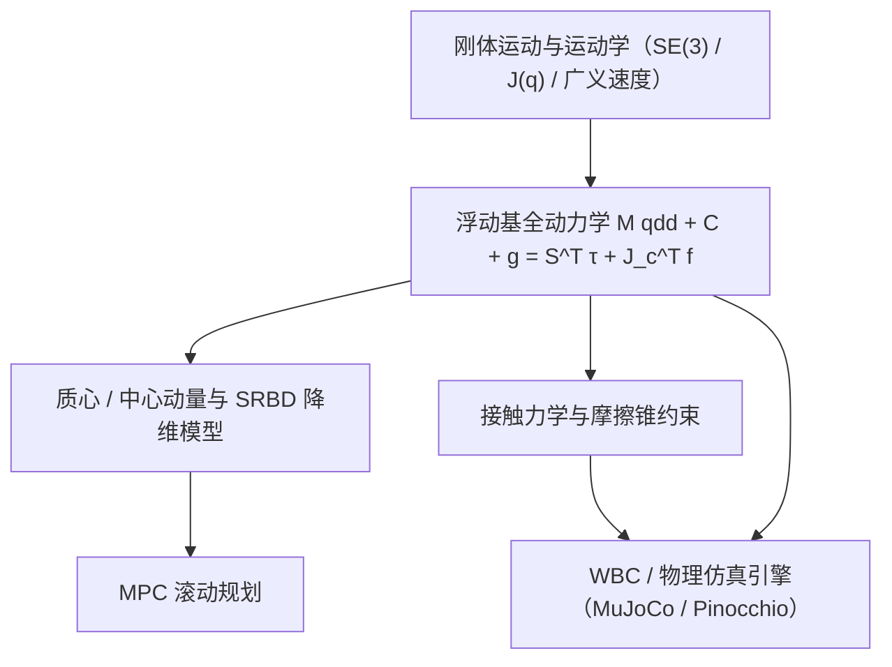

# 动力学（技术栈模块）

动力学回答「要多大的力矩才能这么动」。人形与腿足场景有三个绕不开的重点：**浮动基** 动力学（机器人不固定在地面上）、**质心 / 中心动量** 这类降维模型（MPC 常用），以及 **接触建模**（摩擦锥、互补约束）——后者是仿真与真机差距的主要来源之一。

## 在全栈中的位置

## 核心内容与站内入口

- **三大核心模型**：[浮动基动力学](../../../wiki/concepts/floating-base-dynamics.md) · [质心动力学](../../../wiki/concepts/centroidal-dynamics.md) · [接触动力学](../../../wiki/concepts/contact-dynamics.md)
- **工程求解与推导**：[Pinocchio](../../../wiki/entities/pinocchio.md) · [MPC 预测模型从浮动基推导](../../../wiki/formalizations/mpc-prediction-model-from-floating-base-dynamics.md)

## 上下游模块

- **上游依赖**：[刚体运动](rigid-body-motion.md) · [运动学](kinematics.md) · [全栈技术域总览](../../overview.md)
- **下游应用**：[MPC 模块](../control/mpc.md) · [WBC 模块](../control/whole-body-control.md) · [仿真（系统集成层）](../system/simulation.md)

## 参考来源与收录边界

- [Herzog et al. 2016 原文归档（arXiv:1410.7284）](../../../sources/papers/herzog_2016_momentum_control_hierarchical_inverse_dynamics_arxiv_1410_7284.md)
- [Modern Robotics 教材摘录](../../../sources/papers/modern_robotics_textbook.md)
- [sources/papers/robot_kinematics_tools.md](../../../sources/papers/robot_kinematics_tools.md) — Pinocchio/RBDL/Crocoddyl 工具归档
- 完整方程推导与符号表见对应 `wiki/concepts/` 与 `wiki/formalizations/` 页面。
