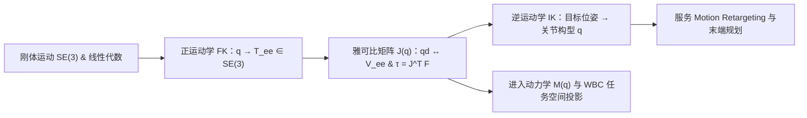

# 运动学（技术栈模块）

运动学只回答「几何上怎么动」，不管力与质量：**正运动学** 由关节角算末端位姿，**逆运动学** 反过来由目标位姿求关节角，**雅可比** 把关节速度与末端速度联系起来，也是奇异位形、可操作度与力映射的分析工具。它是控制与规划共同的语言底座。

## 在全栈中的位置

## 核心内容与站内入口

- **形式化核心**：[正运动学](../../../wiki/formalizations/forward-kinematics.md) · [逆运动学](../../../wiki/formalizations/inverse-kinematics.md) · [机器人雅可比](../../../wiki/formalizations/robot-jacobian.md)
- **工程可行性对比**：[运动学可行 vs 动力学可行](../../../wiki/concepts/kinematic-vs-dynamic-feasibility.md)

## 上下游模块

- **上游依赖**：[线性代数](../math/linear-algebra.md) · [刚体运动](rigid-body-motion.md) · [全栈技术域总览](../../overview.md)
- **下游应用**：[动力学](dynamics.md) · [WBC 模块](../control/whole-body-control.md) · [Motion Retargeting](../il/motion-retarget.md)

## 参考来源与收录边界

- [Modern Robotics 教材摘录](../../../sources/papers/modern_robotics_textbook.md)
- [PoE 正运动学讲义归档](../../../sources/blogs/wechat_goodman_forward_kinematics_poe.md)
- [Robotics Toolbox for Python 归档](../../../sources/repos/robotics-toolbox-python.md)
- 指数积公式与数值 IK 算法细节见对应 `wiki/formalizations/` 页面。
