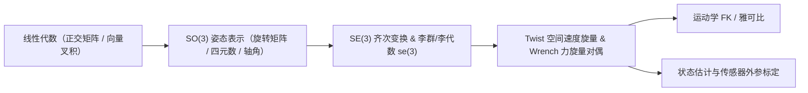

# 刚体运动

刚体运动是描述「位姿」的数学工具：旋转的多种表示（旋转矩阵、四元数、轴角）、齐次变换与 **SE(3)**，以及速度与力的配对表示（Twist / Wrench）。它看起来只是记号约定，但坐标系、外参与李群求导一旦搞错，后面的运动学、动力学与状态估计会全线出错。

## 在全栈中的位置

## 核心内容与站内入口

- **形式化底座**：[SE(3) 表示](../../../wiki/formalizations/se3-representation.md) · [李群与刚体运动](../../../wiki/formalizations/lie-group-rigid-body-motions.md)
- **坐标系工程联动**：[State Estimation](../../../wiki/concepts/state-estimation.md) · [ROS 2 集成层 tf2](../system/ros2.md)

## 上下游模块

- **上游依赖**：[线性代数](../math/linear-algebra.md) · [全栈技术域总览](../../overview.md)
- **下游支撑**：[运动学](kinematics.md) · [动力学](dynamics.md) · [Motion Retargeting](../il/motion-retarget.md)

## 参考来源与收录边界

- [Modern Robotics 教材摘录](../../../sources/papers/modern_robotics_textbook.md) — Ch.3 刚体运动核心参考
- [Diebel 2006 姿态参数化统一参考](../../../sources/papers/diebel_2006_representing_attitude_quaternions.md)
- [Zhou et al. CVPR 2019 连续旋转表示](../../../sources/papers/zhou_2019_cvpr_continuity_rotation_representations.md)
- 具体李代数指数映射与伴随矩阵推导见对应 `wiki/formalizations/` 页面。
