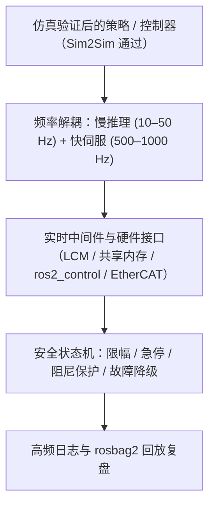

# 部署（上真机）

从「仿真里能跑」到「真机上能跑」，中间隔着一整套工程问题：控制频率与推理频率怎么解耦、硬件接口与驱动器怎么接、出错了进什么安全状态、怎么留下可复盘的日志。这一模块收敛的是真机落地阶段最容易踩坑、也最难从论文里学到的那部分。

## 在全栈中的位置

## 核心内容与站内入口

- **Sim2Real 迁移与检查**：[Sim2Real](../../../wiki/concepts/sim2real.md) · [Sim2Real 上机检查单](../../../wiki/queries/sim2real-checklist.md)
- **实时性与安全底座**：[控制频率与推理频率解耦](../../../wiki/concepts/control-inference-frequency-decoupling.md) · [机器人安全状态机](../../../wiki/concepts/robot-safety-state-machine.md)
- **系统工程枢纽**：[系统工程与部署枢纽](../../../wiki/overview/hub-systems-engineering.md)

## 上下游模块

- **上游依赖**：[仿真（系统集成层）](simulation.md) · [ROS 2（系统集成层）](ros2.md) · [全栈技术域总览](../../overview.md)
- **关联控制与学习模块**：[WBC 模块](../control/whole-body-control.md) · [人形强化学习](../rl/humanoid-rl.md)

## 参考来源与收录边界

- [sources/notes/sim2real.md](../../../sources/notes/sim2real.md) — Sim2Real 部署索引归档
- [DDS / RTOS / 安全 FSM 一手资料归档](../../../sources/sites/dds_omg_rtos_edge_ota_safety_primary_refs.md)
- [Real-Time Chunking 归档（arXiv:2506.07339）](../../../sources/papers/real_time_chunking_arxiv_2506_07339.md)
- 具体中间件配置参数与各硬件平台 SDK 见对应 `wiki/` 页面。
