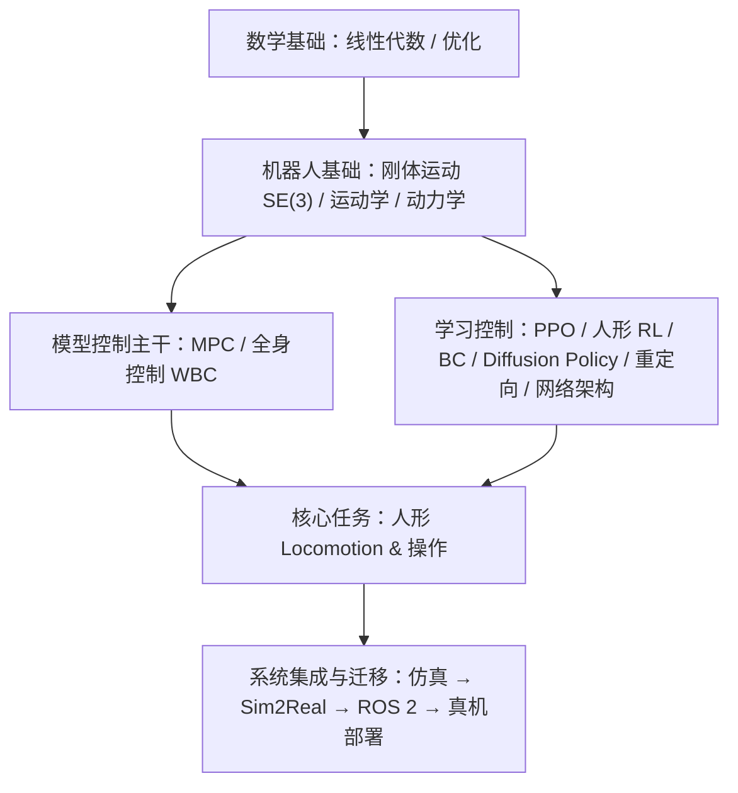

# 全栈技术域总览

本页不是单纯列方向，而是 `Robotics_Notebooks` 的技术栈模块入口页。

目标是回答三件事：
1. 机器人全栈大图景大致长什么样
2. 当前主攻主线落在什么位置
3. 每个模块应该从哪些知识页与模块节点继续往下看

## 一句话总览

机器人全栈成长主干从底层数学、刚体运动学/动力学出发，穿过最优控制、全身控制与学习策略，最终经仿真、Sim2Real 与中间件集成落地到真机部署：



当前 `Robotics_Notebooks` 的主线，不是平均铺开，而是：

> 以人形机器人运动控制为切入口，把控制、优化、学习、sim2real 串成一条可持续扩展的技术栈主干。

## 技术栈模块地图（16 个模块节点）

| 分层 | 模块节点 | 核心定位 |
|---|---|---|
| 数学底座 | [线性代数](modules/math/linear-algebra.md) | 矩阵分解、伪逆最小二乘、特征值与雅可比求解底座 |
| 机器人学 | [刚体运动](modules/robotics/rigid-body-motion.md) · [运动学](modules/robotics/kinematics.md) · [动力学](modules/robotics/dynamics.md) | SE(3)/李群位姿、正逆运动学、浮动基与接触动力学 |
| 控制主干 | [MPC](modules/control/mpc.md) · [WBC](modules/control/whole-body-control.md) · [人形 Locomotion](modules/control/humanoid-locomotion.md) | 滚动时域规划、优先级力矩控制与双足运动任务闭环 |
| 强化学习 | [PPO](modules/rl/ppo.md) · [人形强化学习](modules/rl/humanoid-rl.md) | 并行仿真策略优化默认基线与人形训练全栈 |
| 模仿学习 | [Behavior Cloning](modules/il/behavior-cloning.md) · [Diffusion Policy](modules/il/diffusion-policy.md) · [Motion Retargeting](modules/il/motion-retarget.md) · [策略网络架构](modules/il/policy-network-architecture.md) | 监督基线、去噪动作块、动作重定向与骨干演化 |
| 系统集成 | [仿真（系统集成层）](modules/system/simulation.md) · [ROS 2（系统集成层）](modules/system/ros2.md) · [部署（上真机）](modules/system/deployment.md) | 仿真验证、DDS 中间件分层与高频真机安全部署 |

## 当前主攻主线

当前优先主线：
- 运动控制
- 强化学习
- 模仿学习
- 人形机器人

对应当前最核心的一条知识链：

```text
LIP / ZMP
  ↓
Centroidal Dynamics
  ↓
Trajectory Optimization / MPC
  ↓
TSID / WBC
  ↓
State Estimation / System Identification / Sim2Real
```

这条链不是全部，但它是当前项目最值得先打通的主干。

## 一级模块总览

### 1. 数学与基础理论

作用：提供后续控制、优化、学习和建模所依赖的语言与工具。

模块入口：[线性代数](modules/math/linear-algebra.md)

关键子域：
- 线性代数
- 微积分 / 常微分方程
- 概率统计
- 数值优化

和当前主线的关系：
- 最优控制、状态估计、MPC、轨迹优化都强依赖这里

### 2. 机器人动力学与控制主干

作用：这是当前项目最核心的主干模块。

模块入口：[刚体运动](modules/robotics/rigid-body-motion.md) · [运动学](modules/robotics/kinematics.md) · [动力学](modules/robotics/dynamics.md) · [MPC](modules/control/mpc.md) · [WBC](modules/control/whole-body-control.md)

建议从这里进入：
- [Optimal Control (OCP)](../wiki/concepts/optimal-control.md)
- [LIP / ZMP](../wiki/concepts/lip-zmp.md)
- [Centroidal Dynamics](../wiki/concepts/centroidal-dynamics.md)
- [Model Predictive Control (MPC)](../wiki/methods/model-predictive-control.md)
- [Trajectory Optimization](../wiki/methods/trajectory-optimization.md)
- [TSID](../wiki/concepts/tsid.md)
- [Whole-Body Control](../wiki/concepts/whole-body-control.md)

这个模块解决的问题：
- 机器人怎么建模
- 平衡怎么描述
- 轨迹怎么规划
- 控制怎么落到关节和接触力层

这是当前仓库最成熟的一块。

### 3. 学习控制与机器人学习

作用：把 RL / IL 接到人形和运动控制主线上。

模块入口：[PPO](modules/rl/ppo.md) · [人形强化学习](modules/rl/humanoid-rl.md) · [Behavior Cloning](modules/il/behavior-cloning.md) · [Diffusion Policy](modules/il/diffusion-policy.md) · [Motion Retargeting](modules/il/motion-retarget.md) · [策略网络架构](modules/il/policy-network-architecture.md)

建议从这里进入：
- [Reinforcement Learning](../wiki/methods/reinforcement-learning.md)
- [Imitation Learning](../wiki/methods/imitation-learning.md)
- [AI 架构地图](../wiki/overview/ai-architecture-map.md)（MLP/MoE、CNN/ViT、RNN–Mamba、VAE/GAN/Diffusion/DiT、GNN 与五类策略骨干）
- [人形与腿式策略的网络架构](../wiki/concepts/humanoid-policy-network-architecture.md)（MLP / AMP / MoE / Diffusion chunk / VLA–WAM 演化与论文 Method 常见披露项）
- [Robot Learning Overview](../wiki/overview/robot-learning-overview.md)
- [WBC vs RL](../wiki/comparisons/wbc-vs-rl.md)

这个模块解决的问题：
- 什么时候该用 model-based control
- 什么时候该用 RL / IL
- 学习方法怎么和传统控制结合

和当前主线的关系：
- 当前重点不是把学习模块独立展开，而是把它接到 locomotion / humanoid control / sim2real 上

### 4. 状态估计与 sim2real

作用：把“控制器想做什么”和“真实机器人能不能做到”接起来。

模块入口：[仿真（系统集成层）](modules/system/simulation.md) · [部署（上真机）](modules/system/deployment.md)

建议从这里进入：
- [State Estimation](../wiki/concepts/state-estimation.md)
- [System Identification](../wiki/concepts/system-identification.md)
- [Sim2Real](../wiki/concepts/sim2real.md)
- [Domain Randomization](../wiki/concepts/domain-randomization.md)

这个模块解决的问题：
- 当前真实状态是什么
- 模型参数准不准
- 仿真训练的策略怎么落到真机

这是当前项目里非常关键、但后面还可以继续扩的桥接层。

### 5. 任务层：Locomotion / Manipulation

作用：把方法和控制框架落到具体机器人任务上。

模块入口：[人形 Locomotion](modules/control/humanoid-locomotion.md)

建议从这里进入：
- [Locomotion](../wiki/tasks/locomotion.md)
- [Manipulation](../wiki/tasks/manipulation.md)

这个模块解决的问题：
- 方法最终服务什么任务
- 不同任务对模型、控制、学习、估计的要求分别是什么

当前状态：
- locomotion 是主攻方向
- manipulation 目前更多是占位与后续扩展方向

### 6. 路线图与学习执行层

作用：把知识图谱转成成长路线。

建议从这里进入：
- [运动控制主路线](../roadmap/motion-control.md)
- [roadmap/README.md](../roadmap/README.md)

这个模块解决的问题：
- 现在先学什么
- 下一步学什么
- 当前切入口如何通向更完整的机器人全栈能力

当前状态：
- 已有骨架
- 但执行性仍然不够强，属于下一阶段重点

### 7. 集成与扩展模块

核心系统集成入口：[ROS 2（系统集成层）](modules/system/ros2.md) · [仿真](modules/system/simulation.md) · [部署](modules/system/deployment.md)

持续扩展中的模块：
- 感知
- 规划
- ROS2 / Middleware
- 硬件系统
- 部署与测试
- System Integration

它们会决定项目能不能最终走向“真正的机器人全栈”。

## 当前阅读建议

如果你是从“人形机器人运动控制”切入，建议顺序：

1. [LIP / ZMP](../wiki/concepts/lip-zmp.md)
2. [Centroidal Dynamics](../wiki/concepts/centroidal-dynamics.md)
3. [Trajectory Optimization](../wiki/methods/trajectory-optimization.md)
4. [Model Predictive Control (MPC)](../wiki/methods/model-predictive-control.md)
5. [TSID](../wiki/concepts/tsid.md)
6. [Whole-Body Control](../wiki/concepts/whole-body-control.md)
7. [State Estimation](../wiki/concepts/state-estimation.md)
8. [System Identification](../wiki/concepts/system-identification.md)
9. [Sim2Real](../wiki/concepts/sim2real.md)

如果你是从“学习控制”切入，建议顺序：

1. [Robot Learning Overview](../wiki/overview/robot-learning-overview.md)
2. [Reinforcement Learning](../wiki/methods/reinforcement-learning.md)
3. [Imitation Learning](../wiki/methods/imitation-learning.md)
4. [WBC vs RL](../wiki/comparisons/wbc-vs-rl.md)
5. [Locomotion](../wiki/tasks/locomotion.md)
6. [Sim2Real](../wiki/concepts/sim2real.md)

## 当前结论

这个页面后续的职责，不是继续写泛泛而谈的“全栈很大”。

而是：

> 持续把模块、依赖关系、知识页入口、成长路线入口组织清楚，让 `tech-map/` 真的成为技术栈地图，而不是标题存放处。

## 参考来源与收录边界

- [Modern Robotics 教材摘录](../sources/papers/modern_robotics_textbook.md) — 刚体运动、运动学与动力学体系参考
- [sources/papers/mpc.md](../sources/papers/mpc.md) — MPC 与模型控制主干文献索引
- [sources/papers/sim2real.md](../sources/papers/sim2real.md) — Sim2Real 桥接主线资料归档
- [sources/sites/ros2-official-documentation.md](../sources/sites/ros2-official-documentation.md) — ROS 2 系统集成层官方文档归档
- 具体概念定义与单篇论文结论见对应 `wiki/` 页面；本页只负责技术栈分层导航与模块映射。
