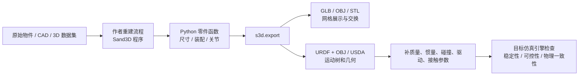

# 3D-as-Code、网格与机器人仿真描述：如何选择可编辑资产

## 一句话定义

Sand3D 把物体结构、形状参数和关节写为 **Python 程序**；GLB/OBJ/STL 主要存储已生成的网格结果；URDF/USDA 则表达**机器人连杆与关节结构**。这三层能够串联，但**程序可编辑、几何可见、物理仿真可用不是同一回事**。

## 英文缩写速查

| 缩写 | 英文全称 | 简要说明 |
|------|----------|----------|
| CAD | Computer-Aided Design | 机械零件及装配的参数化设计 |
| URDF | Unified Robot Description Format | 连杆、关节、几何等机器人描述 |
| USD | Universal Scene Description | 可包含几何与物理语义的场景描述 |
| GLB | glTF Binary | 面向交换及渲染的二进制 3D 资产 |
| LLM | Large Language Model | 可编写和编辑 Sand3D Python 程序 |
| API | Application Programming Interface | Sand3D 用 `s3d.<verb>` 暴露的建模操作 |

## 为什么重要

同一个“能打开的 3D 模型”，在机器人场景生成、零部件改型、仿真导入与控制评测中有截然不同的维护成本。例如把柜门宽度改大：三角网格一般需要另做几何编辑；Sand3D 可改入口函数参数后重新执行；但要让柜门在 Isaac Sim 或 MuJoCo 中被驱动，还需有效的质量惯量、关节驱动和碰撞模型。

## 核心原理

| 资产形态 | 主要真实内容 | 修改方式 | 对机器人的边界 |
|----------|--------------|----------|----------------|
| Sand3D Python 程序 | 零件函数、尺寸、局部坐标系、装配、关节、材质 | 改函数参数或部件函数后重新执行 | 是程序化建模层；输出仍需检查物理信息 |
| GLB / OBJ / STL | 已展开的几何网格；GLB 可带材质/部分关节 extras | 网格编辑或返回源程序重新生成 | 不能自动得到完整动力学定义 |
| Sand3D 导出的 URDF + OBJ | rest pose 的 link / joint / limits 及 OBJ 网格 | 修改源程序后重导出，或另行编辑 URDF | `effort=0`、`velocity=0`，没有自动补全完整动力学 |
| Sand3D 导出的 USDA | 文本 OpenUSD：UsdGeom / UsdPhysics joints / 材质 | 修改源程序再导出，或用 USD 工具续编 | 官方 writer 缺质量、驱动、碰撞体；不等于可直接训练策略 |
| 完整仿真物理资产 | 几何、碰撞、惯量、驱动、接触、场景与引擎约束 | 在对应仿真栈完成编辑与验证 | 是否稳定/可信需按目标引擎逐项检查 |

来源：Sand3D 官方技术原文及 `src/sand3d/assembly.py`、`urdf.py`、`usd.py`。本表最后一行是机器人工程的**实施目标**，不是 Sand3D 已发布的现成完整输出。

### 从程序到物理环境

不能把 `program → URDF` 这条几何/运动学链推断成已通过仿真 benchmark 的动力学资产。导出还要注意单位：Sand3D 默认建模毫米，文件按米写出。

## 工程实践

1. **只要外形/渲染或快速布景：** 取 Sand3D 数据中的程序，修改部件尺寸并导出 GLB；保留原始 `program` 以便维护。
2. **要机械结构或可动机构：** 使用 `s3d.joint` 定义关节轴与范围，导出 `URDF` 或 `USDA` 并检查父子 link / 原点 / 关节范围。
3. **要 ROS、MuJoCo 或 Isaac Sim 真正运动/接触：** 在导出基础上补充 mass/inertia、collision、effort、velocity、actuation 与接触参数，在目标引擎中进行加载与运动测试；官方源码没有提供这些完整属性。
4. **要批量商用资产：** 仓库 Apache-2.0 与数据 CC BY 4.0 分别处理，每个对象单独检查来源许可 `source_license` 和署名字段 `attribution`，不能用集合级标识替代单件授权审查。
5. **要机器人型号目录：** [robot_descriptions.py](../entities/robot-descriptions-py.md) 直接提供已发布机型的加载与缓存；Sand3D 更适合改动场景物品及零件，不替代真实机器人资产的厂家标定。

## 局限与风险

- Sand3D 的 106,094 是**离线重建语料库规模**，不是物理正确、随文本可生成任意物体的模型能力指标。
- 官方重建主要覆盖**硬表面对象**，并以 F-score 筛选表面相似性；几何分数不保证真实质量、运动副、接触稳定性或制造精度。
- Sand3D 直接输出的是 `.usda`；`.usdc/.usdz` 需交给 USD 工具转换。
- 这里的“可商用”是**满足许可证条件时可使用**；尤其不能忽略原始资产携带的限制。
- 本页面依据原文和公开 writer 源码做选型分析，**未独立执行 Blender、MuJoCo 或 Isaac Sim 基准测试**。

## 关联页面

- [Sand3D](../entities/sand3d.md) — 统一程序语言、10 万级数据与源代码导出的详细核验。
- [Articraft](../entities/articraft.md) — 可关节资产的 Agent + SDK 管线；也是 Sand3D 的原始数据来源之一。
- [URDF-Studio](../entities/urdf-studio.md) — 导出 URDF 后继续编辑结构和参数的工作台。
- [文字生成 CAD](../concepts/text-to-cad.md) — 文本/图像条件重建 CAD 的上游任务。
- [机器人 URDF 描述](../concepts/urdf-robot-description.md) — 理解 link、joint 与视觉/碰撞配置的差异。

## 参考来源

- [Sandflow 官方完整技术发布稿（通读归档）](../../sources/blogs/sandflow_sand3d_release_2026_11_05.md)
- [Sand3D 官方源码关键入口与导出 writer 核验](../../sources/repos/sandflow-sand3d.md)
- [Sandflow 官方项目主页](../../sources/sites/sandflow-sand3d.md)

## 推荐继续阅读

- [Sand3D 官方 API](https://github.com/Sandflow-ai/sand3d/blob/main/docs/api.md)
- [Sand3D 具体 URDF writer](https://github.com/Sandflow-ai/sand3d/blob/main/src/sand3d/urdf.py)
- [Sand3D 具体 USDA writer](https://github.com/Sandflow-ai/sand3d/blob/main/src/sand3d/usd.py)
