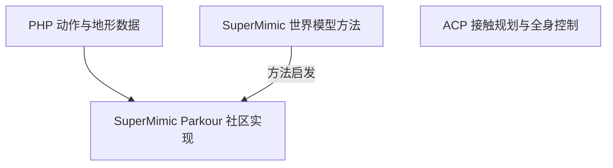

# ACP、SuperMimic 与 PHP：接触规划、训练方法和跑酷数据

这四项工作分别关注接触规划、世界模型训练、感知跑酷和社区跑酷复现，不能仅凭名称推断它们已经组合为同一个系统。

## 英文缩写速查

| 缩写 | 英文全称 | 简要说明 |
|---|---|---|
| ACP | Attention-based Contact Planner | 根据地形与目标预测身体接触的规划器 |
| PHP | Perceptive Humanoid Parkour | 利用感知与动作匹配进行人形跑酷的项目 |
| BPTT | Backpropagation Through Time | 沿世界模型预测轨迹反传梯度的方法 |

## 方法和关系

| 项目 | 重点 | 推理或训练中使用的关键机制 | 实验范围 |
|---|---|---|---|
| [ACP](../entities/paper-acp-humanoid-mobility.md) | 接触引导的人形移动 | 接触规划器和全身控制器使用地形、本体感知与目标；部署不输入参考动作 | 论文与项目页展示复杂地形移动 |
| [SuperMimic](../entities/paper-supermimic.md) | 高效训练通用动作跟踪器 | 用仿真转移拟合可微世界模型，通过想象轨迹优化策略 | 项目页展示仿真与 G1 实机动作跟踪 |
| [PHP](../entities/paper-hrl-stack-22-perceptive_humanoid_parkour.md) | 深度感知和跑酷技能链 | 离线动作匹配生成参考，训练专家并向深度学生蒸馏 | 项目页展示 G1 实机跑酷 |
| [SuperMimic Parkour](../entities/supermimic-parkour.md) | 世界模型训练跑酷跟踪 | 社区实现使用 PHP 动作和地形数据；策略通过世界模型训练 | 仓库报告仿真结果，尚未据此确认真机效果 |

已核实的直接关联是 **SuperMimic Parkour 使用 PHP 动作数据，并受 SuperMimic 启发**。ACP 与其余工作可作为不同方法对照；现有资料不足以证明某个 ACP 与 SuperMimic 的组合实现。

## 截图核验边界

触发本次整理的截图标有“ACP + super mimic”，画面还显示 `php_pretrained` 和预测左右脚的标注。但未找到该视频原帖、作者说明或对应代码，无法确认其采用了上述哪套实现，也不能把画面中参数当作论文实验结果。

## 待核验

- 获取视频原始链接或发布者提供的项目源码，核对模型、数据与控制链路。
- 本次仅复核项目主页和仓库说明，尚未重新通读三篇论文全文或完整复核源码；本文为草稿，详细机制以各项目原文及已有实体页为入口。

## 参考来源

- [ACP 论文归档](../../sources/papers/acp_arxiv_2610_31608.md) · [项目页](../../sources/sites/acp-attention-based-contacts.md)
- [SuperMimic 实体与原文入口](../entities/paper-supermimic.md)
- [PHP 源码归档](../../sources/repos/php_parkour.md) · [项目页](../../sources/sites/php-parkour-github-io.md)
- [SuperMimic Parkour 仓库归档](../../sources/repos/supermimic-parkour.md)

## 推荐继续阅读

- [ACP 官方项目页](https://leggedrobotics.github.io/ACP/) · [SuperMimic 官方项目页](https://supermimic.github.io/)
- [PHP 项目页](https://php-parkour.github.io/) · [SuperMimic Parkour 社区仓库](https://github.com/yhx1203/supermimic_parkour)
