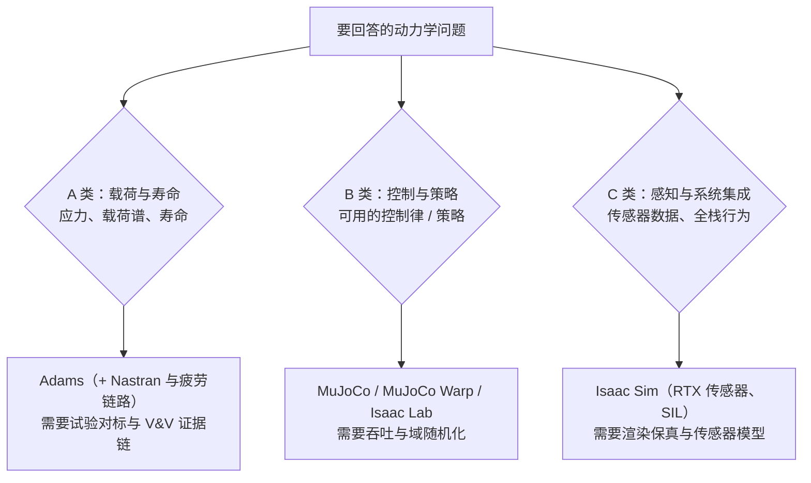

# Adams vs MuJoCo vs Isaac Sim（Newton）：按三类物理问题选型

## 一句话定义

「Isaac Sim / MuJoCo 能不能取代 Adams」问错了问题：三者回答的是三类不同的物理问题，**取代发生在控制与机器人学习层，不发生在载荷与寿命层**（Zane Hub 第 385 篇的判断，作者表述；本页对其中可核对的事实做了一手核对）。

## 英文缩写速查

| 缩写 | 英文全称 | 简要说明 |
|------|----------|----------|
| MBD | Multibody Dynamics | 多体动力学 |
| MNF | Modal Neutral File | Adams 的模态中性文件（柔性体） |
| V&V | Verification and Validation | 验证与确认：方程解对了吗 / 解符合真实世界吗 |
| K&C | Kinematics and Compliance | 悬架运动学与柔度台架试验 |
| SIL | Software-in-the-Loop | 软件在环测试 |
| MJX | MuJoCo XLA | MuJoCo 的 JAX 后端（GPU / TPU，可自动微分） |
| MJWarp | MuJoCo Warp | MuJoCo 的 NVIDIA Warp 后端 |
| USD | Universal Scene Description | OpenUSD 场景与资产描述 |

## 为什么重要

- 机器人团队常把「动力学仿真」当成一件事；实际上训练策略、验证全栈、签发载荷寿命数字是三种不同的工作，误差的代价和证据要求完全不同。
- 2026 年的几个事件让这个问题变得具体：Cadence 完成对 Hexagon 设计与工程业务的收购（Adams 随之并入）、Newton 1.0 稳定版、MuJoCo 把批量仿真做进核心库、Isaac Sim 6.x 把 Newton 作为并列物理后端。

## TL;DR：三类问题与工具

| 类型 | 输出物 | 误差的代价 | 适配工具（作者表述） |
|------|--------|------------|----------------------|
| A 载荷与寿命 | 应力、载荷谱、寿命预测 | 签字责任、召回风险 | Adams（含 Nastran 与疲劳分析链路） |
| B 控制与策略 | 可用的控制律、策略网络 | 训练时间、迭代速度 | MuJoCo / Isaac Lab（MJWarp、PhysX） |
| C 感知与系统集成 | 传感器数据、全栈行为验证 | 系统集成返工 | Isaac Sim（RTX 传感器、SIL） |

## 事件与版本核对（2026-11-07，一手资料）

| 文章说法 | 核对结果 |
|----------|----------|
| MuJoCo 3.17.0（2026-10-22）新增批量 API、一维柔性体弯曲弹性 | ✓ 官方更新日志：3.17.0 (October 22, 2026)；批量 API 用独立线程池步进同一模型的多个仿真，结果与串行循环逐位一致；一维 flex 的离散弹性杆弯曲模型 |
| Newton 1.0 稳定版、Linux Foundation、Apache-2.0、MuJoCo Warp 主后端、图灵 7.5+ | ✓ 官方 README / CHANGELOG：1.0.0 发布于 2026-03-10，当前 1.7.0；Disney Research / Google DeepMind / NVIDIA 发起；需 NVIDIA Turing（算力 7.5+）与较新驱动 |
| Isaac Sim 6.0 正式版（2026-06-08） | 日期来源不一致（6 月 4 日与 8 日均有出处），**我没能证实 6 月 8 日**；且官方文档最新已是 **6.2.0**，6.0 不是最新版 |
| Isaac Sim 有 Newton 后端、MCP 服务器与技能接口 | ✓ 官方文档目录含 Newton Physics Backend、Isaac Sim MCP Server、Agent Skills |
| Isaac Sim 双层许可 | ✓ 仓库内软件 Apache 2.0；构建 / 使用需 Omniverse Kit SDK 与 3D 模型 / 纹理等「其他条款许可」的组件，另有 NVIDIA 附加软件与材料许可（限定在安全网络内部使用）；再分发条款未逐条读完 |
| Cadence 以约 27 亿欧元收购 Hexagon 设计与工程业务 | ✓ 2026-02-23 宣布完成交割；约 27 亿欧元（含约 1.5 亿欧元税费），70% 现金 + 30% 股票；MSC Nastran 与 Adams 并入 Cadence 多物理场产品线 |
| 文中的 Adams 2026.1 特性、SimReady 工业资产、BMW / Volvo 案例、Atlas / Unitree 训练栈、MJWarp 暂不可微、人形单卡每秒数十万步 | **未核实**，按作者表述转述 |

## 三者的真实位置（作者表述为主）

### Adams：护城河在载荷链路，不在求解器

- 刚柔耦合：先在有限元软件里缩聚部件（Craig-Bampton，保留 10–30 阶固定界面模态），导出 MNF 柔性体文件，在多体求解后做模态应力恢复，为疲劳分析提供时变应力场。
- 载荷到寿命：整车多体模型复现并外推道路载荷采集试验，给无法直接测量的部位提取载荷，再对接疲劳分析；输出要经 K&C 台架、四立柱等试验对标。
- 与控制的联合仿真（Simulink S 函数 / FMI）与五十年的 V&V 证据链，使迁移成本高于许可费。
- 详见库内 [Adams 实体页](../entities/adams.md)（谱系、产品、开源状态）。

### MuJoCo：被低估的求解器，被高估的取代论

- 广义坐标递推动力学保证关节约束精确，凸优化接触求解保证稳定与唯一（官方文档层面的说法，本次未逐页核对）；MJX 与 MJWarp 分别面向可微仿真 / TPU 与 NVIDIA GPU 大规模批量训练。
- 边界：柔性体仍在早期（3.17.0 刚为一维柔性体加入弯曲弹性），没有耐久模块、疲劳链路与试验对标体系。
- 对比见 [MuJoCo vs Isaac Sim](./mujoco-vs-isaac-sim.md)、[MuJoCo 实体页](../entities/mujoco.md)。

### Isaac Sim 与 Newton：平台而非单一引擎

- Isaac Sim 把 RTX 渲染、OpenUSD、ROS 2 桥与 Isaac Lab 训练栈合在一起；6.x 的多物理后端让同一份资产在 PhysX 与 Newton 间切换，并有 MCP 服务器把仿真器当作可编程基础设施。
- Newton 以 MuJoCo Warp 为主后端，另有 XPBD、VBD、Featherstone 等求解器后端，在 [Newton 实体页](../entities/newton-physics.md) 有完整说明；它把开源软件锚定在 NVIDIA GPU 生态（图灵及以上）。
- **许可成本：** 「开源」不等于免费商用：Isaac Sim 的 Kit SDK 与资产受 NVIDIA 附加许可约束；MuJoCo 与 Newton 的 Apache-2.0 更宽松，但省下的许可费会以 GPU、运维与模型资产迁移成本的形式出现（作者观点）。

## 选型与行动清单（作者建议）

| 工程场景 | 建议 |
|----------|------|
| 整车载荷、悬架 K&C、耐久道路载荷 | Adams |
| 齿轮、轴承、链条等传动系统动力学 | Adams/Machinery |
| 机构概念阶段的快速动力学验证 | MuJoCo（CPU）已足够 |
| 机器人策略训练（数亿步采样） | Isaac Lab 或 MuJoCo Warp，需 NVIDIA GPU |
| 感知仿真、合成数据、软件在环 | Isaac Sim |
| 软体、布料、接触丰富操作研究 | Newton（VBD / XPBD 后端） |
| 预算受限的教学与科研 | MuJoCo |

1. **把两类仿真在流程里切开：** 不用 Adams 跑强化学习，也不用 MuJoCo 签耐久报告。
2. **管好模型资产：** 跨引擎复用的瓶颈是 URDF / MJCF / MNF / USD 的转换与质量、惯量、摩擦系数的同源管理。
3. **跟踪生态接口：** Adams 并入 Cadence 后与其多物理场工具的整合、Newton 与商业 CAE 的数据交换。

## 局限

- 来源是单篇工程评论，未经同行评审；Adams 一侧的工程细节（模态缩聚、耐久链路、V&V 标准）本次未回 MSC / Cadence 文档与标准原文核对。
- 「Adams 退守为审计级工具、开源引擎接管前端」是作者对终局的预测，属推测。
- Isaac Sim 的最新版本已超过文中的 6.0，选型时应以当前版本说明为准。

## 关联页面

- [Adams](../entities/adams.md)
- [MuJoCo](../entities/mujoco.md)
- [MuJoCo Warp](../entities/mujoco-warp.md)
- [MuJoCo MJX](../entities/mujoco-mjx.md)
- [Isaac Sim](../entities/isaac-sim.md)
- [Isaac Lab](../entities/isaac-lab.md)
- [Newton Physics](../entities/newton-physics.md)
- [NVIDIA Warp](../entities/nvidia-warp.md)
- [MuJoCo vs Isaac Sim](./mujoco-vs-isaac-sim.md)
- [十年仿真平台技术地图](../overview/sim-platforms-decade-technology-map.md)
- [Sim2Real](../concepts/sim2real.md)

## 参考来源

- [Zane Hub 第 385 篇（微信归档，含一手核对表）](../../sources/blogs/wechat_zane_hub_adams_vs_isaac_sim_mujoco_2026-11-07.md)
- [Cadence MSC Adams 产品页归档](../../sources/sites/cadence-msc-adams.md)
- [MuJoCo 更新日志](https://github.com/google-deepmind/mujoco/blob/main/doc/changelog.rst)
- [Newton 仓库](https://github.com/newton-physics/newton)
- [Isaac Sim 仓库](https://github.com/isaac-sim/IsaacSim) 与[发布说明](https://docs.isaacsim.omniverse.nvidia.com/latest/overview/release_notes.html)
- [Cadence 完成收购 Hexagon 设计与工程业务（转载）](https://www.hpcwire.com/off-the-wire/cadence-completes-acquisition-of-hexagons-design-and-engineering-business/)
