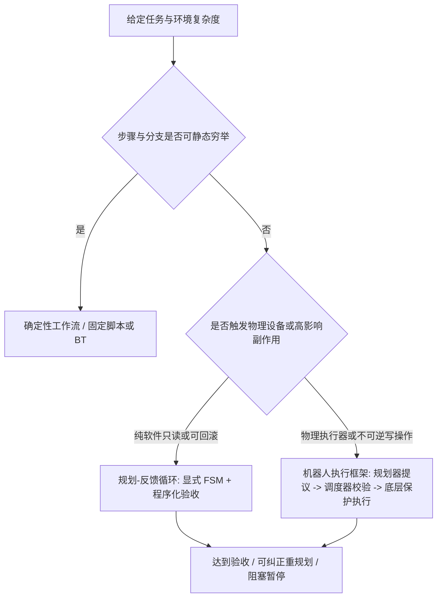

# 智能体规划反馈循环 vs 确定性工作流 vs 机器人执行框架

## 一句话定义

当任务步骤可事先穷举时应保留**确定性工作流**，只有下一步决策真正依赖动态环境反馈时才引入有状态约束的**智能体规划-反馈循环**；而在物理机器人场景中，还需在规划与执行之间再隔离一层**机器人执行框架（Harness）**来守住契约校验、实时性与急停边界。

## 英文缩写速查

| 缩写 | 英文全称 | 简要说明 |
|---|---|---|
| FSM | Finite-State Machine | 有限状态机，用于显式约束智能体状态转移与终止边界 |
| BT | Behavior Tree | 行为树，机器人任务层常用的确定性/混合编排结构 |
| HAL | Hardware Abstraction Layer | 硬件抽象层，隔离开高层任务调度与底层电机控制 |
| SayCan | Do As I Can, Not As I Say | 结合语言相关性与状态可行性价值函数的技能排序框架 |
| LLM | Large Language Model | 大语言模型，负责候选动作提议或失败后重规划 |

## 为什么重要

许多工程团队在接入大模型后倾向把所有任务都做成自由循环（free-form ReAct loop），结果在生产环境面临延迟抖动、无界重试、假阳性自报成功以及物理副作用不可控问题；厘清三层编排边界可以避免用循环智能体去替代本该确定性执行的流水线与实时护栏。

## 核心原理

| 比较维度 | 确定性工作流（Workflow / BT） | 规划–反馈循环（[Agent Planning & Feedback](../methods/agent-planning-feedback.md)） | 机器人执行框架（[Robot Agent Harness](../methods/robot-agent-harness.md)） |
|---|---|---|---|
| **控制权归属** | 代码显式定义控制流 | 模型按观察在合法状态集合内选择下一步 | 模型只提议候选技能；调度器与底层控制守住执行权 |
| **终止与成功判据** | 步骤全部执行且断言通过 | 程序化工件/终态校验 + 步数/预算上限 | 后置观测验证 + 硬件看门狗与安全状态机 |
| **失败恢复方式** | 固定回退分支或报错退出 | 区分暂态重试 vs 否定前提后重规划 vs 人工接管 | 限额重试 / 切换技能 / 安全降级停机 |
| **适用场景** | 固定 ETL、标准部署脚本、成熟产线流程 | 调试排障、多步检索综合、带局部异常的软件/规划任务 | 移动操作、多技能家庭/工业服务机器人、VLM/VLA 上层编排 |

## 工程实践

1. **先做固定工作流基线再决定是否加循环**：先跑通固定链路记录失败分布；只对需要按真实观测分支的环节启用 [Agent Planning and Feedback Loops](../methods/agent-planning-feedback.md)。
2. **用程序校验替代模型自报成功**：把验收条件写成独立检查（单测、终态断言、物理传感器读数或日志完整性检查），避免把模型输出文本当任务完成的唯一证据。
3. **高风险副作用与物理动作必须走独立调度门控**：在机器人场景下参考 [Robot Agent Harness](../methods/robot-agent-harness.md)，将规划器（提议技能）与调度器（核对前置条件、数据新鲜度、关节/力矩安全包络）解耦，并记录全链路请求 ID 与状态转移日志。

## 局限与风险

- **把智能体循环当成权限边界**：FSM 与重规划逻辑只治理任务收敛，不能替代底层授权认证、沙箱隔离或硬件急停链。
- **无界重规划放大延迟与副作用**：未设置最大步数、重复动作检测和不可逆写前确认时，模型可能在瞬态失败中反复触发相同外部副作用。
- **证据边界**：本页综合仓库既有方法文档与课程/论文规范整理选型对照，未引入新的端到端延迟或成功率 benchmark。

## 关联页面

- [Agent Planning and Feedback Loops](../methods/agent-planning-feedback.md) — 规划–反馈解耦、四类校验状态与显式 FSM 落地规范
- [Robot Agent Harness](../methods/robot-agent-harness.md) — 物理机器人场景的技能契约、调度门控与故障恢复框架
- [Coding Agent 验证闭环](../methods/coding-agent-verification-loops.md) — 软件工程场景下的程序化验证闭环实例
- [Agent-first 软件工厂](../concepts/agentic-software-factory-harness.md) — 软件工厂中的验证门禁与认知监督
- [LLM 机器人控制接口](../concepts/llm-robotics-control-interfaces.md) — 高层语言/VLM 与底层实时控制环的接口边界
- [行为树 × VLA 编排](../concepts/behavior-tree-vla-orchestration.md) — 行为树生命周期与 VLA 技能调度的结合

## 参考来源

- [Agent Planning and Feedback 一手方法归档](../../sources/sites/method-agent-planning-feedback-primary-20261126.md)
- [Agentic Design Patterns 仓库归档](../../sources/repos/agentic-design-patterns.md)
- [SayCan 论文摘录](../../sources/papers/saycan_arxiv_2204_01691.md)

## 推荐继续阅读

- [Stanford CS 329Z: Engineering AI Agents](../entities/stanford-cs329z-engineering-ai-agents.md) — 课程中工作流与智能体循环的分界实践
