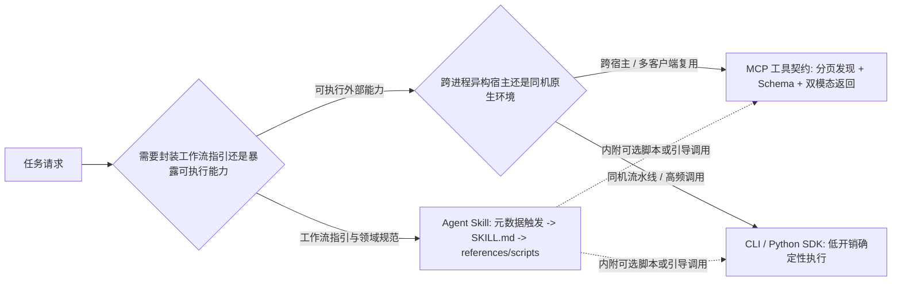

# Agent Skill 封装 vs MCP 工具契约 vs CLI/SDK 调用接口

## 一句话定义

**Agent Skill 封装**负责把任务流程规范与可选脚本按需渐进加载进上下文，**MCP 工具契约**负责跨宿主统一外部能力发现、Schema 校验与结构化反馈，而 **CLI / Python SDK** 则便于在本地流程中显式组合调用；三者处于不同抽象层且常协同使用。

## 英文缩写速查

| 缩写 | 英文全称 | 简要说明 |
|---|---|---|
| MCP | Model Context Protocol | 面向智能体与外部工具/数据源的标准 JSON-RPC 接口协议 |
| SOP | Standard Operating Procedure | 标准操作规程，Skill 中承载的领域任务步骤与约束 |
| CLI | Command-Line Interface | 命令行接口，适合本地脚本化、管道组合与确定性回归测试 |
| SDK | Software Development Kit | 语言原生开发工具包，用于进程内低延迟结构化调用 |
| JSON-RPC | JavaScript Object Notation Remote Procedure Call | MCP 等协议用于分离传输错与工具执行错的消息格式 |

## 为什么重要

智能体扩展常见问题是「把整个长手册硬塞进系统提示词导致上下文膨胀」，或「把本该写成工具权限隔离的约束仅写在 Markdown 指引里」。分清指令封装（Skill）与可执行能力接口（MCP / CLI / SDK）的边界，能同时降低 token 浪费、提高触发精度并守住安全与幂等性。

## 核心原理

| 对比维度 | Agent Skill（[Agent Skill Packaging](../methods/agent-skill-packaging.md)） | MCP 工具契约（[Agent Tool-use Interface](../methods/agent-tool-use-interface.md)） | CLI / 本地 SDK |
|---|---|---|---|
| **核心载体** | 目录规范：`SKILL.md` + `references/` + 可选 `scripts/` | 进程间 JSON-RPC 服务端暴露 `tools/list` 与 `tools/call` | 命令行二进制、Shell/Python 脚本或本地库函数 |
| **上下文机制** | 渐进加载：仅预加载简短触发描述，命中后再读正文 | 暴露工具名称、描述与输入 JSON Schema（可分页发现） | 仅在文档或 `--help` 中按需查阅参数说明 |
| **权限与隔离边界** | 规范只校验格式，**不自动担保权限或沙箱** | 须在服务端独立实现认证授权与副作用校验 | 依赖操作系统进程权限、容器沙箱或 CLI 审批门控 |
| **错误处理语义** | 通过评测正例与负例验证触发与步骤遵守 | 严格分离协议/传输异常与业务 `isError` 执行错误 | 退出码、stderr 与结构化 JSON/文件工件 |

## 工程实践

1. **用 Skill 管「何时做、按什么顺序做」，用工具接口管「实际改状态」**：不要在 Skill 正文堆砌长篇 API 文档，把大参考拆到 `references/`，把高频确定性检查沉淀为 `scripts/`。
2. **Skill 与工具评测均须纳入负例与状态校验**：参照 [Agent Skill Packaging](../methods/agent-skill-packaging.md) 同时测「该触发（正例）」与「不该触发（负例）」；参照 [Agent Tool-use Interface](../methods/agent-tool-use-interface.md) 对写操作分离参数合法性校验与后端真实状态核对，且写入超时后先查状态再决定是否重试。
3. **把外部工具返回视为不可信数据而非新指令**：无论是 MCP 返回文本还是 CLI 日志，都应校验字段类型与对象 ID 后再供后续规划消费。

**一手证据对应：** Agent Skills 规范把触发元数据、正文及附属资源分层；固定版本 MCP Tools 规范把 JSON-RPC 协议错误和工具执行错误分开，输出 Schema 是可选的。CLI/SDK 一栏是工程选型，不承诺更低延迟：启动进程、序列化和远端 API 都可能成为主开销，须用自己的任务量测。

## 局限与风险

- **混淆提示词约束与系统权限**：在 `SKILL.md` 元数据或工具描述中声明只读或禁止删除，不构成真正的服务端访问控制。
- **工具定义膨胀挤占上下文**：一次性向模型注入过多重叠功能的 MCP 工具会降低选型准确率并增加首 token 延迟。
- **证据边界**：本页综合既有方法文档与官方最佳实践归档整理接口选型对照，不替代特定客户端/运行时的吞吐与安全渗透测试。

## 关联页面

- [Agent Skill Packaging](../methods/agent-skill-packaging.md) — 渐进式加载结构、正负例触发评测与权限边界
- [Agent Tool-use Interface](../methods/agent-tool-use-interface.md) — MCP 工具契约、错误分层、幂等与提示注入防护
- [Model Context Protocol（MCP）](../concepts/model-context-protocol.md) — MCP 协议栈与机器人/仿真工具接入概念
- [Agentic Coding 软件基础](../concepts/agentic-coding-software-fundamentals.md) — 上下文工程、工作流编排与工具设计基础
- [Coding Agent 验证闭环](../methods/coding-agent-verification-loops.md) — 工具执行结果与代码变更的程序化验证闭环

## 参考来源

- [Agent Skill Packaging 一手方法归档](../../sources/sites/method-agent-skill-packaging-primary-20261126.md)
- [Agent Tool-use Interface 一手方法归档](../../sources/sites/method-agent-tool-use-interface-primary-20261126.md)
- [Anthropic Claude Code Best Practices 归档](../../sources/sites/anthropic_claude_code_best_practices_2026.md)
- [OpenAI Harness Engineering 归档](../../sources/blogs/openai_harness_engineering_2026-02-11.md)

## 推荐继续阅读

- [Agent Skills 开放规范与最佳实践](https://agentskills.io/)
- [Model Context Protocol 官方规范](https://modelcontextprotocol.io/)
