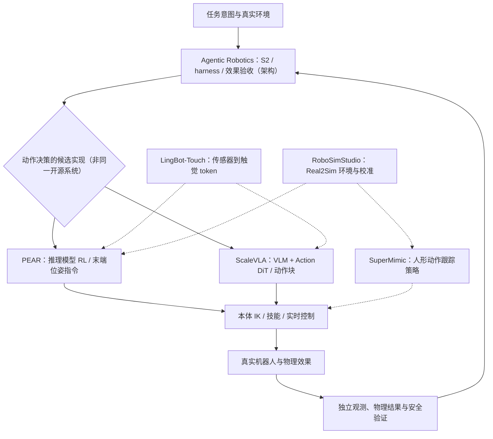

# Agentic Robotics 六条研究路线对照 / Six Complementary Paths in Agentic Robotics (2026)

## 一句话定义

这六项工作**不是六个可以直接横向排名的机器人策略**：它们分别解决系统级决策和验收、推理模型后训练、超大 VLA 动作生成、全身跟踪、异构触觉表征以及 Real2Sim 工具链。这里将原有六个**独立且不重复**的详情节点串起来，帮助判断实际系统还缺哪一层。

## 英文缩写速查

| 缩写 | 英文全称 | 本页语境 |
|---|---|---|
| S2 / S1 / S0 | System 2 / System 1 / System 0 | 推理编排 / 技能 / 实时执行的逻辑分层 |
| RURL | Robot-Use Reinforcement Learning | PEAR 的机器人交互式强化学习 |
| VLA | Vision-Language-Action | 将视觉、语言与动作预测连接的模型 |
| DiT | Diffusion Transformer | ScaleVLA 的动作生成模块 |
| BPTT | Backpropagation Through Time | SuperMimic 经短时模型想象回传梯度 |
| JEPA | Joint-Embedding Predictive Architecture | LingBot-Touch 的触觉表征预训练思路 |
| Real2Sim | Real-to-Simulation | 由真实场景构建物理仿真并迭代校准 |

## 为什么重要

- 六项研究的任务、动作空间、硬件、训练奖励和评测口径不同：强行把成功率排序会掩盖实际系统的缺层。
- 机器人部署除了策略输出，还需要观测契约、低层控制、碰撞与急停保护、验收证据及物理模型校准。
- 官方代码可得性各不相同：需分别说明框架/推理/训练/权重是否公开，避免以 README 存在代替可复现性。

## 研究对象、接口与证据

| 工作（详情） | 研究对象 / 核心接口 | 作者报告的代表性证据 | 开放边界（2026-11-18 核对） |
|---|---|---|---|
| [Envisioning Agentic Robotics](../entities/paper-envisioning-agentic-robotics.md) | **系统与评测路线**；基础模型 + embodied harness，组织 S2/S1/S0，基于物理结果验证完成 | 提出 9 维能力/系统评测与 L1–L4 可委托职责阶梯；**不是独立训练出的新策略** | 有论文和项目页；本次未发现本研究独立可运行代码 |
| [PEAR / RURL](../entities/paper-pear-robot-use-rl.md) | **机器人使用智能体的后训练**；推理模型接收图像/本体状态，输出末端位姿指令，经 IK/控制栈执行 | LIBERO 1.6%→74.4%；真实双臂机器人 18/30（60%） | 训练、评测、部署代码与权重公开；复现依赖大规模算力 |
| [ScaleVLA](../entities/paper-scalevla-2611-21607.md) | **VLA 动作生成与参数规模**；552B 总参数 DeepSeek-V4.1-Flash 骨干 + Action DiT | 10 条示范 LIBERO-Goal 87.8%；LIBERO-PRO 45.1%；单动作块推理中位延迟 216 ms | 有论文与项目页；目前未见可核实的官方完整代码或权重发布 |
| [SuperMimic](../entities/paper-supermimic.md) | **人形全身跟踪策略训练**；可微世界模型 + 短时想象 rollout + BPTT | 单 H100 训练 3 h 超过 SONIC 对照回报；129,514 条训练动作库中的覆盖失败数需与未见动作泛化区分 | 官方仓库公开；真实 Unitree G1 演示不能替代其他本体复现 |
| [LingBot-Touch](../entities/paper-lingbot-touch.md) | **跨触觉硬件的观测表征**；压阻/磁性/视触觉转为可供下游策略读取的触觉 token | 作者报告覆盖 26 类真机操作任务；下游表现依赖策略与传感器标定 | 提供 Tiny/Small 冻结 encoder、权重和推理接口；**并非全量预训练/下游策略训练开源** |
| [RoboSimStudio](../entities/robosimstudio.md) | **Real2Sim 物理环境与工具链**；编码 Agent/人类从视频搭场景并反复校准多物理交互 | 项目展示约 1 小时双臂擦拭场景重建及单项真机迁移案例；不代表通用 1 小时 SLA | 官方 Apache-2.0 工具包及示例已公开，仿真物理量仍须校准 |

*表中实验指标均是各自论文或官方主页作者报告，不是本知识库独立复现；不同任务、示范数量、硬件和评价协议之间**禁止直接按百分比排序**。*

## 核心原理：按系统边界看六条路线

**图的边界：** 实线是 *Envisioning* 所主张的概念闭环的示意分工；虚线表示**可研究的接口或互补关系，并非这些论文已经提供了互通的集成实现**。PEAR 的实际代码接口、ScaleVLA 的动作 chunk、SuperMimic 的全身跟踪目标都不同，不能直接互换。尤其不要从图推断 PEAR 已用 RoboSimStudio 训练，或 LingBot-Touch 已接入上述任一项目。

## 选型：先问你缺什么

| 当前工程问题 | 优先阅读 | 最先验证的接口或失败模式 |
|---|---|---|
| 机器人能执行指令，却不能可靠确认任务完成或中途安全改计划 | [Agentic Robotics](../entities/paper-envisioning-agentic-robotics.md) | 取消/停止确认、物理结果 verifier、观测时间戳、实时监护 |
| 希望用任务成功奖励训练会多轮看图、思考并操控末端的模型 | [PEAR](../entities/paper-pear-robot-use-rl.md) | JSON 动作、坐标单位、IK、本体预检、sim/real 任务定义 |
| 少样本 VLA 成功率与超大骨干规模的权衡 | [ScaleVLA](../entities/paper-scalevla-2611-21607.md) | 相同演示数与测试划分、总/激活参数、动作块延迟和部署预算 |
| 大量人类动作的人形全身跟踪训练过慢 | [SuperMimic](../entities/paper-supermimic.md) | 真实动力学与可微模型误差、动作覆盖和未见动作泛化分别评测 |
| 更换触觉传感器后，灵巧策略观测难以复用 | [LingBot-Touch](../entities/paper-lingbot-touch.md) | taxel 几何映射、触觉 token 接口、下游策略后训练与延迟 |
| 接触丰富操作的仿真难以从视频复建并向真机对齐 | [RoboSimStudio](../entities/robosimstudio.md) | 坐标、摩擦与柔顺参数、接触误差、跨求解器稳定性、真机验证 |

## 工程实践：对照实验的最低协议

1. **对齐目标而非数字：** PEAR 的 LIBERO 指令泛化、ScaleVLA 的少样本操作、SuperMimic 的动作库覆盖、LingBot-Touch 的跨传感器操作成功率和 RoboSimStudio 的物理一致性，不对应同一评价变量。
2. **分层报告：** 模型/策略成功率、末端指令合法性、低层跟踪误差、触觉输入故障、Real2Sim 物理误差、wall-clock 及真机安全事件分列，不只保留任务最终成功率。
3. **说明复现状态：** 论文数字、官方可获取代码、实际运行、真机复验四个证据等级要分开写；“有代码”不代表含完整训练数据/权重。
4. **锁定预算与场景：** 固定演示数、并行环境、推理 GPU、机器人本体、观测频率与安全监护后，才有可比的系统级消融。

## 结论

**这六项工作共同覆盖“能理解并验收任务—能产生动作—能稳定跟踪—能感知接触—能构建可迭代仿真”的不同瓶颈，而非单一通用机器人系统的六种替代品。** 实际落地需先定义动作/观测接口，再分别补齐实时控制、故障保护和可重复物理验收。

## 局限与风险

- 本页是基于已有全文归档与 2026-11-18 官方页面交叉核对的**工程对照/编排建议**，不是新的第七项研究成果。
- 箭头的组合关系属于工程推导；各研究的训练集、动作空间、仿真平台、延迟定义不同，不能推断即插即用或端到端成功率。
- 开源状态与性能证据具有日期性；未来释放的仓库、权重和新版论文应以官方页面重新确认。

## 关联页面

- [Agentic Robotics 的架构与评测](../entities/paper-envisioning-agentic-robotics.md)
- [PEAR 的机器人使用强化学习](../entities/paper-pear-robot-use-rl.md)
- [ScaleVLA 的大规模视觉动作模型](../entities/paper-scalevla-2611-21607.md)
- [SuperMimic 的可微世界模型与全身跟踪](../entities/paper-supermimic.md)
- [LingBot-Touch 的异构触觉预训练](../entities/paper-lingbot-touch.md)
- [RoboSimStudio 的接触物理 Real2Sim](../entities/robosimstudio.md)
- [具身大模型分类学选型闭环](../queries/embodied-fm-taxonomy-loop.md) — 在五层具身大模型分类学中定位 ScaleVLA、SuperMimic 与 PEAR 的分层边界
- [机器人视觉感知栈选型闭环](../queries/robot-perception-stack-selection-loop.md) — LingBot-Touch 触觉观测与视觉感知栈在下游策略消费层（第④层）的协同定位

## 参考来源

- [Agentic Robotics 论文全文归档](../../sources/papers/envisioning_agentic_robotics_arxiv_2611_18359.md) · [项目页](https://grid-robotics-official.github.io/agentic-robotics-roadmap/)
- [PEAR / RURL 论文归档](../../sources/papers/pear_robot_use_rl_mit_2026.md) · [代码](https://github.com/mit-han-lab/pear)
- [ScaleVLA 论文归档](../../sources/papers/scalevla-2611-21607.md) · [主页](https://galaxygeneralrobotics.github.io/scalevla/)
- [SuperMimic 论文归档](../../sources/papers/supermimic_arxiv_2610_28480.md) · [代码](https://github.com/HybridRobotics/supermimic)
- [LingBot-Touch 论文归档](../../sources/papers/lingbot-touch-technical-report.md) · [代码](https://github.com/Robbyant/lingbot-touch)
- [RoboSimStudio 技术报告归档](../../sources/papers/robosimstudio_arxiv_2610_18835.md) · [代码](https://github.com/robosimstudio/robosimstudio)

## 推荐继续阅读

- [Envisioning Agentic Robotics（arXiv:2611.18359）](https://arxiv.org/abs/2611.18359)
- [PEAR（arXiv:2611.18562）](https://arxiv.org/abs/2611.18562)
- [ScaleVLA（arXiv:2611.21607）](https://arxiv.org/abs/2611.21607)
- [SuperMimic（arXiv:2610.28480）](https://arxiv.org/abs/2610.28480)
- [LingBot-Touch（arXiv:2611.12806）](https://arxiv.org/abs/2611.12806)
- [RoboSimStudio](https://robosimstudio.github.io/)
