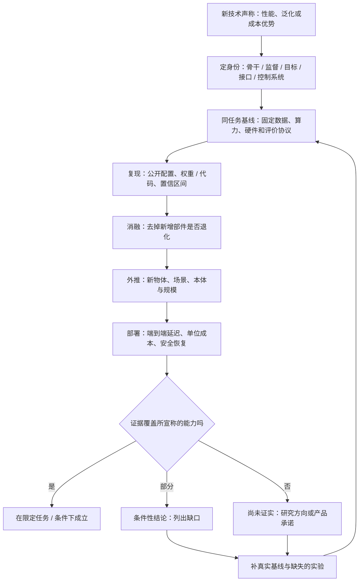

# CNN / Transformer → VLA / 世界模型：机制证据与进化叙事（Evidence vs Narrative）

## 一句话定义

**CNN、Transformer、自监督、MoE、VLA 和世界模型分属架构、目标、数据、接口和控制系统的不同选择轴；评价技术进步要看可复核的机制与工程收益，而不是把它们画成互相替代的时代阶梯。**

## 英文缩写速查

| 缩写 | 英文全称 | 简要说明 |
|---|---|---|
| CNN | Convolutional Neural Network | 空间局部连接、参数共享的视觉网络族 |
| SSM | State Space Model | 通过隐状态建模序列；Mamba 是选择性 SSM |
| MoE | Mixture of Experts | 路由到稀疏专家，参数容量与激活计算可部分解耦 |
| VLM | Vision-Language Model | 感知与语言语义模型，输出不必是动作 |
| VLA | Vision-Language-Action | 由视觉、指令与状态条件生成机器人动作 |
| WAM | World Action Model | 同时建模世界演化与动作的研究路线，非唯一标准架构 |
| DPO | Direct Preference Optimization | 在偏好对上直接优化策略相对概率 |
| GRPO | Group Relative Policy Optimization | 根据组内相对奖励优化策略，不需独立价值网络 |
| RLHF | Reinforcement Learning from Human Feedback | 人类偏好反馈驱动的策略优化方法族 |
| OOD | Out-of-Distribution | 跨物体、场景、动作或本体的分布外测试 |

## 为什么重要

- **防止降低历史基线。** Transformer 不是从 2023 年突然开始；生成式模型在 2023 年已成熟，RT-2 同年提出了 VLA 路线。不同范式长期共存，不能按发布时间直接推断性能等级。
- **选型必须先写指标。** 对机器人控制，优先固定采样率、动作频率、设备、观测输入和延迟预算，再比较骨干、目标和动作头。
- **“验证了算法”不等于“验证了产品”。** 离线 benchmark、视觉生成质量、真机任务成功率、故障恢复与安全边界属于不同证据层。
- 本页由[深蓝具身智能文章](../../sources/blogs/shenlan_ai_evolution_evidence_vs_narrative_2026_11_21.md)引出；**文章观点、论文定点核验和本库工程判断分开记录**，不将“行业营销占比”视为可量化事实。

## 核心原理

### 六条变化：机制与承诺分开验

| 比较轴 | 已有明确研究机制或实验支持 | 不应直接外推的承诺 | 建议核验 |
|---|---|---|---|
| **骨干架构** | ViT 将图像 patch 输入 Transformer；Mamba 采用选择性 SSM；Jamba 混合注意力、Mamba 与 MoE | Transformer “统一一切”；线性注意力在任何检索任务都必败 | 同数据同预算消融；KV 检索长度；设备上实际延迟/带宽 |
| **数据与监督** | 自监督预训练、数据去重/过滤、任务微调是可检验的做法 | “质量胜过数量”是独立且普适的定律 | 固定 token/训练 FLOPs，报告过滤规则、覆盖率与 held-out 性能 |
| **判别与生成** | 分类/对比学习、扩散动作去噪与通用生成接口并存；DPO/GRPO 改变训练步骤 | 2023 “判别”、2026 “生成”是互斥阶段 | 区分骨干、学习目标、训练算法、输出接口四个轴 |
| **缩放与成本** | Chinchilla 训练最优；更大推理需求可改变最优模型大小与训练 token 配比 | 固定 20:1 通用于所有模型；“质量三角”是经验定律 | 分别记录训练成本、推理次数、质量约束和总服务成本 |
| **多模态** | 视觉/语言/音频可在共享模型或跨模态流水线中协作；Moshi 支持流式音频交互 | 任意输入→任意输出已由单一解码器无损统一 | 明确每种 I/O 是否原生、经过哪种 codec/解码器、端到端延迟 |
| **具身与世界模型** | RT-2、OpenVLA、π₀、Diffusion Policy 展示了不同策略与动作生成机制；Genie 可动作控制 | 高画质未来帧意味着可靠物理动力学、可直接真机部署 | OOD 真机成功率、接触与失效测试、动作条件预测误差、回路时延 |

**重要辨析：**“架构”指计算图，“自监督”指监督信号来源，“判别/生成”通常指任务或模型目标，“VLA/WAM”指系统输入输出与预测控制任务。把这些术语相连，只能作为学习导航，不能作为证明一代取代另一代的逻辑链。

### 机制证据闭环（非历史单线进化图）

**判据解释：**复现和消融是因果可信度证据；外推关注泛化边界；部署收益关注是否真正降低系统时延/成本。四者是实用审查框架，**不是必须四项全过才算科学进展**，例如纯理论论文可能没有部署指标。

### 关键纠偏：术语不等于能力

1. **ViT ≠ VLM。**[ViT](https://arxiv.org/abs/2010.11929) 研究图像分类的视觉骨干，不是原文所说“把视觉和语言塞进一个模型”。VLM 是另一个跨模态训练与融合问题。
2. **稀疏 MoE ≠ 零内存成本。** 每个 token 只激活部分专家，但专家权重的分片/驻留、跨设备调度与路由均衡仍会决定吞吐；[DeepSeek-V3](https://arxiv.org/abs/2412.19437) 有具体的无辅助损失路由方案，不能替代所有硬件配置下的基准测试。
3. **Mamba ≠ 对任意长度都保真回忆。** 固定/压缩状态会引入容量权衡；标准注意力虽能直接访问历史 token，也不保证在任何长度/噪声/参数条件下精确检索。应做长度与准确率曲线，而非简单写“主干胜支线”。
4. **数据质量可以操作化，但没有统一标量。** 去重率、污染率、标注一致性、覆盖多样性、困惑度和 held-out 成绩都能测；比较时要给出筛选标准，而不是把“质量好”当不可检验解释。
5. **Moshi 仍有音频 tokenizer。** [官方实现](https://github.com/kyutai-labs/moshi)使用 Mimi 神经音频编解码器；其创新在流式全双工语音与文本/音频 token 协作，不是“直接吃波形、无需 tokenizer”。
6. **世界模型不等于仅做下一帧像素预测。** [Genie](https://proceedings.mlr.press/v235/bruce24a.html) 是可动作控制的交互环境生成研究；[NVIDIA Cosmos](https://research.nvidia.com/publication/2025-01_cosmos-world-foundation-model-platform-physical-ai) 侧重物理 AI 世界模型平台。两者均不自动保证接触物理和真机策略闭环有效，仍应核对动作/状态接口与真实任务指标。
7. **pass@k 和 majority@k 测的是不同东西。** 前者考察采样覆盖与“至少一解正确”，后者考察聚合选择正确性；不可把前者全称“运气”、后者全称“稳定”，也不能无证据推广某个固定的推理算力收益上限。
8. **DPO/GRPO 是方法进步，成本结论有条件。** [DPO](https://arxiv.org/abs/2305.18290) 消去传统 RLHF 的显式奖励建模与在线策略优化阶段；[GRPO](https://arxiv.org/abs/2402.03300) 使用相对组奖励而不需要单独价值模型。端到端成本还取决于采样、验证、序列长度与训练硬件。

### 缩放律：训练最优与服务最优是不同问题

- [Chinchilla](https://arxiv.org/abs/2203.15556) 在其拟合范围与**固定训练计算预算**下指出参数量和训练 token 应协调扩展；约 20 token/参数是常被引用的经验近似，**不是模型选型的全域常数**。
- [Beyond Chinchilla-Optimal](https://proceedings.mlr.press/v235/sardana24a.html) 把**未来推理调用需求**纳入成本目标：目标质量相近时，训练较小模型但用更多 token 可能更省全生命周期成本。
- [Meta Llama 3 模型卡](https://github.com/meta-llama/llama-models/blob/main/models/llama3/MODEL_CARD.md) 的 8B、15T+ token 是实际配方示例；不应从一个配方反推出所有规模/语料下的最佳比例。

## 工程实践：模型与机器人系统验收

### 评审记录模板

| 模块与声称 | 最小可接受证据 | 失败或营销信号 |
|---|---|---|
| “骨干升级” | 对齐相同数据、参数/FLOPs 与目标硬件的消融；P50/P95 延迟 | 只报模型参数或孤立 benchmark |
| “数据质量改善” | 清洗规则、去重率、真实任务验证曲线与样本数 | 无可复核质量定义，只换数据 |
| “VLA 泛化” | 未见物体/位置/灯光分层成功率、每层试验次数 | 只展示挑选后的视频和平均成功率 |
| “世界模型学到了物理” | 动作条件多步预测、接触事件/碰撞一致性、可执行反馈 | 只给视觉清晰度、无下游物理测试 |
| “系统可用” | 端到端 P95/P99 latency、控制频率、异常停止/接管、故障恢复 | 只给单网络推理耗时 |
| “更省钱” | GPU 时、数据采集/标注、部署单位任务成本、失败重试成本 | 只报训练时更少参数或单卡速度 |

**机器人场景示例：**慢速 VLM 规划器 + 高频运动控制器可以组成有用系统，但“整体是 VLA/WAM”不意味着单一网络承担全部闭环。把[控制频率与推理频率解耦](../concepts/control-inference-frequency-decoupling.md)和[具身测评路线](../../roadmap/depth-embodied-eval.md)作为验收入口：量化动作指令最迟何时生效、感知过期如何处理、碰撞和通信失联后的安全路径。

**复现记录的最小字段：**论文/代码 commit、权重版本、训练集与去重脚本、随机种子、任务集合、失败样本、机器/推理设备、指标定义与置信区间；若无法取得源码或训练数据，要标注“作者自报，未独立复现”。

## 局限与风险

- 本页编译自**用户提供的完整文章文字稿**；微信公众号链接未在当前工具中打开，配图未单独核对，文章署名/发布时间按提供信息记录。
- 表中的“已有机制”是对**特定论文/技术材料的可核对结论**，并不声称相关模型在所有任务都胜出；本页未对文中所有引用论文做逐篇全文复现。
- “营销比例较高”“多数论文未评测”以及“推理计算普遍有某个 2× 上限”缺少统一样本、基线和统计定义；视为作者观点或未经充分支持的泛化，不转成定量事实。
- 质量评审不应反过来成为“所有探索都必须立即能省钱”的要求。基础研究、系统原型与可部署产品应分别设验收门槛。
- 这是一篇**跨主题对比页，不是某个项目或论文实体**；Mermaid 为证据审查流程，不虚构源码运行时序或声称某份代码开源。

## 关联页面

- [DNN、CNN、RNN、GAN：结构轴与训练轴](./dnn-cnn-rnn-gan-architecture-vs-training.md)
- [RNN/CNN/Transformer/Mamba 骨干对照](./rnn-cnn-transformer-mamba.md)
- [VLM、VLA 与世界模型的术语边界](./vlm-vln-vla-vlx-world-model-taxonomy.md)
- [11 个开源世界模型的控制接口与复现边界](./open-source-world-models-11-2026.md)
- [具身 Scaling Laws](../concepts/embodied-scaling-laws.md)
- [多模态基础](../concepts/multimodality-basics.md)
- [世界模型功能分类](../concepts/functional-taxonomy-world-models.md)
- [VLA 方法](../methods/vla.md)
- [Diffusion Policy](../methods/diffusion-policy.md)
- [模型架构纵深路线](../../roadmap/depth-model-architecture.md)
- [具身模型测评纵深路线](../../roadmap/depth-embodied-eval.md)

## 参考来源

- [深蓝具身智能原文的全文摘录与逐条纠偏](../../sources/blogs/shenlan_ai_evolution_evidence_vs_narrative_2026_11_21.md)
- [ViT — An Image Is Worth 16x16 Words](https://arxiv.org/abs/2010.11929)
- [Mamba: Linear-Time Sequence Modeling](https://arxiv.org/abs/2312.00752)
- [Jamba: A Hybrid Transformer-Mamba Language Model](https://arxiv.org/abs/2403.19887)
- [DeepSeek-V3 Technical Report](https://arxiv.org/abs/2412.19437)
- [Training Compute-Optimal Large Language Models (Chinchilla)](https://arxiv.org/abs/2203.15556)
- [Beyond Chinchilla-Optimal（ICML 2024）](https://proceedings.mlr.press/v235/sardana24a.html)
- [DPO（NeurIPS 2023）](https://arxiv.org/abs/2305.18290)
- [Moshi（官方代码与音频编码器）](https://github.com/kyutai-labs/moshi)
- [RT-2（Google DeepMind）](https://deepmind.google/blog/rt-2-new-model-translates-vision-and-language-into-action/)
- [OpenVLA](https://arxiv.org/abs/2406.09246)
- [π₀](https://arxiv.org/abs/2410.24164)
- [Diffusion Policy](https://arxiv.org/abs/2303.04137)
- [Genie（ICML 2024）](https://proceedings.mlr.press/v235/bruce24a.html)
- [Cosmos（NVIDIA 研究）](https://research.nvidia.com/publication/2025-01_cosmos-world-foundation-model-platform-physical-ai)

## 推荐继续阅读

- [模型架构纵深路线 Stage 0–5](../../roadmap/depth-model-architecture.md) — 从时延预算反推骨干，不按“年代”强制选型
- [Beyond Chinchilla-Optimal](https://proceedings.mlr.press/v235/sardana24a.html) — 训练与推理总成本如何改变最优配方
- [具身模型评测纵深路线](../../roadmap/depth-embodied-eval.md) — 从离线指标到真机闭环证据
