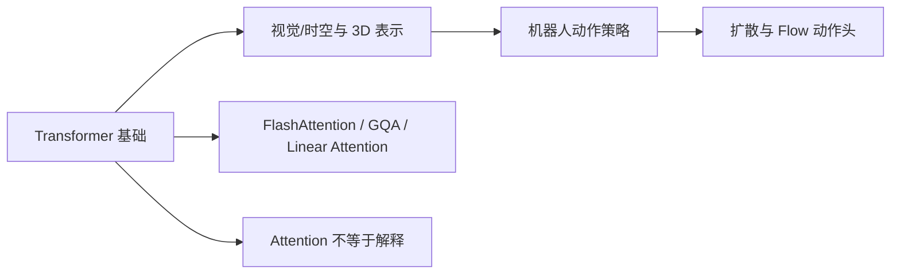

# 注意力架构到机器人策略：20 篇论文对照 / Attention Architecture to Robot Policies

## 一句话定义

把基础 Transformer、多模态提示、视觉/三维注意力、通用机器人策略、扩散模型和推理效率研究放在一张**问题驱动的路线图**上。**这里是跨论文比较，不代替每篇独立论文实体页。**

## 英文缩写速查

| 缩写 | 英文全称 | 简要说明 |
|---|---|---|
| VLA | Vision-Language-Action | 由视觉与语言条件生成动作的机器人模型 |
| MHA | Multi-Head Attention | 基础注意力机制 |
| GQA | Grouped-Query Attention | 多个查询头共享键值头，减少缓存成本 |
| BC | Behavior Cloning | 通过示范监督训练策略 |

## 为什么重要

仅说“都用了 Transformer”没有意义：它们分别改变**输入的空间/时间结构、动作预测目标、计算与显存成本、解释可靠性**。相同成功率名称并不代表相同数据、机器人或评测。

## 核心原理

按信息在控制管线中的位置区分注意力机制：**输入编码**（视觉、点云、视频）、**条件融合**（文本和观测）、**动作生成**（离散 token、动作块、扩散/flow）和**计算实现**（内核 IO、KV 缓存与线性状态）。选择论文应首先匹配任务输入输出，再评估计算复杂度与部署时延；不能把各论文不同数据集的指标横向视为同口径排名。

## 架构路线

## 20 篇论文分类索引

### 基础与跨模态

理解注意力的理论底座及多模态机器人策略的 token 组织方式

| 序号 | 论文 | 主要研究问题 |
|---:|---|---|
| 1 | [Attention Is All You Need](../entities/paper-attention-is-all-you-need.md) | 纯注意力 encoder-decoder |
| 2 | [VIMA](../entities/paper-pai-2210-03094-vima.md) | prompt 与观测历史交叉注意力 |
| 3 | [Octo](../entities/paper-octo.md) | 任务/观测 token 与动作 readout |
| 4 | [Perceiver: General Perception with Iterative Attention](../entities/paper-2103-03206-perceiver.md) | 通过输入到固定大小 latent array 的非对称交叉注意力 |
| 5 | [π₀](../entities/paper-pi0.md) | VLM 条件与 flow matching 动作专家 |

### 视频、图像及三维几何

按视频时空、局部窗口、体素、虚拟视图及点云表达选择视觉骨干

| 序号 | 论文 | 主要研究问题 |
|---:|---|---|
| 6 | [Is Space-Time Attention All You Need for Video Understanding?](../entities/paper-2102-05095-timesformer.md) | 将视频帧划分为 patch tokens；比较时空联合注意力与分解注意力 |
| 7 | [Swin Transformer: Hierarchical Vision Transformer using Shifted Windows](../entities/paper-2103-14030-swin-transformer.md) | 在非重叠局部窗口内执行注意力 |
| 8 | [RVT: Robotic View Transformer for 3D Object Manipulation](../entities/paper-2306-14896-rvt.md) | 从相机观测构建三维场景表示并重渲染工作空间的虚拟视图 |
| 9 | [Perceiver-Actor: A Multi-Task Transformer for Robotic Manipulation](../entities/paper-2209-05451-perceiver-actor.md) | 语言目标和 RGB-D 观测经过体素化 |
| 10 | [Point Transformer](../entities/paper-2012-09164-point-transformer.md) | 针对无序三维点集 |
| 11 | [3D Diffuser Actor: Policy Diffusion with 3D Scene Representations](../entities/paper-2402-10885-3d-diffuser-actor.md) | 将三维视觉场景、语言指令及本体状态送入三维去噪 Transformer |
| 12 | [Deformable DETR: Deformable Transformers for End-to-End Object Detection](../entities/paper-2010-04159-deformable-detr.md) | 每个查询只围绕参考点在多尺度特征图中采样少数关键位置 |

### 机器人策略与动作扩散

区分动作块、扩散动作头和离散动作 token 的输出语义

| 序号 | 论文 | 主要研究问题 |
|---:|---|---|
| 13 | [ACT / ALOHA](../entities/paper-act.md) | action chunking 与 CVAE |
| 14 | [RDT-1B](../entities/paper-rdt-1b.md) | 多模态异构输入与扩散 Transformer |
| 15 | [RT-1](../entities/paper-rt-1.md) | 视觉语言条件的机器人动作 token |
| 16 | [DiT-Block Policy](../entities/paper-robotic-dit-ingredients-dit-block-policy.md) | adaLN-zero 与条件层设计 |

### 内核、缓存、复杂度与解释

把算法复杂度、GPU IO、KV cache 和可解释性评估拆开

| 序号 | 论文 | 主要研究问题 |
|---:|---|---|
| 17 | [FlashAttention: Fast and Memory-Efficient Exact Attention with IO-Awareness](../entities/paper-2205-14135-flashattention.md) | 采用分块和片上 SRAM 计算以及在线归一化 |
| 18 | [GQA: Training Generalized Multi-Query Transformer Models from Multi-Head Checkpoints](../entities/paper-2305-13245-gqa.md) | 通过 grouped-query attention 让多组 query heads 共享较少的 key/value heads |
| 19 | [Transformers are RNNs: Fast Autoregressive Transformers with Linear Attention](../entities/paper-2006-16236-linear-transformer.md) | 通过 kernel feature map 重写注意力 |
| 20 | [Attention is not Explanation](../entities/paper-1902-10186-attention-not-explanation.md) | 在文本分类、问答和自然语言推理中的基于注意力的编码器上 |

## 方法选型（非跨论文统一排名）

| 想解决什么 | 首选阅读 | 不要混淆 |
|---|---|---|
| 高分辨率视觉特征 | Swin / Deformable DETR | 检测 mAP 不是机器人成功率 |
| 视频历史建模 | TimeSformer / Perceiver | 视频分类不同于在线动作控制 |
| 3D 操作决策 | PerAct / RVT / 3D Diffuser Actor | 体素、虚拟视图、扩散轨迹的输出不同 |
| 多模态策略 | VIMA / Octo / π₀ / RT-1 / RDT-1B | prompt、token、flow、diffusion 并非同一种监督目标 |
| 双臂低成本模仿 | ACT / DiT-Block Policy | CVAE 动作分块与 diffusion 动作分布不同 |
| 注意力算力与解释 | FlashAttention / GQA / Linear Attention / Jain & Wallace | 精确核优化、KV cache、近似复杂度、归因是四个问题 |

## 与其他工作对比

- [Transformer 机制](../concepts/transformer.md) 解释基础计算；本页负责**应用边界和代表工作关系**。
- [Robotics Transformer RT 系列](../methods/robotics-transformer-rt-series.md) 组织机器人 VLA 演化；本页补上视觉输入与注意力系统层。

## 工程实践

评测对齐时记录观察窗口、相机模态、动作表示、执行频率、推理硬件、任务分布和真实/仿真比例；不要把不同论文的数字直接相减。

## 局限与风险

- 这 20 篇并非统一 benchmark 排行榜。
- 部分新补论文页仍是全文和源码待核的草稿；原文归档明确写了核对范围及通读状态。
- 已存在的 8 篇论文页复用原路径，无新建同身份节点；如原有页面深度不足，应在后续原页补充，而不是创建第二个相同 arXiv 的项目节点。

## 关联页面

- [Transformer 机制](../concepts/transformer.md)
- [Attention Is All You Need](../entities/paper-attention-is-all-you-need.md)
- [ACT](../entities/paper-act.md)
- [Octo](../entities/paper-octo.md)
- [VLA/RT 系列](../methods/robotics-transformer-rt-series.md)

## 参考来源

- [Attention Is All You Need 来源归档](../../sources/papers/attention_is_all_you_need.md)
- [Octo 来源归档](../../sources/papers/octo_arxiv_2405_12213.md)
- [ACT 来源归档](../../sources/papers/act_arxiv_2304_13705.md)
- [Perceiver: General Perception with Iterative Attention 原文资料卡](../../sources/papers/attention20_2103_03206.md)
- [Is Space-Time Attention All You Need for Video Understanding? 原文资料卡](../../sources/papers/attention20_2102_05095.md)
- [Swin Transformer: Hierarchical Vision Transformer using Shifted Windows 原文资料卡](../../sources/papers/attention20_2103_14030.md)
- [RVT: Robotic View Transformer for 3D Object Manipulation 原文资料卡](../../sources/papers/attention20_2306_14896.md)
- [Perceiver-Actor: A Multi-Task Transformer for Robotic Manipulation 原文资料卡](../../sources/papers/attention20_2209_05451.md)
- [Point Transformer 原文资料卡](../../sources/papers/attention20_2012_09164.md)
- [3D Diffuser Actor: Policy Diffusion with 3D Scene Representations 原文资料卡](../../sources/papers/attention20_2402_10885.md)
- [Deformable DETR: Deformable Transformers for End-to-End Object Detection 原文资料卡](../../sources/papers/attention20_2010_04159.md)
- [FlashAttention: Fast and Memory-Efficient Exact Attention with IO-Awareness 原文资料卡](../../sources/papers/attention20_2205_14135.md)
- [GQA: Training Generalized Multi-Query Transformer Models from Multi-Head Checkpoints 原文资料卡](../../sources/papers/attention20_2305_13245.md)
- [Transformers are RNNs: Fast Autoregressive Transformers with Linear Attention 原文资料卡](../../sources/papers/attention20_2006_16236.md)
- [Attention is not Explanation 原文资料卡](../../sources/papers/attention20_1902_10186.md)

## 推荐继续阅读

- [Vaswani 等 Transformer 原文](https://arxiv.org/abs/1706.03762)
- [PerAct 原文](https://arxiv.org/abs/2209.05451)
- [FlashAttention 原文](https://arxiv.org/abs/2205.14135)
