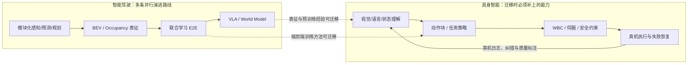

# 智能驾驶四个时代（2013–2026）→具身智能六维映射

## 一句话定义

将智能驾驶从**模块化、BEV/占用网络、端到端、VLA/世界模型**的技术演变，与具身机器人的**算法、算力、数据、产业分工、商业化和安全监管**逐项对照，寻找可迁移的方法与**不能照搬的因果关系**。本页是历史分析框架，**不是对机器人赛道或公司的确定性投资预测**。

## 英文缩写速查

| 缩写 | 英文全称 | 简要说明 |
|---|---|---|
| ADAS | Advanced Driver Assistance Systems | 需区分有驾驶员监督的驾驶辅助与无人驾驶 |
| BEV | Bird's-Eye View | 多相机视角融合为鸟瞰场景表征 |
| E2E | End-to-End | 联合学习观测到规划或动作；并不意味取消所有保护环 |
| VLA | Vision-Language-Action | 语言条件动作策略，车与机器人具体接口不同 |
| WAM | World-Action Model | 预测世界演化与动作的模型家族 |
| WBC | Whole-Body Control | 多接触、多关节、动态约束下全身控制 |
| L2/L3/L4 | SAE Levels 2/3/4 | 分别为部分驾驶自动化、有条件自动化、高度自动化；等级取决于运行设计域 |
| ODD | Operational Design Domain | L3/L4 系统允许工作的场景边界 |
| TOPS | Tera Operations per Second | 吞吐指标，必须明确运算精度与模型负载 |

## 为什么重要

智驾提供了真实世界 AI 系统从**可演示、可上路，到可收费和可承担安全责任**的案例。机器人产业也关心端到端模型、车载级芯片、数据闭环、自研与外采、场景 ROI、标准责任；但机器人动作维度、接触物理、本体差异和购买决策与汽车不同。若不区分**已发生事件**与**类比预测**，容易得出“L2 渐进路线必胜”“独立机器人模型公司必败”等过强结论。

## 四个时代：交叠的技术范式，不是统一替换日历

| 阶段（分析口径） | 时间 | 典型技术/组织形态 | 已证实的代表事件 |
|---|---|---|---|
| ① 规则/模块化 | 2013–2019 | 感知、预测、规划、控制分段，显式规则和专用模型；Mobileye/Tier 1 提供子系统 | Tesla 2015 Autopilot 上车；Mobileye 与 Tesla 2016 终止合作（具体原因须以双方当期文件为准） |
| ② BEV/占用表征 | 2020–2022 | 多相机 BEV、多任务联合、Occupancy；域控制器推理算力增加 | Waymo **2020-10-08** 向 Phoenix 乘客开放完全无人驾驶服务；这是限定区域 L4，与量产 BEV 路线并列 |
| ③ 端到端联合学习 | 2023–2024 | 感知、预测、规划的可微联合建模或直接视频到规划输出；仍可保留安全监督与控制层 | Tesla **2024** 发布 FSD v12 端到端城市驾驶栈；GM **2024-12-10** 宣布停止资助 Cruise Robotaxi 研发 |
| ④ VLA/世界模型/规模化 | 2025–2026 | VLM 条件规划、生成式场景、世界-动作联合建模、Robotaxi 运营规模扩大 | 工信部 **2025-12-15** 附条件许可两款 L3 产品；小鹏 **2026-03** 推送第二代 VLA；Mobileye **2026-02-03** 完成 Mentee 收购 |

**边界**：BEV 不是“取消高精地图”的充分条件；V12 的“替代30万行 C++”是其**城市街道驾驶栈**版本说明，不能概括所有车载软件；“2026 VLA 时代”是观察角度，不表示全行业已采用 VLA。Tesla 官方仍定义 **FSD (Supervised) 为 SAE L2，需要驾驶员全程监督**。

## 流程总览：历史经验如何投影到机器人决策



**读图**：虚线是方法论的类比，不是“汽车驾驶策略能直接控制机械臂”；机器人高频伺服和安全保护不能因为上层是大模型就省略。

## 六维映射：相似性、证据和脆弱点总表

| 维度 | 智能驾驶的经验 | 机器人对应 | 当前证据强度（定性） | 最大误用风险 |
|---|---|---|---|---|
| 算法 | BEV、联合学习、VLA / WM | π₀、GR00T 等策略和世界模型 | 较强：共享方法论 | 误以为共享模型即共享控制接口 |
| 算力 | 训练集群 + 车端推理、DRIVE 平台 | 训练集群 + Jetson Thor / 本体计算 | 较强：架构和生态 | 错把 INT8 TOPS 与 FP4 TFLOPS 同口径 |
| 数据 | 车辆行驶、难例重放、影子模式式筛选 | 遥操、模仿、仿真、真机失败回流 | **最弱**：闭环成本差异大 | 用驾驶里程对比机械臂小时 |
| 分工 | Tier 1、OEM 与平台协同/竞争 | 本体厂、模型厂、控制层和集成商 | 中等：商业结构可比较 | 认为所有核心能力必须自研 |
| 商业化 | L2 量产市场与 L4 限定运营并存 | 固定工位到泛化移动操作的扩展 | 中等：ROI 指标可借鉴 | 将机器人形态硬对照驾驶等级 |
| 安全法规 | ODD、自动驾驶分级、主体责任 | 工业机器人安全、功能能力分级 | 中弱：框架可借鉴 | 误以为机器人智能分级等于 SAE L1–L5 |

**强度是本页对比方法论的判断，不是研报给出的概率、测评得分或投资评级。**

## 维度一：算法——一脉同源，但执行接口不同

- 车：从模块化栈到 [UniAD](../entities/paper-uniad.md) 等规划导向联合建模，再到 Tesla v12 和驾驶 VLA；[DiffusionDrive](../entities/paper-diffusiondrive.md) 代表实时生成轨迹的另一支。
- 机器人：[VLA](../methods/vla.md)、[World-Action Models](../concepts/world-action-models.md)、[Isaac GR00T](../entities/isaac-gr00t.md) 将图像、语言和本体状态连接到动作表示。
- **不能混为一谈**：车端一般输出路径/轨迹或车辆运动指令；机器人可能输出末端 6D 位姿、动作块、关节位置/力矩等，接触动力学与安全要求不同。上层策略频率与底层 WBC/电机伺服频率应分开标注；“车10Hz、机器人1kHz”只能作为特定系统示例，不是统一行业指标。

## 维度二：算力——同一供应商/架构，不等于同一颗芯片

[NVIDIA DRIVE AGX Thor](https://developer.nvidia.com/drive/agx/) 官方开发平台写 **单 AGX Thor SoC 最高 1000 INT8 TOPS**；[Jetson Thor](https://www.nvidia.com/en-us/autonomous-machines/embedded-systems/jetson-thor/) 写 **最高 2070 FP4 TFLOPS**。二者服务驾驶与机器人边缘推理，且共享 Blackwell 技术方向，**但算子精度、产品封装及功耗边界不同，严禁把 TOPS 与 FP4 TFLOPS 作简单大小比较**。

可迁移的是**算力规划方式**：数据闭环、离线训练/回放、边缘推理优化、延迟与热功耗预算。机器人还必须把动作生成、状态估计、WBC 和硬实时伺服的时序分开预算。

## 维度三：数据——最不该硬类比的地方

**智驾**能在大规模车辆运行中收集驾驶/场景数据，并通过困难事件挖掘、重放、标注继续训练；**机器人**往往先要搭建安全工位、具身遥操作或人视频映射与测评链，才有可用的成败闭环。

- 两者都需要：数据质量门禁、接管/失败分类、部署覆盖、主动采样、离线与在线回放。
- 关键差异：驾驶**里程**不能和操作**小时数/轨迹条数**直接比较；车队远程观测不自动等于拥有大量经许可、质量一致的训练标签。
- 机器人可组合：真机示教与遥操、具身/人类视频、仿真与合成轨迹、部署后主动学习；可对照 [Data Flywheel](../concepts/data-flywheel.md)。
- **未证实**：“具身数据差3–4个数量级”“数据采集员$25–48/h”“FSD 2026-05 累计100亿英里”等，需要可复核的统计定义与时间戳。

## 维度四：产业分工——Tier 1 教训是谈判力，不是必然终局

2016 年 Tesla/Mobileye 合作结束常用于解释差异化自研；但“所有高阶车企都必须全栈自研”“机器人通用大脑短期无法独立销售”是**战略假说**，非定理。汽车仍有 Tier 1、芯片、地图与系统集成协作；机器人也存在本体厂、控制器、策略模型、集成商及终端工厂。

**可核实案例**：Mobileye 于 2026-01-06 公告拟收购 Mentee Robotics，2026-02-03 完成交易，约 9 亿美元。这证明公司**横向进入人形机器人**，并不能单凭交易推导其原有驾驶业务失去生存空间。与 [公司技术路线对照](./robot-foundation-model-company-paths-2026.md) 互补，判断外购/自研应比较接口可替换性、数据所有权、SLA、运动与安全责任、迭代效率、长期维护成本。

## 维度五：商业化——Robotaxi 不是“跳跃派全灭”

| Robotaxi 节点 | 已证实内容 | 对具身智能的可迁移问题 |
|---|---|---|
| Waymo 2020 | Phoenix 开放限定运营区域的完全无人服务 | 机器人是否存在足够明确、可监管的 ODD / 工位？ |
| Argo 2022 / Cruise 2024 | 高投入模式调整或停止；GM 2024-12 官方不再资助 Cruise Robotaxi 研发 | 有无可持续融资/现金流，以及故障和责任成本？ |
| Waymo 2026-02 | 官方公布每周超过 **40 万次**运营行程，2025 年 **1500 万次**；2026-03 媒体引述 **50 万/周**，口径必须标日期 | 规模指标要同时报告单位经济性、安全、城市/工位覆盖 |
| 武汉 2026-03-31 | 多辆萝卜快跑车辆停滞，警方初判系统故障，无人受伤 | 关注失效安全、远程支持与批量故障的共因风险 |

### Robotaxi 四幕剧：应保留幸存者样本

| 幕 | 时段 | 历史事件与阅读边界 |
|---|---|---|
| 试验扩张 | 2016–2018 | Cruise、Argo 等资本投入，Uber 2018 年致命事故暴露道路公共安全风险 |
| 商业压力 | 2019–2022 | Argo AI 2022 年收缩；但 Waymo 已在 **2020-10** 开放 Phoenix 无安全员行程，因此并非整个 L4 赛道停止 |
| 安全与资金拐点 | 2023–2024 | Cruise 2023 年事故及许可问题，GM 在 **2024-12** 明确停止资助 Robotaxi 项目 |
| 限定区域规模运营 | 2025–2026 | Waymo 披露 2025 年 1500 万次行程与 2026-02 周超 40 万次；武汉 2026-03-31 故障再次证明共因故障不可忽略 |

**真正的经验**不是“渐进 L2 必然战胜跳跃 L4”，而是**运营设计域清晰、规模成本可控、合规安全与事故响应可验证**，才有机会长期经营。Waymo（原生 L4）正是反例。

### 从买断到订阅：价格史与机器人收入模型不能直接等同

用户材料描述 Tesla FSD 的买断价格从 **$5,000 → $15,000（峰值）→ $8,000**，再转向 **$99/月**订阅。当前 Tesla 官方支持页可直接核实**$99/月、现阶段不可新买断**，但上述历史价格时点、2026-02 具体停止日期未在本次核验中逐条锁定，因此只作为**历史线索**。同样，国内“智驾平权”是差异化功能普及的市场叙事，不等于所有车型所有功能免费且功能同质。

机器人对应的价值指标可能是**每合格工件、每有效工时、每部署工位、每任务成功或年度服务合同**；软件一次性收费、订阅或按结果付费取决于客户采购习惯和验收条款，不能由汽车 FSD 收费史单向推出。

**轮式双臂固定工位先于双足通用落地**是合理的工程/商业假设，不是从“L2 获胜”逻辑必然推导出来的结论。用工位 ROI 而非形态标签检验：

```text
静态回本年限 = 初始购置+集成成本 / (年节约人工与停线成本 - 年运维/能源/保险/停机成本)
```

上式是简化财务估算，需另纳入利用率、班次、良率、返工、资本成本、残值及安全改造。用户所引 **45 万元/3.3 年/2027–28 门槛**因本次未取得研报模型和假设表，仅记录为**待复核的研报测算**，不可直接作为行业一般事实。机器人商业化不能用科研/演示订单替代付费生产部署率。

## 维度六：安全法规——必须区分技术能力和责任等级

中国工信部 2025-12-15 附条件许可两款 L3 车型产品，仅允许对应道路和速度下开展试点（长安最高 50 km/h、极狐 80 km/h）；这不同于量产车型全面具备 L3。机器人现有功能、智能化或自主性分级也**不是 SAE 自动驾驶等级的法律移植**。工业机器人安全仍需危险源分析、隔离/协作、速度力限制、急停、故障恢复与责任链设计。

机器人部署面向人、夹具、工件直接接触，不能以大模型生成的“看起来正确”代替实测验证；详见 [具身三层控制架构](../concepts/embodied-three-layer-control-architecture.md)。

## 工程实践：用六项指标验证类比是否能落地

| 评估项 | 驾驶对应 | 机器人应实测的证据 |
|---|---|---|
| 能力边界 | ODD / 地理围栏 | 工序、物料、形状/负载、光照、工位限制 |
| 训练数据 | 实际驾驶/边界场景 | 真机轨迹小时数、有效动作、覆盖/失败样本 |
| 端侧闭环 | 感知→规划→驾驶执行 | VLA 延迟、动作块衔接、WBC/关节环频率 |
| 可靠性 | 接管率、事故/百万英里 | 成功率、平均故障间隔、恢复成功率、危险事件 |
| 经济性 | 每英里/每单成本 | 每小时合格产出、单件成本、停线/维修 |
| 安全责任 | 主体、监管审批、远程运营 | 本体商/模型商/集成商/业主的责任、应急机制 |

建议先在**可量化工位**收集成功率、错误恢复和单位经济性，再扩大任务分布；将训练集成收益与部署运营收益分开测量，避免“为了数据无利润部署”被当作普适商业规律。

## 人才与资本流向：只能作为辅证

用户材料提及智驾管理人才转向具身创业、芯片厂商跨汽车/机器人双市场布局、卖方研究把两个行业关联起来。它们能提示**产业供给侧正在共享技术、渠道与人才**，但人事转移、融资额、ARR、估值与模型的实际成功率不是同一层证据：

- **人才**：需逐人核实原任职、离职时间、创始角色和企业登记；不把“车企高管创业”当作新路线技术胜出的证明。
- **资本**：融资/估值不是量产营收，预测的潜在市场规模不是已经存在的 TAM 交易额。ARR 也不自动等于可复现的策略能力。
- **供应链**：车端芯片与机器人芯片的共用平台能够降低生态研发成本，但关节驱动器、末端操作、工位集成、维护仍需独立交付。

因此“2026 机器人产业对应 2019–2020 智驾”最多是**帮助讨论成熟度的比喻**。如要用于项目决策，优先看下一阶段可检查的**合格产出、失败恢复、毛利、部署时长与客户复购**。

## 局限与风险：哪些观点尚不能作为事实

- **时间/数字待核**：2026 年 Cybercab 9 月奥斯汀载客及“无监督330万英里”、Waymo 3000+ 在运车辆、所有中国智驾标配的定义、特斯拉 FSD 精确累计里程、工信部 L3 的普遍上路权限，均不可直接依用户分析作定论。
- **材料未全文取得**：华泰证券《人形机器人：全栈自研者主导格局》（用户称 2026-10-25）、长江证券等研报的成本假设、采样范围、收入预测、投资建议尚缺**原始正文与表格**；因此本页不复写其股价/估值预测。
- **类比失效**：汽车本体/道路接口较统一，机器人本体形态与任务域远未收敛；自动驾驶能借已售车辆获取运行场景，机器人部署前需额外解决工位安全和具体交付问题。
- **模型胜率不要跨任务外推**：用户转述 GPT-6 Astra 仿真抓放“120 项超过专模”，既有 [项目页](../entities/paper-gpt-6-astra-embodied-policy.md) 需单独按评测数据/控制接口读；仿真得分不能直接证明真机高 DoF 接触鲁棒性。
- **主观预测**：“2026 具身≈2019–2020 智驾”“还有5–8年规模化”“纯模型公司注定被整机吞并”，只可作为情景假说，**不是技术里程碑倒计时**。

## 关联页面

- [自动驾驶核心算法盘点](../overview/autonomous-driving-core-algorithms-series.md)
- [端到端自动驾驶十大算法](../overview/e2e-autonomous-driving-top10-algorithms.md)
- [机器人基础模型公司技术路线对照](./robot-foundation-model-company-paths-2026.md)
- [VLA](../methods/vla.md) · [WAM](../concepts/world-action-models.md) · [数据飞轮](../concepts/data-flywheel.md)
- [Isaac GR00T](../entities/isaac-gr00t.md) · [具身三层控制架构](../concepts/embodied-three-layer-control-architecture.md)

## 参考来源

- [用户全文的结构化核验记录（一手链接与纠偏说明）](../../sources/blogs/autonomous-driving-embodied-intelligence-evidence-2026-11-13.md)
- [Waymo：2020 年凤凰城完全无人服务](https://waymo.com/blog/2020/10/waymo-is-opening-its-fully-driverless-service-in-phoenix/)
- [GM：2024 年停止资助 Cruise Robotaxi 研发](https://investor.gm.com/news-releases/news-release-details/gm-refocus-autonomous-driving-development-personal-vehicles)
- [工信部：2025-12 L3 两款车型附条件许可](https://wap.miit.gov.cn/xwfb/gxdt/sjdt/art/2025/art_f734c7074580470593d4018742997640.html)
- [Waymo：2026-02 商业运营规模](https://waymo.com/blog/2026/02/waymo-raises-usd16-billion-investment-round/)
- [Mobileye：2026 Mentee 收购公告](https://ir.mobileye.com/news-releases/news-release-details/mobileye-acquire-mentee-robotics-accelerate-physical-ai)
- [Tesla：FSD(Supervised) 定义与销售](https://www.tesla.com/support/fsd)
- [小鹏：第二代 VLA 2026-03 公告](https://www.xiaopeng.com/news/company_news/5539.html)

## 推荐继续阅读

- [NVIDIA DRIVE AGX Thor 开发平台（INT8 TOPS）](https://developer.nvidia.com/drive/agx/)
- [NVIDIA Jetson Thor（FP4 TFLOPS）](https://www.nvidia.com/en-us/autonomous-machines/embedded-systems/jetson-thor/)
- [Physical Intelligence π₀ 技术介绍](https://www.pi.website/blog/pi0)
- [NVIDIA Cosmos 3：机器人与自动驾驶共用的物理 AI 基础设施](https://nvidianews.nvidia.com/news/nvidia-launches-cosmos-3-the-open-frontier-foundation-model-for-physical-ai)
